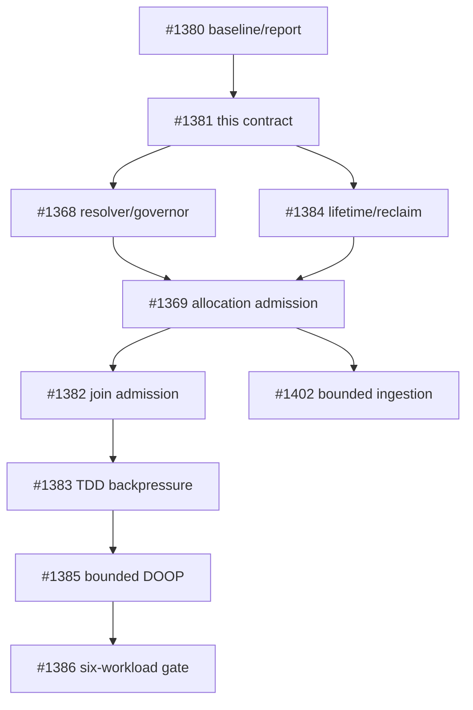

# Memory budget contract

This document defines the memory contract for a managed wirelog session. It
is normative for the resolver, governor, allocation sites, and TDD workers;
it does not turn the current accounting ledger into an allocator or an
admission controller.

## Scope and terminology

The contract covers memory reservations owned by one session: its coordinator,
workers, relation buffers, arenas, arrangements, caches, timestamps, exchange
buffers, and spill state. It does not promise a process-wide or host-wide OOM
guarantee. The following quantities remain distinct:

| Quantity | Meaning | Contract role |
| --- | --- | --- |
| Managed reservation | Bytes admitted to the session governor | Enforced budget |
| Ledger attribution | Best-effort current/peak counters by subsystem | Observability only |
| RSS/working set | Process residency, including allocator retention | Safety signal, not a reservation |
| cgroup/job/address-space limit | An external limit imposed by the host | Input to automatic resolution |
| Physical RAM | Installed or visible machine memory | Never a bounded guarantee by itself |

`wl_mem_ledger_t` currently implements attribution and reporting. Its
`budget == 0` compatibility value means “unlimited ledger accounting”; it
does not mean that a user supplied zero budget is accepted.

## Selecting a budget

There is one environment namespace: `WIRELOG_MEMORY_BUDGET`. The eventual
versioned session-options API has precedence over the environment, and the
environment has precedence over automatic resolution:

```text
versioned API option > WIRELOG_MEMORY_BUDGET > automatic resolution
```

The reusable `scripts/ci/run-memory-pressure.sh` helper records external-limit
evidence for a command: source and binary identity, command arguments,
effective ceiling, enforcement mechanism, exit/timeout classification, output
hashes, and Linux cgroup memory events when available. It prefers a writable
cgroup v2 and otherwise records a kernel-enforced `RLIMIT_AS` ceiling as a
different enforcement class. A bare `SIGKILL`/exit 137 is not treated as OOM;
resource-error mode requires supporting cgroup evidence. This runner is
qualification infrastructure only: its evidence does not prove that Wirelog
allocation classes, JOINs, TDD transport, or DOOP are bounded.

Values are decimal bytes (not MiB or a human-readable suffix). The following
table is part of the interface contract:

| Input | Result |
| --- | --- |
| API option absent and environment unset | Automatic resolution |
| Explicit positive value at least 256 MiB | Enforcing managed budget |
| Explicit zero | Invalid configuration; never silently becomes unlimited |
| Empty, signed, negative, non-decimal, or overflowed value | Invalid configuration |
| Positive value below 256 MiB | Invalid configuration |
| Explicit value on a supported platform | Enforcing managed budget |
| Automatic resolution with no supported limit source | Advisory/unbounded mode, with an explicit diagnostic; no bounded guarantee |

The minimum is a progress floor, not a promise that every workload fits. All
parsing and arithmetic must reject overflow before converting to `uint64_t`.
The internal zero value remains available only to represent an unlimited
ledger in tests and compatibility paths.

For the existing accounting hint, a threshold of `0` means pressure is true
for any valid nonzero subsystem cap, `100` means pressure starts at the cap,
and a value above `100` is invalid and returns false. This is not an admission
decision and does not reject an allocation.

Automatic resolution examines effective limits, not just the first file it can
read:

1. cgroup v2 `memory.max` and `memory.high`, including relevant ancestors;
2. cgroup v1 memory limits, including ancestors and unlimited sentinels;
3. `RLIMIT_AS` where supported, treating it as virtual address-space, not RSS;
4. supported Windows Job Object process-memory limits;
5. no physical-RAM-only fallback for an enforcing guarantee.

The internal `wl_session_create_with_options()` entry point accepts a
versioned, non-installed options object. Its `windows_job_handle` is a
borrowed opaque handle used only during synchronous creation; Wirelog stores
the resolved byte limit and provenance in the governor, and never duplicates
or closes the host handle. Missing, unsupported, or invalid handles clear the
provider and leave automatic resolution advisory unless another finite source
is available. `WIRELOG_MEMORY_BUDGET` remains higher precedence.
Options version 2 (#1473) adds `memory_governor`: a caller-retained governor
reference the session retains for its own lifetime in place of any resolved
source, so create-time admission can be driven deterministically from tests;
`windows_job_handle` and `WIRELOG_MEMORY_BUDGET` are ignored when it is set.
The program-owned intern table attached at creation keeps its own reference
until `wirelog_program_free()`, so the governor can outlive the session.

An unlimited cgroup value, an absent optional source, and an unsupported
platform are different observations. The resolver records which source was
selected and whether the result is enforcing or advisory. Tests use injected
provider fixtures for these cases; they must not depend on the host's actual
cgroup or RAM configuration.

## Reservation lifecycle

Every managed allocation follows this transaction:

```text
reserve(bytes) -> commit/transfer(owner) -> release(bytes)
       |                 |
       +-- rollback/cancel on failure
```

- `reserve` is an atomic admission operation against the shared session
  budget. It happens before the allocation can become visible to another
  operation.
- `commit` attaches the reservation to its owner. A transfer between the
  coordinator and a worker changes attribution, not the shared limit.
- `release` is idempotent for a committed reservation and returns capacity.
- Failed allocations roll back their reservation. Cancellation releases
  reservations and must not publish a partial result.
- A realloc that needs both old and new storage reserves the new size while
  the old size is still counted; only after a successful move may it release
  the old reservation.
- A governed replacement uses the same overlap accounting even when the new
  footprint is smaller:

  ```text
  committed(old) -> begin_replacement(new)
      -> commit_replacement(new) -> release
      -> rollback_replacement(old) when publication cannot complete
  ```

  `begin_replacement` is the downsize-only primitive: it admits the complete
  new footprint before replacement
  storage is allocated or published, so the governor accounts for old and
  new storage at the same time. Commit drops the old charge only after the
  new storage is published and the old storage has been freed; rollback drops
  only the temporary new charge. If the final accounting transition is
  rejected after publication, rollback retains the old reservation as a
  conservative upper bound rather than under-accounting the live storage.
  The reservation identity, owner attribution, and generation remain on the
  original token throughout the transition. Relation-level writer gates
  still serialize storage publication; this reservation lifecycle provides
  the memory admission and rollback guarantee.
- Batch compaction admits every governed replacement before preparing any
  member. If one overlap cannot fit, all reservations admitted for that batch
  are rolled back and no member is published; this is a finite no-progress
  result, not an unbounded retry.
- Overflow in a size, sum, or headroom calculation is a distinct
  representation-overflow failure, never a wrapped small reservation.
- A reserved cleanup/drain headroom remains available for rollback, error
  reporting, and worker teardown. It is not handed out as ordinary work
  capacity.

Coordinator and worker operations use one shared governor. A worker share is
only a fairness hint used for scheduling; `W` workers do not receive `W`
independent hard budgets. RSS sampling, allocator retention, and sampling
lag may trigger a safety brake, but they do not rewrite committed ownership.

## Failure and retry contract

These outcomes remain distinguishable internally and at the public boundary:

| Outcome | Meaning | Retry/reset rule |
| --- | --- | --- |
| Budget denial | Reservation would consume available managed capacity | Reclaim, reduce work, spill, or report a bounded-memory failure |
| Allocator failure | `malloc`/system allocation returned failure | Release reservation; report memory failure |
| Representation overflow | Size arithmetic cannot be represented | Release reservation; report invalid/overflow failure |
| I/O/spill failure | External backing store failed | Release or retain only durable committed state; report I/O failure |
| Cancellation | Host or operation cancellation | Roll back unpublished work and reservations |
| Unsupported configuration | Requested enforcement source/platform is unavailable | Explicit request fails; automatic mode may remain advisory as above |

On a successful retry after reclaim or a smaller request, the operation's
error state is reset and no partial rows are published. Retry loops are
bounded; the governor must not spin indefinitely while RSS or capacity is
unchanged. Public `create`, `insert`, `step`, and `snapshot` paths, including
typed and easy facades, must map these outcomes consistently when enforcement
is implemented.

## Ownership and sequencing

This issue defines the contract and boundary fixtures. Implementation is
owned as follows:

| Work | Owner | This contract supplies |
| --- | --- | --- |
| Budget source resolution, shared governor, advisory/enforcing state | #1368 | Precedence, providers, minimum, headroom, source provenance |
| Allocation-site admission and public propagation | #1369 | Reservation lifecycle, error taxonomy, retry/reset boundaries |
| Arrangement/cache lifetime and reclaim primitives | #1384 | Release/transfer behavior and cleanup reserve |
| Join admission, ingestion, TDD backpressure | #1382, #1402, #1383 | Workload-specific reservation sizes and rollback tests |
| Bounded DOOP and downstream gates | #1385–#1387 | Evidence that the contract works under constrained memory |

The existing ledger tests prove accounting invariants only: they do not prove
admission, allocator ownership, RSS control, or OOM prevention. In
particular, `wl_mem_ledger_alloc()` remains a post-allocation accounting call
and must not be used as a substitute for `reserve()`.



## Acceptance evidence

The contract unit is complete only when documentation and executable ledger
fixtures agree on:

- exact percentage arithmetic at `UINT64_MAX` scale;
- zero/unlimited internal ledger behavior and clamped remaining capacity;
- threshold `0`, `100`, and invalid values above `100`;
- saturating accounting rather than counter wraparound;
- deterministic subsystem percentages summing to 100;
- the boundary between accounting evidence and future admission evidence.

Resolver-provider, reservation-lifecycle, and session-lifecycle tests now cover
the #1368/#1413 foundation. Allocation-site admission tests belong to #1369;
the current ledger still does not claim to enforce individual allocations.

## Foundation implementation status

The internal wirelog/columnar/memory_governor.{h,c} foundation implements
the resolver and tokenized reservation primitive for #1368. Explicit
WIRELOG_MEMORY_BUDGET values are strict decimal bytes: empty, signed,
negative, non-decimal, overflowing, zero, and values below 256 MiB are
invalid. When the variable is unset, injected or runtime providers reduce
finite cgroup v1/v2 and RLIMIT_AS limits to the effective minimum; Windows
job limits have the same provider boundary. If no finite supported source is
available, resolution is advisory and unbounded.

An enforcing resolution reserves 5% cleanup headroom, capped at 256 MiB and
never above half the budget. Ordinary reservations can consume only the
remaining usable limit. Reservation tokens move through reserved, committed,
and released states; rollback is valid only from reserved, and release
returns capacity exactly once. Session lifetime/public error integration is
#1413. Allocation-site admission remains the responsibility of #1369, with
the public batch result collector as the scoped exception implemented by
#1418: the result object, relation table, names, row buffers, and type arrays
share one governor reservation. Growth uses replacement buffers and admits
the full new footprint while the old buffer is still live, so a failed growth
leaves the previous result unchanged. The result retains the governor until
`wirelog_result_free()`, which releases the reservation exactly once.

The #1413 integration adds a reference-counted coordinator-owned governor to
columnar sessions before relation, pool, arena, cache, or worker setup. Worker
sessions retain the same governor reference and release it during every
normal or partial teardown path. The fixed eval arenas now use
`wl_arena_create_managed()`: their complete backing capacity is admitted before
`malloc`, retained across reset, and released exactly once at destruction.
Recursive TDD subpasses retain popped results, lower stack entries and CONCAT
segment boundaries in persistent cleanup frames. Segment metadata is disposed
with its entry; a refused owned relation keeps its metadata and allocator
storage reachable. The specialized nonrecursive parallel rule evaluators use
the same frames; K-Fusion is the one evaluator still draining an unframed
stack, tracked by #1648.

Hybrid TDD initialization gives existing empty IDBs private governed worker
relations, preserving schema, graph/compound metadata and timestamp mode.
Only EDB/earlier-stratum inputs use shared views: borrowing empty IDB storage
would prevent the coordinator from publishing the first delta. Partial setup
reclaims every untransferred slot, including the current incomplete relation. The
partitioned, replicated and global-read initializers likewise inspect every
allocated worker row and original relation slot on failure. Non-NULL matrix
entries remain caller-owned; worker creation NULLs entries only on transfer.
Attempted-worker counts control checked teardown, never caller-slot cleanup.
A refused worker stays in the coordinator cohort until release and retry.

Final recursive aggregate canonicalization takes the canonical relation's source
writer and excludes live storage aliases before changing rows or timestamps.
Borrowed destinations refuse publication. Reader/alias refusal and group-map
allocation failure preserve the relation; access is released before arrangement
invalidation. TDD final relation normalization likewise uses an admitted private
candidate and checked publication after worker dependencies retire. Merge paths
consume worker results before teardown; finalization errors do not record
convergence or advance completed iteration history. Private exchange intermediates
and global-read exchange publication remain separate from this final boundary.
Specialized nonrecursive publication stages independent worker results before
retiring input views, then publishes one checked normalized replacement.

Heap and pooled constructors create independently owned Arrow schemas, including
untyped and zero-width relations. Clones preserve declared width, names, types,
graph metadata and required compound maps; a failed required map copy fails
construction instead of changing tuple interpretation. Arena-backed pooled
construction initializes schema without replacing arena columns. Partitions
preserve that metadata and scatter timestamps with their rows. Empty and
replicated worker inputs use governed clones; legacy partition buffer allocation
still follows its existing admission contract.

The fixed delta-pool slab and data arena follow the same lifecycle through
`delta_pool_create_managed()`. Coordinator, ordinary worker, and K-fusion
branch arenas and pools all use the same shared governor; legacy standalone
constructors remain unmanaged. Their ledgers remain attribution-only; while the legacy join
backpressure path still reads ledger thresholds, each worker gets an equal
reporting share so the aggregate threshold does not multiply by the worker
count. The removed `tdd_budget_per_party` value is no longer a second governor
admission domain.
Explicit invalid budgets fail session creation with the existing public
execution error mapping and leave output handles null. Parser AST, IR/program,
execution plan, executor wrapper, caller-owned fact buffers, CSV staging, and
advanced-API conversion buffers remain outside the result-only admission unit;
extending admission across parse → IR → optimize → plan requires a separate
lifetime and caller-owned context design.

The next #1369 allocation unit, #1425, admits only the `ht_head` and
`ht_next` backing arrays of primary, delta, and filtered hash arrangements.
Each arrangement retains the shared session governor while its registry entry
is alive. Full rebuilds and incremental capacity growth reserve the
prospective footprint before allocating replacement arrays; the old
reservation remains live until publication, and failed admission leaves the
old index unchanged. Sorted and differential arrangements, registry metadata,
relation/timestamp storage, cache policy, and join/TDD scratch remain separate
allocation classes.

## #1418 Allocation Coverage Matrix

The session relation-name hash owns a governor reservation for its bucket and
chain arrays. Rebuilds reserve both replacement arrays while the old index is
live; denied optional rebuilds leave lookup on its linear fallback.
Transactional registry images hold their hash reservation until discard or
publication, when it moves to the session. Coordinator and worker relation
pointer arrays reserve their full capacity before allocation or replacement.
A prepared image separately reserves its future relation array and validation
copy; publication moves the future array token to the session and releases
the validation copy. Relation descriptors, names and schema metadata remain
a separate allocation class.

The following matrix is the boundary for allocations created outside a
managed columnar session. “Covered” means that the owner retains a governor
reservation and publishes growth only after both admission and allocation
succeed. “Excluded” is an explicit non-guarantee; the owner must still
propagate failure and must not report a truncated successful result.

| Allocation class | Owner and lifetime | #1418 status | Failure contract |
| --- | --- | --- | --- |
| Parser AST and parse diagnostics | `wirelog_program_t`, released by `wirelog_program_free()` | Excluded; parse context is created before a managed session | Return `NULL` with `WIRELOG_ERR_PARSE` or `WIRELOG_ERR_MEMORY`; no partial program is published |
| Interned strings (`wl_intern_t`: hash slots, id segments, string copies) | `wirelog_program_t`; the reservation is retained until `wirelog_program_free()` | Covered from the first managed session (#1431): session creation attaches the program's table to that session's governor and admits the bytes it already holds transactionally, so session creation fails with `ENOMEM`/`EOVERFLOW` (public `WIRELOG_ERR_MEMORY`) when they exceed the budget; session destruction never releases it; while a live session, worker or result still holds that governor, later sessions get `EBUSY` and leave it in place, and once the table is the only holder the next session creation rebinds the table transactionally (#1469): the retained footprint is admitted under the new governor first and only then credited back to the orphaned one, so a denied rebind (`ENOMEM`/`EOVERFLOW`, session creation fails) leaves the old reservation and the new governor unchanged. Each unique `wl_intern_put()` reserves the string copy plus any new id segment or doubled slot array before allocating, with the old footprint still held; duplicates are uncharged | `wl_intern_put()` returns `-1` and leaves every existing id, `wl_intern_reverse()` result and the reservation unchanged. String builtins, `uuid5_rfc` and non-pre-interned literals whose result cannot be interned fail the evaluation step with `ENOMEM` and publish no row (#1470), which the easy, advanced and legacy facades report as `WIRELOG_ERR_MEMORY` without a scalar-extension diagnostic (#1521); invalid operands still yield `-1` as before |
| IR/program relation metadata | `wirelog_program_t`, released with the program | Excluded; same owner as parser output | Return `NULL` with the existing parse/IR error; callers retain no partially initialized program |
| Optimized execution plan | `wirelog_executor_t`, released by `wirelog_executor_free()` | Excluded; plan construction precedes result collection | Return `NULL` with `WIRELOG_ERR_INVALID_IR`, `WIRELOG_ERR_MEMORY`, or the existing executor error |
| Executor/session wrapper and columnar session storage | `wirelog_executor_t` and its session | Covered by #1413/#1369 session admission, not charged again here | Session creation fails with the existing public memory error and releases all reservations |
| Public result object, relation table, names, row buffers, and type arrays | `wirelog_result_t`, released by `wirelog_result_free()` | Covered by #1418 | Reserve the prospective footprint before replacement allocation; rollback leaves the old result unchanged and reports `WIRELOG_ERR_MEMORY` |
| Caller-owned fact buffers and input rows | Caller, released by the caller or input adapter | Excluded; ownership is external to wirelog | Reject the operation or return the existing input error; never charge or free caller storage |
| CSV staging and advanced-API conversion buffers | CSV/advanced API call, released at call completion | Excluded; temporary caller-facing buffers have independent ownership | Return `false` or the existing API error and discard the temporary buffer |

The matrix intentionally has one admission owner per allocation. The result
collector uses reservation move semantics when publishing a new token, so
the reservation identity follows `wirelog_result_t` rather than a temporary
stack object. The governor's denial, rollback, overflow, and exact-release
fixtures provide the admission primitive evidence; the Linux-only
`wirelog_result_oom` test uses linker allocation-failure injection over a
32-row result so relation-table and row-buffer growth cannot silently return
a truncated success. `wirelog_public_api` covers result lifetime after
executor destruction and the public error path. Other platforms retain the
same production transaction and ABI checks, while platform-specific allocator
failure injection remains outside this unit because GNU `--wrap` is not a
portable linker contract.
# wirelog Memory Instrumentation

This document describes what the columnar engine measures about its own
memory use, how to read the numbers, what they cost, and the baselines that
bounded-memory work (Issue #1367 and its sub-issues) starts from.  It covers
Issue #1380.

The ledger is an accounting instrument, while the memory governor uses the
resolved budget to admit covered allocation classes before they grow. Coverage
is incremental; the sections below describe which paths participate.

## 1. Units and conventions

- Every value is a byte count of an exact allocation size as requested from
  `malloc`/`calloc`/`realloc`, not a page count and not what the allocator
  actually reserved.
- The human-readable report uses binary prefixes: `1.0KB` is 1024 bytes,
  `1.0MB` is 1048576 bytes, `1.0GB` is 1073741824 bytes, printed with one
  decimal.
- Peak RSS (`rss_peak`) comes from `getrusage(RUSAGE_SELF).ru_maxrss`.  It
  is a process-wide, monotonically increasing kernel value: kilobytes on
  Linux (converted to bytes), bytes on macOS, unavailable on Windows
  (reported as 0).
- `current` is the value at the moment of the report; `peak` is the
  session-lifetime high-water mark of that counter.  Peaks are never reset
  by a second `wl_session_snapshot()`.

## 2. The ledger

Each `wl_col_session_t` embeds one `wl_mem_ledger_t`
(`wirelog/columnar/mem_ledger.h`).  It holds a total, a total peak and one
current/peak pair per subsystem. Every accounting writer acquires a ledger-local
writer gate; protected saturating/clamped arithmetic uses finite atomic
loads/stores. K-fusion branch threads and TDD workers can share a ledger, while
raw writer admission may wait and does not guarantee fairness or cancellation.
Snapshots retain relaxed atomic reads and may observe intermediate counter
updates. Initialization/reset is quiescent; no callbacks, reclaimers, allocations
or other lock acquisition run inside an accounting critical section. Two update
styles exist:

- **Event accounting** (`wl_mem_ledger_alloc`/`wl_mem_ledger_free`): the
  owner of an allocation charges when it allocates and credits when it
  frees.  Used where allocation and release are paired in code.
- **Gauge sampling** (`wl_mem_ledger_set_gauge`): the session re-measures a
  class it can enumerate and publishes the absolute value; the total moves
  by the difference.  Used where objects are mutated by many code paths
  without a single owner.

TDD worker sessions are separate `wl_col_session_t` values with their own
ledgers (budget = the per-party share, see §6).  Their peaks are folded into
the coordinator's aggregates when a worker is torn down, which happens after
every stratum that ran under TDD.

### 2.1 Subsystems

| Subsystem | Style | What is counted | Where |
|---|---|---|---|
| `RELATION` | event | Column buffers of operator output relations whose `col_rel_t.mem_ledger` is attached; today that is every join output (`col_join_attach_ledger`). Capacity-based (`capacity × owned columns × 8`). | `relation.c` growth, compaction and free paths |
| `ARENA` | event | Fixed capacity of the session's delta pool (slot slab + data arena) and eval arena, plus the compound arena object, generation table, payload buffers, and entry metadata. Each retained capacity is admitted before allocation with old/new peak overlap and released at destruction; the ledger remains attribution-only. `delta_pool_reset()`/`wl_arena_reset()` and compound epoch GC do not return retained capacity. K-fusion branch sessions charge their per-branch pool/arena to the parent. | `session.c`, `kfusion.c`, `arena.c`, `delta_pool.c`, `compound_arena.c` |
| `CACHE` | event | Materialization-cache entries. On insert the cached result is re-parented: its RELATION (and TIMESTAMP) charge is credited and the same bytes are charged to CACHE, so a cached join is counted once. Credited on eviction, truncation and clear. | `cache.c` |
| `ARRANGEMENT` | event | Hash arrangements (`ht_head` + `ht_next`), delta and filtered arrangements, sorted copies for LFTJ (`nrows × ncols × 8`, a full duplicate of the relation) and differential arrangements (struct + keys + buckets + chain). Worker clones are charged to the worker ledger. | `arrangement.c`, `diff_arrangement.c` |
| `TIMESTAMP` | event | `timestamps[]` arrays (24 bytes per row of capacity) of ledger-attached relations. Reconciled together with RELATION. | `relation.c` |
| `CHANNEL` | event | TDD delta transport: the MPSC ring storage for the stratum (charged at queue creation) plus every delta payload (columns + timestamps) between the worker's enqueue and the coordinator's drain or discard. Charged on the coordinator's ledger because ownership transfers on enqueue. | `eval.c`, `eval_tdd_queue.c` |
| `STORED` | gauge | Session-owned relations in `rels[]`: EDB and IDB relations on the coordinator, partitions on a worker. Column buffers plus timestamps; arena-owned columns count 0. | sampled, see §2.2 |
| `TEMPORARY` | gauge | Delta-pool temporaries whose column buffers spilled to the heap because the pool arena was full (`pool_owned && !arena_owned`), excluding those already attached to RELATION, plus admitted evaluator cleanup frames and retained delta-step rollback records. | sampled, see §2.2 |

The per-subsystem cap printed in the report is `budget × share / 100` with
shares `50/10/10/10/5/5/5/5` in the order above.  Only the RELATION share
has an observable effect (§6); the others exist for the report.

### 2.2 Sampling points

`col_session_mem_sample()` re-measures STORED and TEMPORARY:

- on the sequential evaluator, immediately before every `delta_pool_reset()`
  (end of a non-recursive stratum, end of every recursive sub-pass, end of
  the recursive stratum), which is the high-water point of the temporaries;
- on a TDD worker, at the same point of its sub-pass;
- on the TDD coordinator, once per outer iteration;
- at the end of every `wl_session_snapshot()`, and once more in
  `col_session_destroy()` when a report is requested.

Cost is one pass over `nrels` plus the used pool slots, with no allocation.

### 2.3 What is not counted

The difference between `rss_peak` and the ledger peak is the unaccounted
remainder.  Known contributors, in roughly decreasing order for large
workloads:

- **Allocator overhead and fragmentation.** The ledger records requested
  sizes; glibc's arenas, per-thread caches and retained free chunks are
  invisible to it.  This is the largest term on DOOP-sized runs.
- **Delta-pool overflow structs.** When the slot slab is exhausted,
  temporaries fall back to `calloc`'d `col_rel_t` structs that are not
  enumerable from the pool and therefore not sampled into TEMPORARY.  Their
  column buffers are still counted if they are join outputs (RELATION).
- **K-fusion branch sessions.** A branch session is a struct copy of its
  parent, including a bitwise copy of the ledger that is discarded at
  teardown.  Branch arenas and pools are redirected to the parent (ARENA),
  but join outputs, arrangements and caches created inside a parallel
  branch (K ≥ 4) charge the throwaway copy.  #1375 retires this path.
- Parser and IR, the execution plan, nanoarrow schemas, the compound-term
  arena, exchange buffers, thread stacks (8 MB per TDD worker by default)
  and the work queue.  The intern table is program-owned but charged to
  the first managed session's governor (#1431, see the #1418 matrix); its
  bytes appear in that governor's reserved total, not in the session ledger.
  Once no live session, worker or result holds that governor, the next
  session creation rebinds the table to its own governor (#1469).

## 3. Reading the report: `WL_MEM_REPORT`

`WL_MEM_REPORT` is read once at session creation.

| Value | Effect |
|---|---|
| unset, empty, `0` | No memory output. |
| `1` | At `col_session_destroy()` print the coordinator summary: one header line with `rss_peak`, the ledger table, and one aggregate line for TDD workers. |
| `2` | Additionally print the full ledger of every TDD worker when it is torn down (after every TDD stratum, so this is verbose). |

Example (`W=8`, the 100-edge closure fixture, level 2, one worker shown):

```
[wirelog mem] scope=coordinator workers=8 rss_peak=9.0MB
[wirelog mem] budget=94.3GB current=128.2MB peak=224.5MB
  RELATION     current=0B         peak=1.0MB      cap=47.2GB
  ARENA        current=128.1MB    peak=224.1MB    cap=9.4GB
  CACHE        current=0B         peak=0B         cap=9.4GB
  ARRANGEMENT  current=64.1KB     peak=64.1KB     cap=9.4GB
  TIMESTAMP    current=0B         peak=0B         cap=4.7GB
  CHANNEL      current=0B         peak=0B         cap=4.7GB
  STORED       current=100.6KB    peak=248.6KB    cap=4.7GB
  TEMPORARY    current=0B         peak=80.0KB     cap=4.7GB
[wirelog mem] tdd_workers reports=8 peak_max=12.5MB peak_sum=98.8MB
[wirelog mem] scope=worker id=0 workers=8
[wirelog mem] budget=10.5GB current=12.3MB peak=12.5MB
  RELATION     current=0B         peak=128.0KB    cap=5.2GB
  ARENA        current=12.0MB     peak=12.0MB     cap=1.0GB
  ...
```

`reports` is the number of worker teardowns folded in, `peak_max` the
largest single worker peak and `peak_sum` the sum of all worker peaks (an
upper bound on their concurrent footprint, since the same worker slot is
recreated per stratum).

The report is not async-signal-safe and goes to `stderr` unconditionally;
it does not use `WL_LOG`.

## 4. Programmatic access

`col_session_get_mem_stats()` (`wirelog/columnar/columnar_nanoarrow.h`,
internal) fills a `wl_columnar_mem_stats_t` with the same numbers: budget,
current, peak, per-subsystem current/peak indexed by `WL_MEM_SUBSYS_*`,
`rss_peak_bytes`, and the three worker aggregates.
`wl_columnar_mem_subsys_name()` maps an index to its name.  The accessor is
NULL-safe and never touches the atomics directly (it goes through
`wl_mem_ledger_snapshot()`).

`bench_flowlog --format json` emits the stats of the last run as
`ledger_peak_bytes`, `ledger_budget_bytes`, `ledger_worker_reports`,
`ledger_worker_peak_max_bytes`, `ledger_worker_peak_sum_bytes` and the
object `ledger_subsys_peak_bytes`, next to the existing `peak_rss_kb`.

## 5. Overhead

- **Event accounting:** one relaxed `fetch_add` (plus a peak CAS loop) per
  charge and one CAS loop per credit.  Charges happen on buffer growth, not
  per row: a relation that doubles its capacity is charged once per
  doubling.  The fast path of the join operator is unchanged.
- **Gauge sampling:** O(`nrels` + used pool slots) at each point in §2.2,
  typically a few hundred pointer reads per iteration.
- **Report:** a handful of `fprintf` calls at session teardown; nothing at
  all unless `WL_MEM_REPORT` is set.
- **Result identity:** instrumentation is always on; `WL_MEM_REPORT` only
  adds output.  `tests/test_mem_instrumentation.c` runs the fixture with the
  variable unset, `1` and `2` at W=1 and W=8 and requires identical tuple
  counts, iteration counts, relation contents and ledger peaks.

The instrumentation adds one pointer to `col_arrangement_t`,
`col_diff_arrangement_t`, `col_sorted_arr_t` and `col_mat_cache_t`, and one
`uint64_t` to `col_rel_t` and `col_mat_entry_t`.

## 6. Budget: `WIRELOG_MEMORY_BUDGET`

`WIRELOG_MEMORY_BUDGET=<bytes>` is the explicit managed-memory budget. An
unset value resolves the effective minimum of supported cgroup, address-space,
and host Job Object limits; when no finite source exists, the resolver is
advisory/unbounded. Explicit `0`, malformed values, overflow, and values below
256 MiB are invalid. This resolver does not use physical RAM as an enforcing
fallback. The legacy ledger worker-share hint remains separate from governor
admission. Fixed eval-arena, delta-pool, compound-arena backing storage, and
the covered join allocation paths use admission. LFTJ iterator/sort workspace
and operator staging use governor reservations; remaining LFTJ output/source
boundaries, auxiliary metadata, and eval-entry segment allocations remain
follow-up work tracked by #1978.

The ledger's RELATION worker-share hint can still trigger join backpressure
at 80% (`wl_mem_ledger_should_backpressure(RELATION, 80)`). The governor also
admits covered allocations and reports refusals upstream. The legacy
`WIRELOG_JOIN_OUTPUT_LIMIT` row cap is disabled when unset, empty, or zero; a
positive decimal keeps the optional per-join cap, clamped to `UINT32_MAX`.
Malformed values fail session creation. This row cap is not the memory budget
and does not replace allocation admission.

## 7. Baselines

### 7.1 DOOP zxing (`bench_flowlog --workload doop`)

Dataset checksum `154593343fefd18306d4098ba9f6286947b134b56ebcf83d8e8eae368d5867e7`,
35 fact files, `--repeat 1`, release-like build, `WL_MEM_REPORT=1`, taken
on 2026-09-06 with the ledger coverage that existed at the time (RELATION
only; every other subsystem read 0).

| workers | duration | OS peak RSS | ledger peak (RELATION) | tuples | iterations | status |
|---:|---:|---:|---:|---:|---:|---|
| 1 | 2,335,563 ms (38 min 56 s) | 54,646,124 KB (52.1 GiB) | 32.0 GB | 13,828,835 | 153 | OK |
| 2 | 2,064,134 ms (34 min 24 s) | 56,718,660 KB (54.1 GiB) | 15.2 GB | 13,828,835 | 153 | OK |

The W=2 ledger peak is lower because half of the join outputs were charged
to worker ledgers, which were not aggregated at the time; OS RSS is higher
at W=2.  The 20 to 39 GiB gap between RSS and the ledger is the §2.3
remainder plus the classes that were not yet instrumented (stored
relations, arrangements, transport).  A rerun with the current coverage is
part of #1385; the nightly perf portfolio (§7.3) records the numbers per
run from now on.

### 7.2 Fixture: 100-edge chain closure (`tests/test_mem_instrumentation.c`)

`r(x,y) :- edge(x,y).  r(x,z) :- r(x,y), r(y,z).`, 5050 closure rows,
7 iterations, `WIRELOG_TDD_MIN_ROWS_PER_WORKER=1` for W=8 so the stratum
runs under TDD.  Printed by the test on every CI run as `mem-baseline`
lines; values in bytes, `current/peak`.

| build | W | ledger peak | rss_peak | worker peak_max (reports) | RELATION | ARENA | ARRANGEMENT | CHANNEL | STORED | TEMPORARY |
|---|---:|---:|---:|---:|---:|---:|---:|---:|---:|---:|
| fused | 1 | 135,721,092 | 5,545,984 | 0 (0) | 0/1,048,576 | 134,303,744/134,303,744 | 65,604/65,604 | 0/0 | 103,040/254,528 | 0/81,920 |
| fused | 8 | 134,961,176 | 5,750,784 | 13,055,492 (8) | 0/0 | 134,303,744/134,303,744 | 0/0 | 0/657,432 | 133,120/133,120 | 0/0 |
| nofusion | 1 | 135,721,092 | 5,701,632 | 0 (0) | 0/1,048,576 | 134,303,744/134,303,744 | 65,604/65,604 | 0/0 | 103,040/254,528 | 0/81,920 |
| nofusion | 8 | 134,961,176 | 8,491,008 | 13,055,300 (8) | 0/0 | 134,303,744/134,303,744 | 0/0 | 0/657,432 | 133,120/133,120 | 0/0 |

Reading the table: at W=1 the coordinator runs the joins itself (RELATION
and ARRANGEMENT non-zero); at W=8 they move to the workers (coordinator
RELATION/ARRANGEMENT 0, worker peak 12.5 MB each of which 12 MB is the
worker's own pool + arena), and the delta transport shows up as CHANNEL.
ARENA on the coordinator is the 64 MB pool arena + 256 slots + 64 MB eval
arena regardless of W.  `rss_peak` is below the ledger peak here because
the arenas are reserved but never touched at this size.

### 7.3 CI evidence

- `meson test` runs `mem_instrumentation_default` and
  `mem_instrumentation_nofusion` on every PR; their stdout carries the
  `mem-baseline` lines above for the current commit.
- `.github/workflows/perf-nightly.yml` runs `scripts/perf/run-flowlog-portfolio.py`,
  which now records `ledger_peak_bytes`, `ledger_worker_peak_max_bytes` and
  `ledger_subsys_peak_bytes` per (workload, workers) in `portfolio.jsonl`
  and the first two in `portfolio.tsv`, uploaded as the
  `perf-portfolio-<os>-<compiler>` artifact (35-day retention).

### 7.4 Reproducing

```
# Fixture baselines (both builds)
meson test -C build mem_instrumentation_default mem_instrumentation_nofusion -v

# Any bench_flowlog workload, JSON with ledger fields
./build/bench/bench_flowlog --workload tc --data bench/data/graph_100.csv \
    --workers 8 --repeat 1 --format json

# Human-readable report from any program
WL_MEM_REPORT=1 ./build/wirelog_cli --workers 8 program.dl
WL_MEM_REPORT=2 ./build/wirelog_cli --workers 8 program.dl   # + every worker

# DOOP (needs bench/data/doop, ~40 GB peak, tens of minutes)
WL_MEM_REPORT=1 ./build/bench/bench_flowlog --workload doop \
    --data-doop bench/data/doop --workers 1 --repeat 1 --format json
```

## 8. Compound-arena mutation window (#1423)

The coordinator owns compound-arena mutation and its governor reservations.
Workers acquire a non-copyable read lease before using a borrowed arena; the
lease remains active for the lifetime of any lookup pointer. Allocation,
retain, freeze/unfreeze, epoch GC, and destruction acquire the exclusive
mutation gate and therefore fail while a worker lease is active. The
coordinator must close all worker leases before destroying the arena.

Compound payload, entry-offset, and multiplicity growth is staged as one
transaction. A failure at any staging allocation frees only the new buffers,
rolls back pending reservations, and leaves the old pointers, counters and
governor charge unchanged. The unmanaged constructor remains independent of
the governor and the standalone fuzz target.

## 9. Related

- Issue #1380 (this instrumentation), #1385 (DOOP under a budget),
  #1367 / #1368 (memory governor and admission), #1375 (K-fusion
  retirement, which removes the branch-session gap in §2.3).
- `docs/THREADING.md` §5.1 audits every atomic in `mem_ledger.c`.
- `docs/STRESS_BASELINE.md` §Issue #598 for the rotation canary that
  asserts `current_bytes` is unchanged across `wl_arena_reset()`.

## 10. Primary arrangement leases (#1384)

### Integrated ownership and reader boundaries

The following matrix describes the implemented ownership mechanisms. A cache
pin protects its entry; a source reader protects the relation version that an
operator actually reads. Neither is implied merely by putting a pointer on
the evaluation stack. Paths below are relative to `wirelog/columnar/`.

| Resource | Owner and reader protection | Release / invalidation boundary | Implementation |
|---|---|---|---|
| Session relation columns, schema and timestamps | Session owns the relation; source readers bind its descriptor and ultimate storage owner | Checked mutation/destruction requires writer access; identity, view and storage generations invalidate dependent views | `relation.c`, `session.c` |
| Worker relation views and compound arena | Worker owns private descriptors/arrangements and borrows coordinator storage through source/arena leases | Drain tasks and release aliases/read leases before coordinator storage is destroyed | `session.c`, `../arena/compound_arena.c` |
| Owned evaluation-stack result and segment boundaries | Stack entry owns destruction of its relation and its segment array | `eval_entry_dispose` destroys the relation before freeing segment metadata; a refused disposal retains the entry | `eval_stack.c` |
| Borrowed evaluation-stack result | Relation remains owned by its session, cache or enclosing operation; the entry does not acquire a general-purpose pin | Owner must outlive every consuming operator; disposing the entry does not destroy the borrowed relation | `eval_stack.c`, `eval_plan.c` |
| Primary hash arrangement | Session cache owns buckets/chains; probe bundle holds index pin and source readers | Eviction skips pins; invalidation defers; final release permits lazy rebuild | `arrangement.c`, `join.c` |
| Sorted arrangement | Session owns sorted copy; LFTJ probe pins entry and source | Release probe before teardown; source changes require rebuild, deferred while pinned | `arrangement.c`, `lftj.c` |
| Differential arrangement | Session owns persistent index; transaction owns unpublished replacement; pin binds source snapshot | Replacement/invalidation cannot overwrite a leased index; abort discards staged work; final release applies deferred reset | `diff_arrangement.c`, `diff_join_batch.c` |
| Filtered-relation cache | Cache owns filtered relation; explicit cache pins defer replacement | Last pin release destroys an invalidated entry; immediate-release lookup wrapper does not retain a pin for its caller | `filter.c` |
| Materialization cache | Cache exclusively owns accepted heap results; lookup pin protects copying | JOIN exposes an independent copy to the stack; eviction/clear waits for pins and destroys the cached result once | `cache.c`, `join.c` |
| Delta transport payload | Producer transfers owned relation to queue, then coordinator matrix/consumer | Reconstruction deduplicates malformed aliases; discard destroys each owned queued payload; current matrix retains one payload per worker/relation, not an arbitrary batch stream | `eval_tdd_queue.c`, `eval.c` |
| Continuation scratch and published batches | Producer owns scratch and input/index leases; synchronous sink owns committed output | Cursor advances at publication commit; destroy releases producer state; no asynchronous lifetime is implied for scratch-backed payloads | `continuation.c`, `join_batch.c`, `diff_join_batch.c` |
| Delta-step rollback snapshots | Session owns admitted metadata, copied names and flat rows; stable relation identities prevent restoration into replacement registrations; a GC-only compound hold preserves handle IDs | Capture completes before detachment; checked restoration retains refused backups; successful evaluation or recovery releases them once; teardown discards pending backups after evaluator cleanup | `eval_delta.c`, `relation.c`, `session.c` |

### Residual lifetime evidence (#1812)

`timestamp_capacity` counts timestamp rows, not columns (`ncols`). Auditing
`col_rel_prepare_resize`, `col_rel_publish_resize`, `col_rel_compact_impl`,
`col_rel_install_shared_view_unprotected` and `col_rel_free_contents_impl` gives these
boundaries: nonempty compaction prepares both replacements before publication,
sets timestamp capacity to the tight row capacity, advances storage generation,
and frees the old timestamps before settling accounting. Preparation failure
keeps the old buffers; a later accounting refusal can conservatively retain a
reservation after publication. Empty non-nullary compaction frees timestamps and
zeros their capacity; nullary compaction is a no-op. A shared-column view owns
its copied timestamp array, sized to the larger of source row capacity and
source timestamp capacity. Column-only COW can retain that array. Consequently
row capacity and timestamp capacity must be accounted separately; shrinking
columns is not proof that the timestamp allocation shrank. Row reset frees the
array, while copying/transferring replacements must preserve its metadata.

The existing **Delta-step rollback snapshots** row is the live rollback-buffer
policy, rather than a second row for dormant `retract_backup_*` fields. Its six
axes are: **owner**, the session's `delta_rollback` record; **acquire**,
`wl_columnar_eval_delta_capture`, before detachment; **last reader**, active
evaluation or a pending recovery attempt; **invalidation**, stable relation
identity checks prevent restoring into a replacement registration; **destruction**,
`wl_columnar_eval_delta_rollback_discard`, after cleanup permits it; and
**rebuildability**, not reconstructible from mutated live rows, so refused
restoration retains the captured names/flat rows and compound GC hold.
`wl_columnar_eval_delta_rollback_retry` consumes that record in recovery, and
session/worker teardown calls discard after evaluator cleanup. This flat-row
snapshot is not a claim to preserve arbitrary timestamp provenance.

The following controls establish specific assertions, not merely that a named
binary runs under a sanitizer:

| Obligation | Assertion-bearing evidence |
|---|---|
| Pinned cache value resists reclaim | `test_cache_reclaimer.c:test_pin_generation_and_idempotence` holds an epoch pin through clear/reclaim; final release permits destruction. `test_borrowed_stack_keeps_independent_cache_pin` keeps exact borrowed rows and charge through reclaim and stack drain; the enclosing operation, not the stack entry, owns the explicit pin. |
| Suspended reader resists eviction | `test_join_batch_resume.c:test_suspended_producer_survives_eviction` publishes a nonterminal batch, triggers normal LRU eviction with an unpinned control, preserves the live cursor/index, resumes to 40 exact unique rows, then permits eviction on release. |
| Reordered rules preserve exact results | `test_recursive_scc.c:check_scc` runs both `original` and `reordered` at W1/W8 in the default and unfused test binaries; it checks all 66 `p` pairs and three `r` tuples and rejects duplicates/unexpected rows. |
| Partial worker construction is cleaned and retryable | `test_worker_session.c:test_partial_worker_adoption_cleanup_and_retry` refuses the second partition's reader after adopting the first view; checks caller ownership, released leases/compound borrow and balanced charges; releases the writer and retries successfully. This fails before worker arena/pool creation. |
| Checked destruction and coordinator reuse | `test_worker_session.c:test_worker_alias_chain_checked_teardown` releases two aliases in order and then inserts into the coordinator. `test_worker_teardown_refusal_is_retryable` retains owned resources across a refused destroy. `test_worker_arena_borrow.c` separately checks borrowed-arena survival and frozen lookup semantics. |

Normal, ASan/UBSan and POSIX TSan executions of these controls validate the
primitive lifetime contract. They do not replace the downstream bounded JOIN,
transport and full DOOP integration acceptance in #1382/#1383/#1385.

### Pin acquisition and release sites

The table above names the mechanism and the file.  This one names the call
site, because #1801 has to decide, per evaluation-stack producer, whether the
value it pushes is owned or borrowed and who the owner is; a file name does not
answer that.  Anchors are symbols rather than line numbers: these files churn,
and `scripts/ci/check-ownership-matrix.sh` resolves every symbol below against
a definition index, so a rename fails `meson test --suite abi` instead of
rotting the doc.  It also requires every cited symbol to have a caller under
`wirelog/`, so a row that only tests reach is refused.  That last check is a
heuristic: a definition paired with a forward declaration, a doc-comment
mention, a same-named static elsewhere, or an `#ifdef`-gated test wrapper as
its only caller still passes it.  The index
covers ordinary C definitions; it is not a substitute for the linker's symbol
table.

**This table is not complete and nothing establishes that it is.**  The gate
proves each row's subject exists, resolves uniquely, and has a caller under
`wirelog/`.  It does not prove that no further ownership class exists, because
the class list is a reading result, not something derivable from a regex.  Do
not read completeness into it. The timestamp row describes a relation-owned
sub-resource, not an independently pinned peer. Live rollback snapshots are
covered by the table above and the explicit lifecycle mapping above; the
per-relation `retract_backup_*` form remains dormant infrastructure with no
production producer and does not get a misleading live-resource row.

It also does not prove a row's *cells* are true, so the rows carry their own
audit state.  At least nine cells across seven of these rows were wrong on
first writing, and the two failure modes are worth separating because they
need different defences.  Most were in rows nobody had read, and those errors
named the wrong *mechanism* entirely.  But two were written while the row was
being actively read and repaired, and those named a real function with a wrong
claim attached -- `join.c:wl_columnar_join_dispose_left` was cited as the
unchecked disposal when it delegates to the checked one.  Reading a row is
necessary and not sufficient; a citation must be read for what the function
*does*, not only for its existence.  What a function does is the one thing the
gate cannot check. A new row's author must check the cited code before marking
it `author-read`. An independent
reviewer may promote that marker to `reviewer-read` after checking the cited
definitions, production callers, and lifecycle claim. The reviewer must not be
the row's author, and must approve the PR that changes the marker. New rows
start at `author-read`; only a distinct reviewer may promote them. The CI gate
pins the counts for both states but does not authenticate who made the change;
that authority comes from the recorded PR approval. Any material change to a
reviewed row's claim or citations downgrades it to `author-read` until another
independent review approves the changed row. The fifteen rows present
when this issue was raised were independently re-read during review, so this
change promotes those rows to `reviewer-read`. The timestamp sub-resource row
was added later and remains `author-read` until an independent reviewer checks
it.

| Class | Owner | Acquire | Last reader | Invalidation | Destruction | Rebuildable | Read |
|---|---|---|---|---|---|---|---|
| Session relation storage | Session registry | `relation.c:col_rel_source_reader_acquire` | Operator holding the reader | Identity, view and storage generations invalidate dependent cached state; the held reader itself ends only at release | `relation.c:col_rel_destroy` | No | reviewer-read |
| Timestamp sub-resource | Containing relation owns its timestamp allocation, including a private copy in a shared-column view | `relation.c:col_rel_enable_timestamps` allocates under writer exclusion; containing-relation access uses `relation.c:col_rel_source_reader_acquire` | Operator holding the relation reader; there is no separate timestamp pin | Physical resize/compaction changes storage generation; row reset clears timestamp storage | `relation.c:col_rel_free_contents_impl` frees timestamps; `relation.c:col_rel_compact_impl` replaces or frees them under its writer; `relation.c:col_rel_reset_rows_locked` frees them on reset | Not from columns alone: signed differences and timestamp provenance require an explicit producer | author-read |
| Worker relation view | Worker, borrowing coordinator storage | `session.c:wl_columnar_session_adopt_shared_view` | Worker task before drain | Lease retirement | `session.c:wl_columnar_session_source_leases_release_all` releases the lease; `session.c:session_destroy_relation_array_pass` destroys the view | Yes, from coordinator storage | reviewer-read |
| Coordinator compound arena | Coordinator, borrowed by workers | `compound_arena.c:wl_compound_arena_borrow` | Worker holding the borrow | None; a live borrow holds the access gate against the writer, so only the holder ends it | `compound_arena.c:wl_compound_arena_borrow_release` | No | reviewer-read |
| Owned evaluation-stack result | Stack entry, until it transfers out | `eval_stack.c:eval_stack_push` with `owned` true | Consuming operator | Ownership transfers out at `eval_stack.c:eval_stack_drain_to_session`, and where a consumer clears `owned` after handing the relation on (`eval_serial.c:wl_columnar_eval_serial_framed_relation`, and after a TDD delta publish in `eval.c`); otherwise the entry is the owner | `eval_stack.c:eval_entry_dispose`, which propagates a refusal, and `eval_stack.c:eval_stack_dispose_entry`, which re-pushes the complete entry on one; `join.c:diff_txn_commit_after_push` uses this checked path after a failed commit | No | reviewer-read |
| Borrowed stack value, session relation | Session registry, not the entry | `ops.c:col_op_variable` pushes `owned` false | Consuming operator | Owner outlives the entry; no pin is taken | Owner's, not the entry's | Yes, re-read from the registry | reviewer-read |
| Borrowed stack value, registered delta | Session registry delta | `ops.c:col_op_variable` pushes `owned` false with `is_delta` | Consuming operator, within the round | Not mutated while workers are dispatched; the registration is replaced per sub-pass by `eval.c:wl_columnar_eval_retire_prior_deltas`, which runs immediately before the exchange dispatch and is not the exchange, and which the converged round and the non-recursive path skip. The borrow itself is stack-scoped exactly like the session-relation borrow -- `ops.c:col_op_variable` selects the delta or the full relation and pushes both the same way | Owner's, not the entry's | Yes, until retirement | reviewer-read |
| Borrowed stack value, batch payload | Batch producer | `join_pipeline.c:pipeline_sink_append` pushes `owned` false onto a function-local scratch stack, so this borrow never reaches the evaluator's stack | Filter and map within that function | Batch publication boundary | Producer's, not the entry's | Yes, from the producer | reviewer-read |
| Primary hash arrangement | Session; see §10 above and THREADING §13-§14 | `arrangement.c:col_arrangement_probe_bundle_acquire_primary` | Probe holder | Source change, deferred while pinned | `arrangement.c:col_arrangement_probe_bundle_release`, which internally calls `arrangement.c:col_arrangement_pin_release` on the probe's arrangement pin | Yes, lazily | reviewer-read |
| Differential arrangement | Session owns the index; a transaction owns an unpublished replacement | `arrangement.c:col_session_pin_diff_arrangement`, see §11 below | Pin holder | Replacement cannot overwrite a leased index; `arrangement.c:wl_columnar_arrangement_diff_txn_abort` discards staged work | `arrangement.c:col_diff_arrangement_pin_release` | Yes, lazily | reviewer-read |
| Source-storage dependency reader | Storage owner of the probed relation | `arrangement.c:col_arrangement_probe_bundle_acquire_dependency` | Probe bundle holder | None; it is a reader on resolved storage | `arrangement.c:col_arrangement_probe_bundle_release` | No | reviewer-read |
| Sorted arrangement | Session; see §11 below | `arrangement.c:col_session_acquire_sorted_arrangement_probe_with_source_reader` | LFTJ probe holder | Source change requires rebuild, deferred while pinned | `arrangement.c:col_sorted_arrangement_probe_release` | Yes, re-sort | reviewer-read |
| Filtered-relation cache entry | Filter cache | `filter.c:filt_cache_pin_take` | Pin holder | Replacement deferred while pinned | `filter.c:col_filt_cache_pin_release`, and only when eviction was deferred; the ordinary destruction sites are stale rebuild in `filter.c`, session invalidation and teardown in `session.c`, and worker teardown in `kfusion.c` | Yes, re-filter | reviewer-read |
| Materialization cache entry | Cache, exclusively | `cache.c:col_mat_cache_lookup_pin` | Pin holder; the stack gets a copy, not the entry | `cache.c:mat_cache_evict_lru` skips pinned entries and returns false; admission in `cache.c:col_mat_cache_insert_pin` then returns `ENOSPC` | `cache.c:col_mat_cache_pin_release` on the last pin, and only when eviction was deferred | Yes, recompute the join | reviewer-read |
| Delta transport payload | Producer, then queue, then consumer | Ownership transfers at enqueue | Consumer matrix | Reconstruction deduplicates malformed aliases | `eval_tdd_queue.c:tdd_destroy_delta_payload` on reject and discard; the queue's registered destructor is a **same-named static** in `eval.c`, and matrix slots are destroyed by `eval.c:tdd_destroy_delta_slots` and by several open-coded sites in `eval.c` | No | reviewer-read |
| Continuation scratch and published batches | Producer owns scratch; sink owns committed output | `continuation.c:wl_columnar_continuation_create` for the continuation; `continuation.c:wl_columnar_continuation_publish` for each batch | The sink's append, before the cursor advances | Cursor advance at publication commit | `continuation.c:wl_columnar_continuation_destroy` | No | reviewer-read |

One row carries two assertions the code already makes, so it is checked at
runtime rather than only by reading: `cache.c` asserts `pin_count == 0` before
destroying an entry and `pin_count > 0` before decrementing.  No other row has
a runtime check, and none was added for this table -- an assertion over a
resource whose producer never runs would pass for the wrong reason.

Two functions on #1801's consumer list are **not** borrow producers and need
no pin: `col_op_consolidate` and `col_op_consolidate_diff` copy a borrowed
input to owned before pushing, so `work_owned` is unconditionally true at every
push site in `merge.c` and `diff.c`.  Recorded here so that audit is not
repeated.

`eval_entry_t` carries `bool owned` and `bool is_delta` and no other
borrow-flavor field.  Two of the three borrowed rows share a producer, and
`is_delta` separates them only in combination with `owned == false`: it is set
on owned entries too.  A consumer that needs to know which owner a borrowed
value belongs to cannot get it from the entry and must get it from this
table.

Delta-step rollback preserves the existing empty-descriptor restoration policy:
only a relation actually detached by the step, still registered with the same
identity, and still without columns is restored. Populated partial evaluation
results and replacement registrations are preserved. This is not a transaction
that rolls back the entire stratum. Storage rollback alone does not recover
notifications for partial results; whole-step observer ownership below provides
that guarantee for public incremental steps. Failed steps publish no callbacks.

Whole-step notification ownership is separate from per-stratum storage rollback.
An observer transaction captures admitted, owned logical output names and flat
row sets before any affected stratum runs. Duplicate output names are captured
once, including absent or empty outputs. A compound GC hold protects handles
through retry and callback delivery. Relation replacement does not invalidate
this baseline; changed arity yields old removals and new additions with their
respective row widths.

Evaluation failures retain the original observer baseline and affected mask.
After evaluation succeeds, the transaction remembers that phase, so compaction
or event-staging failure retries completion without rerunning evaluation. Final
sets are sorted and deduplicated with the same comparator before constructing
net signed events. All fallible preparation precedes delivery. Metadata, baseline
payload and staging have stable governor reservations; temporary accounting
includes all retained observer bytes. Buffers are freed before reservations are
released, and worker clones do not inherit observer ownership.

Pending transactions refuse nonzero input mutation, compound construction and
snapshot; step is the retry route. Callback publication also refuses reentrant
step. Each event reads the current callback/data pair, so replacement receives
the remaining suffix. NULL cancels the transaction's remaining notifications
without freeing active storage. Cancellation stays effective even if observation
is re-enabled, and retains evaluation phase until completion or teardown. This
preserves reconstruction on retry with a NULL callback. Successful completion
releases the observer hold before replaying coalesced frontier GC; failure and
teardown do not replay GC. Callback-triggered destruction remains unsupported.

One active or pending rollback record is permitted per session. Metadata and flat
payloads are admitted before allocation, and the governor reference and compound
hold remain owned until all snapshots are released. Capture failure changes no
live IDB. Detachment processes aliases before their owners; a later reader refusal
may leave a detached prefix, which is restored or retained for retry. Readiness
first drains evaluator frames, then attempts a finite restoration sweep. Repeated
reader or allocation refusal preserves unresolved backups and blocks mutation.
Quiescent cache reclamation is suppressed while this ownership remains pending.
Synchronous teardown rejects active work and discards pending backups after
frame cleanup without allocating restoration columns. Frontier GC requests made
through the rotation strategy while a record is active are coalesced. Successful
evaluation releases the backups and hold, then explicitly dispatches one requested
frontier collection before observer publication. Failed recovery and teardown do
not replay GC, and generic hold release still performs no collection. Independent
holds or a frozen arena can still defer that explicit collection attempt.

The resident-floor contract below applies across the managed session, including
coordinator and worker dependencies; it is not limited to arrangement leases.

Variable-size operator result storage is part of the session memory budget,
including temporary relations consumed by another operator. Pool descriptor
slabs and arena backing already admitted at creation are charged once; separate
heap names, schemas and column payloads require their own reservations. CONCAT
uses the checked governed pool/heap constructor for its result and admits growth
before appending either input. Constructor or staging failure preserves both
input stack entries and their segment metadata for retry, returning `ENOSPC`
for budget denial and `ENOMEM` for allocator failure. Once input consumption
starts, the existing checked-disposal/retained-owner contract still applies;
this is not a transaction over a refused input destruction.

VARIABLE's empty skip and missing-delta results also use the checked governed
pool/heap constructor, selecting the session governor or, when absent, the
source governor. Budget denial returns `ENOSPC` without changing the stack or
source. Allocator and representation errors remain distinct. Failed stack
publication destroys the private output and releases its reservations; a pool
slot consumed by successful construction remains inert until the pool resets.
Seed conditions, delta tags and borrowed-full iteration-zero behavior are
unchanged.

MAP resolves the session governor first, then the source governor, for scratch,
compiled expressions and result storage. Governed MAP results use independently
owned heap storage with capacity for every input row, admitted before row
expressions or extension callbacks execute. Existing pool/arena backing stays
reserved; this route bypasses those allocators without charging their storage a
second time. With no governor, MAP retains its pool/arena allocation path.
Scratch, result-construction and expression-compilation budget refusals restore
the complete input entry for retry. Ordinary allocation/expression failures keep
the existing checked-disposal error precedence. This is not rollback of callbacks
that have already executed. A zero-column projection admits its non-null row
scratch buffer as well.

REDUCE uses the same session-first/source-fallback policy for scratch, output
and compiled aggregate expressions. Its governed heap output starts at the
smaller of the input row count and the initial relation capacity, then admits
growth as new groups appear. It does not reserve one output row per input for
low-cardinality reductions. Pre-aggregation budget refusal restores the complete
input entry. Late growth denial also restores it for COUNT, absent expressions,
and successfully compiled expressions. Interpreter fallback may modify intern
state, so late refusal retains the existing checked-disposal behavior; universal
late-refusal input retention remains outstanding. Ordinary allocator, arithmetic
and disposal errors keep their existing precedence. Only a private output's
confirmed denial flag converts a collapsed growth `ENOMEM` into `ENOSPC`;
shared growth overflow/invalid-state propagation is tracked separately in #1991.

Borrowed CONS copies also select the session governor before the source
fallback and hold a source reader through schema/row capture. Governed copies
use the checked consolidation workspace for segmented and unsegmented input,
including hash scratch for large inputs. Copy or consolidation refusal captures
actual budget evidence before cleanup, returns `ENOSPC`, and restores the full
borrowed entry and segment metadata. Allocator failure stays `ENOMEM`. If
checked destruction refuses, the private copy remains the owned retry entry;
the original source stays unchanged. Timestamped borrowed copies follow the
same failure contract and retain signed timestamp representatives. Successful
publication preserves entry metadata and releases the consumed segment array.
Governed owned CONS admits its complete radix/merge workspace before COW or
row mutation. Prepublication admission and allocation refusal retain the full
owned entry and segment metadata for retry. A cleanup error after successful
normalization retains the normalized owner and clears obsolete boundaries.
Ungoverned routing and the earlier invalid-float disposal behavior remain
unchanged. The differential CONSOLIDATE (`col_op_consolidate_diff`) reports a
governor denial of its consolidation workspace -- the k-way branch's merge or
hash-dedup scratch, the fallback radix sort, or the incremental merge -- as
`ENOSPC` and sets `memory_budget_denied` before it disposes of the relation
that carried the denial (#2182). Unlike governed owned CONS, it still disposes
of an owned input on that refusal unless checked destruction refuses, as
before; an allocator failure stays `ENOMEM`.

This is CONCAT, VARIABLE empty-output, MAP, REDUCE and borrowed CONS result
coverage, not completion of all temporary admission (#1978/#1369). LFTJ still
needs audit and integration. Direct radix calls and governed owned CONS now
admit radix scratch before mutation, while supplied workspaces reuse their
existing reservation. Workspace failures preserve typed admission causes
(#1993). Eval-entry segment boundaries and other
auxiliary metadata/scratch need lifetime accounting through their actual free
sites; they are not covered by CONCAT's relation reservation or excluded from
the intended budget contract.

An iteration or frontier boundary alone does not authorize reclamation. All
queued tasks, consumer-held values, active probes and rollback obligations
must be accounted for first. The resident floor includes pinned inputs,
required indexes, rollback state and the scratch needed to make progress.
Admission may fail when that floor and the next required allocation cannot
fit; it must not retry indefinitely without released capacity. This is a
contract for admitted allocations, not a claim that all allocation classes,
spill access or downstream pipelines are already bounded (#1369, #1372,
#1475).

Every `col_eval_stratum` caller, including worker sessions, coordinator fallback,
recursive snapshot and delta steps, admits a persistent cleanup frame before
executing each relation plan. Ordinary direct recursive TDD subpasses use the
same framed relation helper. Outbound subpasses have a separate framed publisher.
The frame owns its stack,
popped result and segment metadata until publication or checked disposal.
Refusal preserves allocators, caches and registry owners until session readiness
can drain the frame; snapshot errors return before delta cleanup in this state.
Checked result renaming preserves the original name while a reader is active.
For an owned result appended to an existing target, a governed private heap
copy remains frame-owned while the original result is disposed. Target
publication follows successful disposal, so refusal cannot append duplicate
rows on initial snapshot retry. This requires an additional full temporary
copy; admission denial leaves the target unchanged.

Recursive rule-frame refusal preserves registered delta owners and caches.
Successful previous-pass publication empties all private delta slots before
rule evaluation; the error path asserts this invariant and releases only local
bookkeeping. Recursive delta-step refusal drains retained frames before storage
rollback restores detached relations. The whole-step observer keeps the original
notification baseline throughout both recovery stages.

Delta IDB consolidation also owns a persistent frame. It reads the registered
source into a governed private relation and prepares a checked replacement.
The temporary must be disposed before publication; refusal discards replacement
staging and releases the destination writer while the frame retains its owner.
Recovery drains that frame before storage rollback. Zero/one-row inputs validate
float values and return without mutating sort metadata.

Timestamped private candidates use typed set normalization that moves complete
provenance records with their rows. Equal tuples retain the earliest original
row's timestamp, including its signed multiplicity; this is set normalization,
not weighted aggregation. The original-index scratch is admitted and included
in active cleanup temporary accounting, then released before publication or
unwind. This path requires a private candidate and a replacement copy, increasing
peak admitted memory. Generic sorting timestamp correspondence remains #1689.

Normal FILTER output preserves the complete timestamp record for every selected
source row, including signed multiplicity and empty timestamp-enabled results.
Untimestamped output retains the legacy representation.

Right-side FILTER paths preserve the complete timestamp record for each selected
row in both pool-owned and cached filtered relations, and cached relations
retain the same correspondence across rebuilds and leases (#1720). Deterministic
allocation-failure and admission-retry coverage remains tracked separately in
#1729; normal FILTER provenance is #1715 and shared sort/deduplication is #1689.

The specialized parallel evaluator remains separate. An unsafe parallel plan
(such as CONCAT) returns EAGAIN before dispatch and then uses the framed serial
fallback. A late overflow fallback follows checked worker cleanup; cleanup
refusal must retain its error rather than trigger serial evaluation.

TDD correctness-check replay follows the same error boundary: failed serial
replay skips result restoration and releases only its independent saved copies.
Pending frames keep registered partial replay state and allocator storage alive
until snapshot retry drains them; no callbacks or arena reset precede recovery.

At quiescent snapshot failure and cache-reclaim boundaries, the coordinator
checks both its own cleanup owners and the retained TDD worker cohort. A pending
worker frame therefore prevents coordinator delta removal, registry compaction
and cache-pin release/reclamation. Worker lists are inspected only after the
dispatch barrier; checked teardown retains refused workers for readiness retry.
Callback-free public steps exercise nonrecursive TDD dispatch and error-time
cache reclamation. Snapshot selection currently excludes nonrecursive TDD; its
post-evaluation cohort guard also protects ordinary recursive TDD frames.
Public compound construction also checks quiescent cleanup readiness before
creating a side relation or allocating a handle, preserving pending input state
when coordinator or worker cleanup refuses.

Generic `col_eval_stratum_multiworker` arrays remain caller-owned. Their caller
must join, release readers and perform checked destruction; a full nonrecursive
retry recreates workers rather than rerunning partially published worker state.
They are not implicitly included in the coordinator's retained TDD cohort.

Prior registered TDD deltas remain immutable throughout worker dispatch. After
all workers join successfully and have no retained cleanup, the coordinator
prepares admitted, independent empty replacements before exchange. It retires
aliases across the cohort before roots, using checked registration replacement.
Empty registrations preserve later-round outbound AUTO semantics. Preparation
failure changes no registration; publication is atomic per registration, so a
successful prefix remains owned while a refused owner and its lease stay intact.
Exchange aborts on refusal and releases only newly produced queue/matrix deltas.
Recursive TDD workers check local cleanup readiness before changing
iteration state or worker flags. Their retained frames keep prior-round delta
dependencies alive. Ordinary subpasses produce fresh deltas after all rules
finish; outbound subpasses may publish independent deltas after each rule.
A refused frame therefore stops exchange and retains the cohort for public retry.

Outbound frames own a governed independent delta candidate and dispose the
original result and lower entries before publication. Diff/dedup preparation
keeps the candidate private. Publication reuses checked timestamp storage and
holds its source writer through provenance stamping and queue/slot transfer,
refusing live readers or aliases. Transfer clears the frame's pointer before
releasing the writer; consumers wait for the worker barrier. Failure retains
the candidate for checked disposal. Earlier queued payloads remain independent
and are reclaimed after the barrier if a later rule fails.

Global-read exchange prepares admitted empty replacements for every worker view
of a changed IDB, then retires those views with checked registration replacement
before publishing coordinator rows. External readers still refuse publication;
a retired prefix remains independently owned. Combined deltas preserve schema,
compound metadata and timestamps and use checked normalization. First publication
into a schema-less target adopts complete metadata through checked replacement.
Worker views refresh only after publication; zero-progress targets and empty
next-delta registrations retain their existing semantics. An exchange failure
reclaims every untransferred fresh matrix payload before checked cohort cleanup.
Publication is atomic per target, not per exchange: a successful prefix can
remain, and public snapshot retry completes the exact set after dependencies
release without emitting callbacks for the failed attempt.

Specialized nonrecursive workers evaluate in persistent worker-owned cleanup
frames. A coordinator frame admits a fixed slot for each worker before dispatch;
workers copy into separate governed slots and finish their original results,
lower entries and segment metadata on their own threads. The coordinator reads
those slots only after the dispatch barrier, clears transient join-counter
pointers and retires worker views through checked teardown. A refused worker
frame retains its allocator and dependencies for public retry.

A governed final candidate combines existing output and worker rows, preserving
append behavior without CONSOLIDATE and performing checked private normalization
when requested. Existing outputs use prepared replacement: all staging cleanup
must succeed before commit, and replacement reservations are always discarded.
Missing outputs transfer the private candidate only when the registry owns it.
Reader, admission or allocation failure leaves an existing target unchanged.
This costs independent staging and replacement storage, admitted before use; it
is an atomic relation publication, not a transaction across a whole stratum.
Specialized slices and staging preserve incoming timestamp records. FILTER's
pre-existing loss of selected-row provenance is tracked separately by #1715,
and generic sorting/consolidation provenance remains #1689.

K-Fusion refusal handling (#1648, and the parallel-branch retention orphan
#1765) still precedes closing #1384; #1661's
integration audit is discharged for the framed callers. What remains there is
the per-sub-pass delta removal, which stays a discard deliberately now that
the terminal one propagates; the single TDD delta-exchange removal no test
reaches; and the worker-registry gap: `col_worker_session_create`
writes partitions straight into the registry without the pool and arena
promotion `session_add_rel` performs. Pool/arena relations cannot use the
heap-only deferred registry, and a live reader prevents promoting their
descriptors.
Internal checked cleanup can return `EBUSY`; public session destruction remains
synchronous and does not offer recoverable deferred destruction. See
`wirelog/session.c` and `session.c` for that distinction.

Primary hash arrangements are session-owned cache entries. A join that probes
one through `col_session_pin_arrangement()` holds a non-public lease until the
probe has finished; the lease protects both the hash-table buffers and the
embedded entry identity from cache eviction. The flat entry registry is never
grown while a lease is active, so lookup may report the arrangement unavailable.
The caller decides whether that status permits an ephemeral fallback or must
be propagated as an error. `col_arrangement_pin_release()` must be called
exactly once, including on allocation and join-error paths.

| Event | Pinned entry | Unpinned entry |
|---|---|---|
| LRU eviction | skip and defer reclamation | reclaim and clear the token |
| relation invalidation | mark rebuild deferred; keep the old index readable | clear the token immediately |
| stale or cleared token, row growth, or pending invalidation on lookup | defer rebuild and return unavailable; preserve hash buffers and chains | rebuild before returning |
| final lease release | apply deferred invalidation by clearing the token, without rebuilding; next lookup rebuilds lazily | no action |

An index is unbuilt exactly when its buffers are freed or its source token is
invalid; invalidation, deferred release and eviction clear the token (#1500).
An empty relation's index is built (16 buckets, no chain array) and is not
stale: it is handed out as is, leased or not, and a second lease on it
succeeds.

This is an internal coordinator/worker-session contract, not a public API or a
general concurrent-reader mechanism. Release all leases before session teardown.
Primary probes, compound/side-relation dependencies, and differential working
arrangements are acquired as one operation-scoped transactional bundle. The
bound source reader and ultimate storage-owner generation protect source
columns, row positions, aliases, metadata, and compound storage for that
operation. Mutation is denied with `EBUSY` while the bundle is live and may be
retried after release; aborted differential work leaves the persistent index
and accounting unchanged.

Checked internal teardown drains queued work and rejects destruction while a
live source lease remains. Filtered, materialization, differential and sorted
cache ownership is described below; those mechanisms do not remove the
cleanup-refusal limitations in the matrix's accompanying contract.

## 11. Sorted-arrangement leases for LFTJ

Sorted row-major copies used by leapfrog triejoin are session-owned storage,
not borrowed scratch buffers. `col_session_acquire_sorted_arrangement_probe`
acquires a source reader and pins the cache entry before LFTJ receives the
`sorted` pointer. The lease remains active until the join, its callbacks, and
stack publication have finished. LFTJ tracks cache-backed inputs explicitly;
cleanup never re-queries the cache to decide whether an input may be freed.

While a sorted lease is active, source writers are blocked, the entry's sorted
buffer cannot be rebuilt or freed, and growth that would relocate the sorted
registry is rejected. A freshness change observed against a pinned entry is
recorded as deferred invalidation. The old buffer and its ledger charge stay
valid until the final lease is released; the next acquisition then rebuilds it
lazily. Every success and error path must release the lease before session or
worker teardown.

### Filtered-relation cache leases (#1435)

The filtered-relation cache (`filt_cache`, #386) carries the same lease shape.
`wl_columnar_filter_apply_right_filter_cached_pin()` returns the cached
filtered relation under a lease released exactly once by
`col_filt_cache_pin_release()`; the unleased lookup is a wrapper that takes and
immediately releases a lease, so with no other lease active its behaviour is
unchanged, and with one active it can report the cache unavailable exactly as
the leased lookup does. Leases hold entry pointers, so while any lease is
active the entry array is neither grown nor compacted: a miss that would need
growth reports the cache unavailable, and an invalidation empties unpinned
entries for the relation in place instead of compacting. The counter is
asserted zero at session and worker teardown (an `assert`, active unless the
build disables assertions).

| Event | Pinned entry | Unpinned entry |
|---|---|---|
| lookup with a stale token | mark deferred; keep the old relation readable; report unavailable | rebuild in place |
| relation invalidation (`session_add_rel`) | mark deferred; keep the old relation readable | destroy (emptied in place while any lease is active) |
| cache growth on a miss | refused while any lease is active | grow |
| final lease release | destroy the deferred relation; next lookup rebuilds | no action |

A keyed join whose cache lookup returns NULL uses an owned filtered relation
for that operation. Production JOIN currently calls the immediate-release
wrapper, not the explicit cache-pin interface. Its source-reader bundle is a
separate mechanism and must not be described as a retained filtered-cache pin.
Owned filtered fallbacks bypass the non-delta filtered-arrangement and
materialization caches; their operation-local descriptors cannot become cache
keys or retained cache dependencies.

The filtered-cache lease is likewise an internal coordinator/worker-session
contract, not a public API or a general concurrent-reader mechanism.
Relation-generation validation and the other cache-specific lifetime
mechanisms are integrated, as described in the ownership matrix and adjacent
sections. This does not establish a universal pin for borrowed stack values.

### Materialization-cache ownership

The materialization cache accepts only a result whose storage is exclusively
heap-owned by that result: pool-owned, arena-owned, shared-view, and aliased
relations are rejected before cache or ledger state changes. This is required
because eviction, clear, and reclaimer paths destroy accepted results. A
rejected result remains the producer's responsibility and may be destroyed or
reused by the caller. An accepted result transfers its relation charge to the
cache ledger and is destroyed exactly once when its final unpinned entry is
removed.

### Differential-arrangement leases

Differential hash arrangements use a separate registry-entry lease because
their row links refer to relation positions and are replaced transactionally.
`col_session_pin_diff_arrangement()` acquires a source-reader lease and records
the entry generation and source snapshot; `col_diff_arrangement_pin_release()`
releases both exactly once. While a lease is active, source invalidation is
deferred, registry growth that would relocate entries is refused, and
differential transaction replacement returns `EBUSY`. The final release
applies the deferred reset and advances the entry generation. A continuation
must treat a generation or snapshot mismatch as stale and release the lease
before session teardown. Session teardown also rejects any still-active
differential pin or replacement transaction before destroying relations.

## 10a. Bounded join sub-batches (#1446)

`WIRELOG_JOIN_BATCH_BYTES=N` (strict decimal, default unset = off) makes an
eligible keyed join run the resumable sub-batch producer in
`wirelog/columnar/join_batch.c` instead of the one-shot probe loop.
Eligible means: `key_count > 0`, a persistent primary arrangement on the
right relation, no right-side delta, no right filter expression, and a
coordinator or single session (TDD workers are excluded, so the shared row
counter never applies).  Every other shape falls back to the one-shot join;
the session records the fallback count and last reason and logs one `JOIN`
warning per reason.  A worker session starts with its own count and reason
cleared, and its teardown folds them into the coordinator (#1382), so a
coordinator's count includes what its workers recorded once they are
destroyed.  The snapshot route for an incremental insert (#2114) runs its
joins on a worker clone with the knob turned off; when a stratum it reaches
has a JOIN, a snapshot that attempts the route records `insert-route`
without strict mode; strict mode, recording nothing, refuses the route
before it mutates anything, so the snapshot is evaluated in full (#1382).
With the knob set, K-Fusion also evaluates its branches serially on the
calling session instead of on parallel branch sessions (#1382); a branch
session has no coordinator, so its joins would otherwise run the bounded
producer concurrently and record nothing on the session.  The legacy row
cap (`WIRELOG_JOIN_OUTPUT_LIMIT`) is then checked against each join's own
output, as at one worker, instead of the counter a parallel branch set
shares (#959).  `WIRELOG_JOIN_BATCH_STRICT=1` (ignored unless the bytes
knob is set) turns a fallback into an `ENOTSUP` failure, which is the
explicit bounded-mode result for unsupported shapes.  Differential keyed
joins have the separate producer described below.

A non-differential eligible join is consumed batch by batch on the eval
stack together with its tail (#1475, #1370): the longest prefix of the
operators after it that are row-local FILTERs or consumable SEMIJOIN and
ANTIJOIN probe stages (below), optionally ended by one row-local MAP.  A MAP
always ends the tail.  The full join intermediate is therefore not
materialized while the pipeline runs: each batch is filtered (and mapped)
into one output relation, which is published only after the last batch and
has the schema the sequential operators would publish -- the JOIN output's
for a FILTER ending, the last stage's after a probe stage, and for a MAP
ending `col0..` with the column types the MAP operator gives the tail's
input, so a result the MAP operator types FLOAT stays FLOAT.  Operators
after the tail run as before, and what reads the tail's output decides
strict mode as described below.  The FILTERs may use only numeric variables,
numeric and boolean literals, and comparisons.  The MAP may project columns
or evaluate numeric expressions -- integer and float arithmetic and
comparisons (#1777).  A MAP with a string, digest, UUID, aggregate or
extension expression is not consumed; those have no batch contract yet.  A
pipeline whose input goes stale mid-stream, or whose arrangement is
unavailable, re-runs on the ordinary JOIN with reason
`pipeline-not-consumable` (`ENOTSUP` under `WIRELOG_JOIN_BATCH_STRICT=1`).
A FILTER or MAP failure inside the pipeline returns that operator's errno --
for MAP, `ERANGE` for a failed expression and `ENOSPC` for a denied
admission -- and publishes no rows.

The tail may also contain SEMIJOIN and ANTIJOIN probe stages (#1370).  A
stage is consumed when it is keyed, has no right filter, is not materialized
and reads a relation whose name does not start with `$`, and when, checked
once per pipeline against the stage's input, that relation exists and the
keys resolve in range with compatible types.  A stage that fails the
run-time check ends the tail before it and runs as before.  With the knob
set, a stage whose right relation has rows but no columns fails that check
and ends the tail before it.  Without strict mode the standalone operator
then refuses that right with `EINVAL`, and when that stage directly follows
the JOIN the pipeline first records `pipeline-not-consumable`; under strict
mode the pipeline refuses with `ENOTSUP` and keeps the left (#2209).  Each
consumed stage probes a hash set built once per pipeline, on the first batch
that reaches the stage, from its right relation as it is when the pipeline
starts; a change to that relation, checked whenever a batch reaches the
stage, is reported as stale (`pipeline-not-consumable`, `ENOTSUP` under
`WIRELOG_JOIN_BATCH_STRICT=1`).  In a governed session each set holds the
bytes the standalone operator admits for it (`nbuckets * 4` plus `max(nrows,
1)` next links for SEMIJOIN, `nrows + 1` for ANTIJOIN) from that first batch
until the pipeline ends, on top of the producer and output terms below; it
scales with the right relation, not with `WIRELOG_JOIN_BATCH_BYTES`.  A
stage's per-batch output and row scratch, and for a parallel SEMIJOIN its
worker contexts and offsets, are held only while that batch is in the tail.
Setting the stages up admits at most two zero-row stage output templates at
a time, and the last one is held until the output relation's schema is set,
after the producer.  A MAP ending compiles its expressions once more at that
point, without evaluating them, to resolve the output's column types; that
compile is admitted as the MAP operator admits its own, and freed before the
first batch.  Because the pipeline holds the producer, its output and the
sets at once, a budget the sequential operators fit can deny the pipeline; a
denied set fails it with `ENOSPC`, keeping the left input.

Outside the pipeline, the SEMIJOIN and ANTIJOIN operators
(`wl_columnar_semijoin_op`, `wl_columnar_antijoin_op`) return their input
entry instead of a copy when they would keep every input row (#1370), with
the knob on or off.  Before emitting, the operator builds its probe set in
its own next-link mode and scans the input, stopping at the first row it
would drop; a scan that drops nothing publishes the input itself, with its
ownership unchanged, without CONCAT segment boundaries and as not a delta,
and a scan that drops a row hands the same set to the emit, which builds no
other.  The input passes through only when the copy would be equal to it as
later operators observe it: not in a TDD bound run, a non-empty input
without timestamps or compound metadata, and every column named; for
SEMIJOIN also an identity projection, column types present, no graph
column, and each name exactly `col<i>` (the copy is a fresh
`col0..colN` relation, and a name lookup tries an exact match before the
`col<N>` fallback).  ANTIJOIN's copy is created like its input, names
included.  A passed-through input keeps its relation name and any sort
metadata (`sorted_nrows`, `run_ends`), which a copy does not carry, so a
CONSOLIDATE over it may merge sorted runs instead of sorting; the rows are
the same.  The pass-through admits only the probe set and the key scratch,
which the copying operator also admits; it skips the copy's output and its
row scratch.  The scan costs probe work: when the first dropped row comes
late, the scan and then the emit both probe the input, up to twice the
copying operator's probe work, with the same memory.  The pipeline's probe
stages are unchanged: they copy each batch through the emit.  Measured on
DOOP (zxing facts, workers 1, `WIRELOG_JOIN_BATCH_BYTES=65536`,
`MALLOC_PERTURB_` unset, a `MemoryMax=90G` user scope) at the 51,666th
differential JOIN dispatch, just after a 641,550,746-row JOIN whose
SEMIJOIN keeps every row: peak RSS (VmHWM) was 35.5 GB with the
pass-through against 56.0 GB without it (-36.7%), the session ledger peak
35.3 GB against 69.7 GB (-49.3%), and the time to that point 554 s
against 765 s.
These are single runs at one checkpoint; the full DOOP run does not
complete under that scope (#2182).

A keyed SEMIJOIN or ANTIJOIN whose left input, or whose right operand
after the right filter, has rows but no columns fails with `EINVAL` before
the probe set and the pass-through scan (#2209).  A missing right still
repushes the left, and a right that the filter empties is not refused.
When neither input is a zero-column input with rows, an empty zero-column
input keeps the operator's empty-input result: SEMIJOIN keeps no row, and
ANTIJOIN keeps no row of an empty left and every row of a left whose right
is empty.  Neither operator consults the bounded-join knob here.

When the pipeline does not consume a JOIN, the reason decides what is
recorded.  These rules apply to non-differential evaluation only: the
pipeline is not attempted while differential operators are active, so a
strict differential `JOIN -> REDUCE` is not refused as
`pipeline-not-consumable`; its JOIN follows the differential join's own
bounded-mode rules below, which refuse its excluded shapes.

- For a keyed JOIN without a right filter that is not materialized, in a
  session that is not a worker session, the pipeline first applies the
  JOIN's right-operand selection, a key-column range check and the key-type
  check, in that order and before looking at what follows the JOIN.  A
  missing right relation, a forced-empty right operand, or a key that
  resolves outside a zero-column input is left to the ordinary JOIN, whose
  result stands in both modes and nothing is recorded; there a zero-column
  input with rows (the left, or a right that remains after the right
  filter) fails with `EINVAL`, except that a missing or forced-empty right
  keeps its empty result; when neither input is a zero-column input with
  rows, an empty zero-column input yields the empty result (#2170, #2209).
  A FLOAT key paired with a non-FLOAT key is `EINVAL`, as from the ordinary
  JOIN.  A `$d$` or `$r$` right operand records `delta-right`, and strict
  mode refuses it with `ENOTSUP` before the JOIN runs.
- Otherwise, when the session, the JOIN or the shape of its tail is not
  consumable, what reads the JOIN's output decides.  If the output reaches
  the end of the plan only through CONCAT, CONSOLIDATE, or an EXCHANGE that
  partitions across more than one worker, nothing is recorded for the
  pipeline and the JOIN has the outcome a final JOIN would have, under the
  ordinary JOIN's own bounded-mode rules; for example, a cross JOIN still
  records its own exclusion and is refused under strict mode.  If another
  operator reads the output -- JOIN, REDUCE, or a FILTER, MAP, SEMIJOIN or
  ANTIJOIN the pipeline did not consume -- the session records
  `pipeline-not-consumable`, and strict mode returns `ENOTSUP` before the
  JOIN runs.
- When the pipeline would consume the tail but another operator reads the
  tail's output, strict mode returns `ENOTSUP` before any producer exists
  and records `pipeline-not-consumable`; without strict mode the pipeline
  runs and nothing is recorded.

Ownership and admission:

- The producer holds one arrangement lease for its whole lifetime, one
  governed descriptor allocation (the producer struct itself plus the key
  row and the key-index arrays, admitted at create), and one governed
  scratch relation.  Since #1481 that relation is sized
  LAZILY: create admits only the 64 rows a fresh relation pre-allocates,
  and the fill loop doubles it on demand under admission, clamped to
  `rows_per_batch = N / row_bytes`.  A small join under a large `N`
  therefore reserves what it uses rather than what the knob allows, and
  an `N` below 64 output rows still gets the 64-row floor -- the floor
  wins, as it did before, and the clamp never sizes below it.  `N`
  smaller than one output row, or a zero-width output, is a
  recorded fallback (`row-too-large`).
- The output relation is heap allocated (never from the delta pool, whose
  reset frees nothing) and attached to the session governor.  Its retained
  token owns every visible output byte: the sink admits the capacity the
  relation already owns at attach, grows it when the next batch does not
  fit (`col_rel_reserve_capacity_admitted`), and holds no token of its own.
  Since #2173 the growth is geometric with an exact fallback: the sink first
  asks for double the current capacity (clamped to `UINT32_MAX`, and to at
  least the rows the batch needs), and only when the governor denies that
  doubling does it retry at exactly the rows the batch needs.  A denied
  doubling that is retried exactly is not a failure: the denial is cleared
  before the retry, so a successful retry leaves no denial pending.  Any
  other failure of the doubling fails the batch without a retry, including
  an allocation failure that no governor denied, so near memory exhaustion
  a batch that the exact-fit rule would have admitted can fail.  Either
  way the governor admits the retained footprint formula of `relation.c`
  for the new capacity while the old buffers are still live.  The exact-fit
  rule it replaces reallocated and copied the whole output for every batch
  that did not fit: 4096 output rows in 7-row batches reached storage
  generation 578, and reach 7 with geometric growth
  (`test_join_batch_resume.c:test_sink_growth_is_geometric`).  The
  consumed pipeline's output relation grows by the same rule.
- A batch becomes visible only when the sink commits it; the cursor
  advances only after commit.  A sink failure before commit rewinds
  `nrows` and retries the same batch without a new reservation; the
  capacity admitted for it is retained, as after a failed bulk append.
  Any mutation of either input or a rebuild of the arrangement between
  batches is reported as stale rather than resumed.
- Per-producer bound (measured, #1370).  Under a governor, a bounded
  producer's own reservations are, between scratch growths, `D + S +
  P(cap)`, and during a growth at most `D + S + P(old) + P(new) + R`,
  where:
  - `D` is the descriptor allocation: the producer struct plus the key row
    and the key-index arrays (the struct's size is a governed quantity, so
    a field added to it is not free);
  - `S` is the scratch relation's fixed reservations: its descriptor and
    owned name, and its metadata (column names, types, Arrow schema);
  - `P(n)` is the scratch payload for `n` rows,
    `col_rel_retained_bytes_for(scratch, n)`, timestamps included when the
    left input carries them.  The scratch starts at the 64 rows a fresh
    relation pre-allocates and grows on demand to `cap < rows_per_batch / 2
    ? 2 * cap : rows_per_batch`, so `cap` never exceeds
    `max(rows_per_batch, 64)` and never drops below 64; when one row is
    wider than `N / 64`, the 64-row floor alone exceeds the knob's `N`
    bytes;
  - `R` is the one row of scratch (`ncols * 8` bytes) the payload
    transaction charges while a growth is pending.
  On top of `D + S + P(64)`, create also holds briefly the column-type
  metadata that `col_join_set_output_types` installs while the scratch's
  untyped metadata is still reserved.  Without a governor the same
  allocations are made but nothing is admitted.  A clean doubling holds
  1.5x the new payload, but `P(old) + P(new)` approaches `2 *
  P(rows_per_batch)` when the last doubling is clamped (measured 1.8x at
  `rows_per_batch = 80`, 1.64x at 100, 1.985x at 65), and which step lands
  last depends on where `rows_per_batch` falls relative to the doubling
  sequence, so budget against twice the scratch payload.  The right relation's
  arrangement is not part of the bound.  On the non-differential path the plain
  JOIN operator builds or rebuilds its persistent arrangement before it creates
  the producer, but the consumed pipeline creates the producer directly, and
  that create builds a missing or stale arrangement after admitting the
  descriptor, so a pipeline's create can peak at the descriptor plus that
  build.  The differential arrangement is described below.  The output
  relation is a separate account: its own fixed reservations and
  `P_out(capacity)`, and during each growth `P_out(old) + P_out(new)` plus
  its own `R`.  The sink asks for `new = max(2 * old, need)` rows, where
  `need` is at most `old + rows_per_batch`, and retries at exactly `need`
  when the governor denies the doubling, which was the rule for every
  growth before #2173.  After a growth the admitted output capacity is
  therefore at most twice the rows the output holds; an output that never
  grew keeps the 64-row capacity it was created with, which can exceed
  twice its rows.  For a non-differential JOIN into a relation sink, the
  join's peak is the larger of the producer's growth transient plus the
  output's current footprint and the output's growth transient plus the
  producer's current footprint; on a large result the output's last growth
  dominates.  A consumed pipeline adds its tail's transients (each batch's
  FILTER or MAP output, and the probe sets its SEMIJOIN and ANTIJOIN stages
  build once per pipeline), and a differential join's create-time
  arrangement transaction (below) can exceed both terms.  The full join
  result is still materialized into the output relation: this unit bounds
  producer memory and admits output growth, it does not bound the output
  itself.
- A grow the governor refuses is answered with a SHORT BATCH, not a failed
  produce: the producer parks on the candidate it was about to write and
  emits what it has, so a tight budget costs batch boundaries rather than
  progress.  A short batch always carries at least the 64-row floor, so it
  can never be mistaken for the `rows == 0 && complete` terminal shape.
  Lazy sizing is therefore more tolerant in COMPLETION than the eager
  reservation it replaced -- a budget that made create fail outright can
  now finish in short batches -- but not in PEAK reservation, which the
  2x transient above can push higher than eager's single create charge.
  The binding constraint remains the output relation's growth.
- One narrowing came with it: a publish that returns
  `RESERVATION_DENIED` may now leave the session's reserved total higher
  than it found it, because the producer's scratch transaction is separate
  from and earlier than the sink's.  Everything the caller can observe --
  rows, cursor, output reservation, arrangement pin -- is still unchanged.
  It follows this file's existing rule that a failed operation keeps the
  capacity it was admitted (see `sink_abort` in `join_batch.c`), so the
  retry costs no new reservation.
- The legacy row cap `WIRELOG_JOIN_OUTPUT_LIMIT` stays distinct and is
  checked once per committed batch, so it may be overshot by at most
  `rows_per_batch - 1` rows in bounded mode.  The ledger backpressure
  heuristic of the one-shot loop is not consulted per row in bounded mode;
  admission is the bound.

Differential keyed joins use `wirelog/columnar/diff_join_batch.c` when
bounded mode is enabled for a normal keyed join.  Its scratch grows lazily
by the same rule as the non-differential producer, and the per-producer
bound above applies to it with its own descriptor; its scratch is never
timestamped.  Its create also runs the right relation's differential
arrangement transaction in `index_right`.  Once an earlier create has
committed that arrangement, `index_right` deep-copies it on every create,
even when no row is new, and grows the copy's hash table when new rows need
it; until that transaction commits, the governor holds the arrangement
twice.  The arrangement belongs to the session and outlives the producer, so
this transaction is outside the per-producer bound; it ends, committed or
aborted, before the first batch.  The right relation is incrementally
indexed in a differential transaction before the continuation starts; that
cache transaction is committed before a differential generation/source pin
is held for the continuation.  Since #2173 the bounded differential join
publishes the one-shot `$join_diff` contract: its scratch and its
`$join_diff_batch` output carry no timestamps, and the producer reads
neither input's timestamp column, so it neither reads nor multiplies input
multiplicities.  (Until #2173 each batch carried the signed product
`left * right`, which failed the join with `EINVAL` on overflow.)  Stale
input, generation changes, overflow, cancellation, or failed admission
discard the output relation and release the differential pin exactly once.
Materialized/cache joins and delta-right, filtered, cross and worker shapes
remain on their existing one-shot paths until their publication contracts
are bounded.  Since #1382 the differential join decides them with the same
eligibility check as the ordinary join and then excludes materialized joins.
Without strict mode each records its reason (`worker-session`, `cross-join`,
`delta-right`, `filtered-right` or `materialized`, and `row-too-large` when
create refuses a batch budget below one output row); under
`WIRELOG_JOIN_BATCH_STRICT` each returns `ENOTSUP` instead of running
one-shot and records nothing.  A materialized join whose result is already
cached is copied from the cache before this decision, so it is neither
recorded nor refused.  Under strict mode a differential evaluation therefore
fails as soon as one of its joins reads a delta on the right or filters the
right relation; it is a diagnostic setting.  A keyed differential join whose
left input, or whose right operand after selection and the right filter, has
rows but no columns fails with `EINVAL` with the knob off or on, as the
ordinary JOIN does, before the cache lookup and the bounded-mode decision,
so nothing is recorded (#2202, #2209).  A missing or forced-empty right
operand still yields the empty result first, a right whose filter leaves no
rows is not refused by this check and takes the filtered-right path above,
and an error from the right relation's filter, which runs before the check,
is returned instead.  For a shape eligible for bounded mode that passes this
check, an empty input on either side is joined one-shot without the
producer, and nothing is recorded or refused; an excluded shape is still
recorded, or refused under strict mode, before that decision.  Two empty
zero-column inputs therefore yield the empty result with or without strict
mode; before #2202 the producer refused their zero-width output, recorded as
`row-too-large`, or `ENOTSUP` under strict mode.  The producer itself
rejects a key index outside either input with `EINVAL`, before any
reservation, reader or arrangement is taken (#2202).

A governor denial on these bounded paths is reported as a budget denial: the
JOIN returns `ENOSPC`, and `wl_columnar_session_budget_denied()` is true
afterwards because the session's `memory_budget_denied` is set before the
object that carried the denial is discarded (#2185).  That covers both
producers' scratch relations and their column types (`$join_batch` for the
non-differential join and the consumed pipeline, `$diff_join_batch` for the
differential join), the consumed pipeline's output attachment and growth,
the operator's and the differential join's output growth, the differential
output's column types, and the differential arrangement's hash-table
growth.  A failure that no governor denied, such as a resize-preparation
failure of the output, stays `ENOMEM` and is not reported as a denial.  A
batch that would take the output of any of these paths past `UINT32_MAX`
rows fails before any growth is requested and returns `EOVERFLOW`, which is
not a denial either (#1382).  The consumed pipeline counts the batch before
its FILTER and MAP tail, so the check is conservative there.  An `EOVERFLOW`
returned by the output's capacity reservation itself is still reported as
`ENOMEM`.  The differential arrangement's creation and copy reservations in
the same transaction still return `ENOMEM` when denied; the check is already
true for them.

LFTJ is outside bounded mode: `col_op_lftj` builds the whole `$lftj` output
in one append batch before publishing it.  Since #1382, with
`WIRELOG_JOIN_BATCH_BYTES` set and without strict mode it records the
`lftj` fallback each time it runs; under `WIRELOG_JOIN_BATCH_STRICT` it
returns `ENOTSUP`, recording nothing, before it reserves memory or reads
its inputs.  The planner forms LFTJ only from a chain of at least three EDB
relations joined on one shared `col<N>` key (`lftj_chain_len` in
`exec_plan_gen.c`).  When the session has a memory governor, `col_op_lftj`
reserves its staging before allocating, including `nrows * ncols * 8` bytes
per input for the input copy it makes when no sorted arrangement can be
pinned, and the `$lftj` output's growth is admitted by that governor; a
denial returns `ENOSPC` and sets `memory_budget_denied`
(`test_lftj_integration`).  Without a session governor neither that input
copy nor the output is admitted, even when the inputs carry a governor;
that remains #1978 work.  When this paragraph was written (#1370), the
knob-on test suite ran LFTJ 10 times with at most 3 output rows, and none
of the ten `bench_flowlog` programs nor DOOP planned an LFTJ.  These counts
describe the repository's workloads, not a bound: an EDB-only star join on
one key multiplies its inputs' per-key fanouts.

Cross joins and the ephemeral hash path also stay one-shot.  On the
non-differential path outside worker sessions, a join with no key columns
(`key_count == 0`) is excluded from the bounded producer and, when it
reaches the eligibility check, records `cross-join`; an otherwise eligible
keyed join whose persistent arrangement is unavailable runs the ephemeral
hash probe and records `no-arrangement`; under `WIRELOG_JOIN_BATCH_STRICT`
both return `ENOTSUP`.  The differential bounded path requires a key
column, so outside worker sessions a differential cross join runs as
one-shot `$join_diff`; since #1382 it records `cross-join` and strict mode
refuses it, as on the non-differential path.  In a worker session either
kind of join that reaches the JOIN operator's bounded-mode decision records
`worker-session` instead, and strict mode refuses it there.  When this
paragraph was written (#1370), the knob-on test suite ran 613 cross joins
with at most 6,400 output rows, the ten `bench_flowlog` programs one (100
rows), and DOOP 16 before its run stopped (10,792 rows in total), and no
workload recorded the `no-arrangement` fallback.  These counts describe the
repository's workloads, not a bound: a cross join's output is the product
of its inputs' row counts.

When this paragraph was written (#1370), bounded mode was checked by two gates
over the test suite without its tidy, abi, perf and bench suites.  The knob-on
gate (`WIRELOG_JOIN_BATCH_BYTES=224`, `MALLOC_PERTURB_=165`) ran at timeout
multiplier 1.0 and reported no failing test on the tree that integrated the
#1370 changes.  The strict gate adds `WIRELOG_JOIN_BATCH_STRICT=1` and ran at
multiplier 0.3; at 0.3 the slow tests (`example_13_daemon_style_paced`,
`tdd_recursive`) can time out on budget alone, and its one TIMEOUT was
`example_13_daemon_style_paced`.  The other strict failures are expected:
strict mode turns each recorded fallback into `ENOTSUP`, so a test whose
program plans a shape bounded mode does not cover can fail under it, and the
strict gate is compared by test name against its previous list rather than
expected to be empty.

Cost, measured when this paragraph was written (#1370) with `bench_flowlog`
release builds, `WIRELOG_MEMORY_BUDGET` pinned at 64 GiB in both arms, and the
CPU governor at `schedutil`, so the figures are indicative.  The default path
compares, with the knob off, the tree with the later #1370 changes against the
tree before them, which already contained the first #1370 pipeline units (the
operand checks and the successor-based fallback decisions) and the earlier
bounded producer, over nine interleaved rounds; the explicit knob compares
`WIRELOG_JOIN_BATCH_BYTES` of 1 MiB against the knob off on the #1370 tree of
that time, over five interleaved rounds.  Every pair produced the same tuple
counts, and CSPA's result digest matched (also at 64 KiB).  The cause of CSPA's
difference under the explicit knob is not established.

| Workload | Default path (knob off) | Explicit knob (1 MiB) |
|---|---|---|
| CSPA | -2.3% | -24.4% |
| Galen | +1.0% | -0.5% |
| Polonius | -4.9% | +13.2% |

Bounded mode is not chosen automatically: it runs only when
`WIRELOG_JOIN_BATCH_BYTES` is set, and #2186 records the measurements and a
design for an automatic mode.  When this paragraph was written (#1370), it
would not have helped the two workloads measured under memory pressure.  On
DOOP under a 90 GiB cgroup budget, the bytes reserved above the session's
starting reservation reached at most 36.5% of the usable budget above it at
any JOIN dispatch, and the run stopped at a single large CONSOLIDATE scratch
request.  CSPA's smallest passing `WIRELOG_MEMORY_BUDGET` among those probed
was the same with the knob off and at 1 MiB, consistent with its pressure
being the JOIN outputs, which the relation sink still materializes.

### Scope of bounded JOIN mode (#1382)

What `WIRELOG_JOIN_BATCH_BYTES` bounds is each producer's own working set:
the per-producer bound above, plus the output growth the governor admits
batch by batch.  The output relation itself is still materialized in full,
and the differential arrangement transaction and a consumed pipeline's tail
transients are outside the knob.  Each JOIN operator publishes one relation;
publishing its batches downstream one at a time (bounded exchange) is #1383,
after #1373.  The non-differential producer holds no source reader on its
inputs, which is safe only because it is drained synchronously before the
operator returns; that must change before #1383 publishes batches
asynchronously.

Where bounded mode runs, as the program-level test
`test_join_batch_program_{default,nofusion}` measures it in both planner
builds at one and four workers:

- strata whose inputs are below the parallel thresholds are evaluated on the
  calling session, where joins of an eligible shape run bounded (the
  two-hop and closure programs succeed under strict mode; the K = 4
  recursive rule records its excluded shapes);
- a snapshot after an incremental insert takes the insert route (#2114),
  whose worker clones run with the knob off, and records `insert-route`;
  strict mode refuses the route and the full re-evaluation is bounded;
- a recursive stratum on TDD workers and a non-recursive stratum split
  across workers (reached in that test by forcing
  `WIRELOG_TDD_MIN_ROWS_PER_WORKER` and
  `WIRELOG_NONREC_TDD_MIN_ROWS_PER_WORKER` to 1) run their joins one-shot
  inside the workers, recorded as `worker-session` and folded into the
  coordinator's count; strict mode returns `ENOTSUP`;
- K-Fusion runs its branches serially on the calling session, so no branch
  session exists while the knob is set.

So bounded JOIN is not available inside workers: no worker runs the
producer, which is also why no worker can emit more than one payload into
the one-payload-per-worker transport.  Enabling it there is a follow-up
issue (a name-free arrangement lease, or a producer-owned hash over the
slot-resolved right input, for the insert and bound runs; worker arrangement
caches and folding for full-path TDD workers).  Which route a given
production workload takes depends on its data sizes and is not claimed here.

The shapes bounded mode excludes record these reasons, and each is refused
under `WIRELOG_JOIN_BATCH_STRICT`: `cross-join`, `delta-right`,
`filtered-right`, `worker-session`, `no-arrangement`, `row-too-large`,
`pipeline-not-consumable`, `materialized` (differential path; a cached
result is copied before the decision and is neither recorded nor refused),
`lftj` and `insert-route`.  A controlled attempt on the JOIN route of #1821
refuses the knob with `ENOTSUP` without recording a reason; the numeric plan
driver that dispatches it is not yet reached from session evaluation.
Strict mode therefore refuses incremental differential programs whose joins
read a right delta, LFTJ chains, and recursive multi-way rules (whose joins
feed joins and read right deltas); it is a diagnostic setting.  A keyed
ordinary or differential JOIN whose left input, or whose right operand after
selection and the right filter, has rows but no columns fails with `EINVAL`
before the materialization cache and the bounded-mode decision (#2209).
Nothing is recorded, and such a delta, filtered or (differential)
materialized right gets `EINVAL`, not `ENOTSUP`, under strict mode.  A
missing or forced-empty right keeps its empty result.

The bounded paths report failures as typed errors:
- a governor denial is `ENOSPC` with `wl_columnar_session_budget_denied()`
  set, except a denial of the differential arrangement's creation or copy
  reservation in the differential producer's create, which returns `ENOMEM`
  with the flag set (above); the JOIN does not reclaim and retry on a
  denial, and cancelling a running join from the host is #1821;
- a batch that would take the output past `UINT32_MAX` rows is `EOVERFLOW`;
  an `EOVERFLOW` from the output's capacity reservation itself is still
  `ENOMEM`, and an overflow in the differential scratch's retained-bytes
  arithmetic is reported as a budget denial (`ENOSPC`);
- `col_join_batch_run_to_relation` returns `EAGAIN` for stale inputs and
  `EIO` for an ambiguous commit, and the legacy row cap is `EOVERFLOW`.

The tests pin, on one session, a fault after committed batches, a second
fault on the retried operator run, and an exact clean run, with reserved
bytes back at the warmed baseline in each
(`test_diff_operator_fault_retry_restores_baseline`,
`test_operator_fault_during_retry`, and for the consumed pipeline
`test_pipeline_midstream_fault_retry_baseline`); the differential test also
checks that both inputs' readers are released, and the pipeline test that
the left input is put back on the stack; through the session API, reuse is
shown after the row-cap `EOVERFLOW`.  A second fault on a batch retried
inside one continuation is not separately tested, and faults while a
producer is suspended are covered by input mutation, eviction and
cancellation (`test_suspended_producer_survives_eviction`,
`test_stale_inputs_are_rejected`, `test_stale_by_arrangement_rebuild`,
`test_lease_released_on_every_path`), not by an allocation fault.

With the knob set and more than one worker, the legacy row cap
(`WIRELOG_JOIN_OUTPUT_LIMIT`) for a K-Fusion rule is checked against each
join's own output, as at one worker, rather than the counter a parallel
branch set shares (#959).

When this section was written (#1382), with the #1382 changes on main
`c2ca4fb8`, the full release suite passed (466 tests, tidy and abi included,
14 skipped); the knob-on gate (`WIRELOG_JOIN_BATCH_BYTES=224`,
`MALLOC_PERTURB_=165`) reported no failing test (335); ASan/UBSan over the
whole suite, with the knob off and at 224, and TSan (`-Dthreads=posix`)
reported no failure and no sanitizer report; and the 72-test oracle matrix
(knob off, 224 and 65536, each with `MALLOC_PERTURB_` 0 and 165) ran 68
tests without a failure in every cell, the other four being data- or
environment-gated skips.  The strict gate's list grew from 47 names,
measured on main `284dc96a` before #1382, to 66: 15 tests whose differential
joins read a right delta (now recorded and refused), `lftj_integration` and
`symbol_aggregates` (LFTJ), and `2d_frontier_skip` and
`multi_stratum_rule_frontier`, which assert the frontier state the insert
route leaves and fail once strict mode replaces it with a full evaluation.

## 10b. Plain STEP completion recovery (#1713)

A join output that is **heap-owned** is admitted under the session governor
and holds a reservation covering its live capacity.  A **pool-owned** output
is not: `delta_pool_reset()` rewinds counters without freeing slot contents,
so a governor reference on a pooled relation would leak.  The discriminator
is `col_rel_t.pool_owned`, not `wl_plan_op_t.materialized` -- bounded mode
forces a heap output with `materialized == false`, and a materialized join
*with a projection* is pool allocated.

The ordering invariant, which `tests/test_memory_admission_join.c` asserts at
every observation point as
`col_rel_retained_bytes_for(r, r->capacity) == r->retained_reserved_bytes`:

> No relation reachable from `join.c` whose `memory_governor` is non-NULL
> ever has its `capacity` increased without a reservation covering the new
> footprint committed first, and the previous token is released only after
> the old buffers are freed.

Both growth shapes obey it.  Row append goes through
`col_rel_reserve_capacity_admitted()` one doubling at a time.  Bulk sizing
through `col_join_reserve_exact()` routes governed relations to the same
helper, which is what admits the parallel cross-join output -- that path
allocates its own relation, sizes it to `left->nrows * right->nrows` and
substitutes it for the caller's, so without admission the largest single
allocation in `join.c` would reach the materialization cache ungoverned.
Ungoverned callers keep the plain `realloc()` path, which is what leaves the
pool-owned semijoin output unchanged.

In `col_join_reserve_exact()` the governed branch runs **before** the
`nrows <= capacity` early return, and must stay there.  `col_rel_new_auto()`
allocates `COL_REL_INIT_CAP` rows up front, so a cross product that fits
inside the initial capacity performs no growth at all; with the branch below
the early return, a relation attached to the governor by
`col_join_parallel_cross()` would hold live buffers against a zero token.

The population is wider than "materialized".  A **bounded-mode** output is
also heap-owned, and when its batch producer cannot be created the operator
falls back to the serial loop without ever reaching
`col_join_batch_relation_sink_init()`.  That output was heap-owned and
ungoverned before this unit and is admitted now, so a finite budget can deny
a bounded-fallback join that previously succeeded.

Denial surfaces as `ENOMEM` and never truncates a result, and it is never
retried against a still-full governor.  Two paths matter, and they differ:

- In the **nonrecursive parallel** path, the only retry conversion is
  `EOVERFLOW` to `EAGAIN` after a round that published nothing, which the
  serial caller turns into exactly one serial re-evaluation.  `ENOMEM`
  passes through unchanged and aborts the stratum.
- In the **TDD delta** path, `EOVERFLOW` and `ENOMEM` are both hard errors
  requiring coordinator intervention; neither is retried.

Either way a denial is a non-zero status with nothing published, so it
cannot be mistaken for the empty-result backpressure path that would cause
premature fixed-point convergence.

Accounting notes, so two numbers that legitimately differ are not read as a
bug:

- `col_mat_cache` re-parents the **ledger** on insert (RELATION to CACHE) and
  leaves the governor token with the relation, so a cached join output is
  charged once on each axis.  The token is released when the entry is
  evicted, cleared or destroyed.
- `cache->total_bytes` is **nrows**-based while a governor token is
  **capacity**-based and includes timestamps, so the governor charge can run
  up to about 2x the cache's own accounting.
- `COL_MAT_CACHE_LIMIT_BYTES` is not a hard ceiling: a single oversized
  result is admitted once eviction has emptied the cache, so the bound is
  "limit plus one oversized entry".
- A **pinned** cache entry defers its release at `col_mat_cache_clear()`
  until the final pin is dropped.  The mechanism is pre-existing and
  unchanged, but the consequence is new: the deferral now holds governor
  bytes, not only ledger bytes.  Note also that `col_mat_cache_lookup()`
  itself takes an epoch pin despite its header describing the result as an
  unpinned borrowed pointer, so a diagnostic lookup before a clear defers
  that entry.
- The parallel cross-join path holds **two charged** footprints transiently
  -- the caller's placeholder plus the substitute's own token -- and briefly
  **three physical** ones, because the substitute's initial
  `COL_REL_INIT_CAP` buffers are resident and uncharged between
  `col_rel_new_auto()` and the bulk reserve's publish.  The substitute is
  attached without an admission and enters its bulk reserve with a zero
  token, so no retired token is produced.  That uncharged window is
  single-threaded inside `col_join_parallel_cross()` and always closes,
  since the bulk reserve admits `max(nrows, capacity)`.  A cross join
  therefore needs roughly `COL_REL_INIT_CAP x ocols x 8` of headroom beyond
  its result, and `wl_columnar_memory_reserved()` sampled after the join
  reports the residual, not that peak.

**Residual R1 (accepted, tracked in #1724 and follow-up #1801).** On the
materialized path the operator deep-copies its output for the evaluation stack
with a NULL governor and hands the governed original to the cache. Both
buffers are live and physically identical, so the governor currently charges
once for twice the resident bytes. The deep-copy API explicitly resets
`memory_governor` and `retained_reserved_bytes` for this transient-copy
contract; it is not a general admission policy for governed ownership.
Governing the copy requires auditing every stack consumer's success, failure,
unwind, replacement and teardown paths. That work is tracked in #1801 under
the eval-stack admission class and remains separate from the contract test
added for #1724.

**Untested by construction.** The `col_join_reserve_exact()` caller inside
`wl_columnar_join_diff_op` is not driven end to end by
`tests/test_memory_admission_join.c`; the parallel cross path covers the same
branch. Reaching the diff-op caller requires all of: a heap-owned right
relation registered under `op->right_relation`; `key_count > 0`; no right
filter expression; `!used_right_delta`; `left->nrows >= num_workers *
WIRELOG_JOIN_PAR_MIN_LEFT_ROWS`; and more than `COL_REL_INIT_CAP` output
rows, since a smaller result makes the bulk reserve a no-op.

`WL_MEM_REPORT` total reconciliation is asserted only narrowly here: the
cache-clear case proves that clearing releases exactly the output's token.
A full report-level reconciliation for join outputs is not covered.

## 10c. Plain STEP completion recovery (#1713)

When a nonrecursive TDD plain `STEP` has merged worker results but checked
relation finalization or compaction returns `EBUSY`, the coordinator retains a
bounded scalar completion cursor. A later public `STEP` or `SNAPSHOT` resumes
that cursor before evaluating or emitting anything else; completed worker
publication is not replayed. Relation and alias readers therefore keep their
rows, generations, provenance, and reservations unchanged across refusal.
Input and compound mutations remain refused while completion is pending. The
continuation is limited to post-merge nonrecursive completion; arbitrary
mid-operator or partial-merge rollback is outside this contract.

## 10d. TDD coverage assertion migration (#1396, unit 1)

The first coverage unit for #1396 gives three tests names that describe the
behavior they actually exercise. Test bodies and stress sizes are unchanged;
the mapping below is the assertion inventory for the rename.

| Previous test target/file | Current target/file | Preserved assertions |
| --- | --- | --- |
| `k_fusion_inline_shadow` / `test_k_fusion_inline_shadow.c` | `diff_arrangement_inline_shadow` / `test_diff_arrangement_inline_shadow.c` | Four-worker immutable inline reads, arrangement deep-copy isolation, and worker-state mutation independence |
| `e2e_tsan_inline_kfusion` / `test_e2e_tsan_inline_kfusion.c` | `inline_concurrent_read` / `test_inline_concurrent_read.c` | Concurrent inline reads plus insert/retract lifecycle cycles at the original TSan stress sizes |
| `e2e_kfusion_k4_inline` / `test_e2e_kfusion_k4_inline.c` | `nonrecursive_multiworker_authorization` / `test_nonrecursive_multiworker_authorization.c` | Scalar, nonrecursive authorization result fingerprints and counts at the existing worker widths; no compound or retraction claim |

These names identify arrangement isolation, concurrent inline access, and
multi-worker authorization results. They do not claim that these tests prove
recursive TDD worker dispatch; that end-to-end assertion is the follow-up
unit in this issue.

## Evaluation-control foundation and memory admission (#1819)

The internal `wl_session_options_t` v3 appends a retained evaluation-control
reference beside the memory governor. Verified v2 prefixes remain accepted;
`memory_governor` still overrides environment/host memory-limit resolution and
the Windows handle exactly as before. Session creation retains its own control
reference, claims a unique logical owner, and unwinds both on construction
failure; the options structure itself is never retained. Worker clones borrow
the control until the coordinator's backend teardown has drained them.

Work allowance is independent of byte admission: zero means unlimited work,
not unlimited managed memory. Exhaustion/cancellation have dedicated internal
dispositions; memory denial and accounting overflow remain genuine execution
errors. Completed attempt reports retain execution and cleanup errors separately
from the stop cause. Stopping must never discard a checked-disposal refusal or
skip required release/drain simply because work allowance is exhausted.

This commit provides primitives/attachment only. Controlled STEP/SNAPSHOT
currently return `ENOTSUP`; no public host API enables the feature yet. The
[SEMANTICS evaluation-control contract](SEMANTICS.md#evaluation-control-foundation-1819-engine-integration-pending)
defines charge-before-work accounting, retry/publication obligations and future
256-unit checkpoints. These are not additional memory-governor reservations,
RSS limits or wall-clock deadlines. #1820–#1823 implement recovery, engine
coverage and public access; #1824 validates the combined behavior.

# Relation replacement ordering and recovery

Relation growth, copy-on-write, delta overwrite, and compaction keep the old
storage charge until the old physical buffers have been retired. A prepared
replacement is admitted before publication; if preparation or publication
fails, private replacement buffers are freed before the pending reservation
is rolled back. On successful overwrite, the replacement is published, old
columns are freed, and only then is the old reservation released. This keeps
reusable budget from becoming visible while the corresponding allocation is
still resident.

Ordinary reservation-release refusal is terminal: the relation cannot safely
return with a live token whose accounting state is unknown, so that path
aborts rather than pretending the operation rolled back. Compaction has a
retryable exception because its replacement token is owned by the relation.
If commit and rollback both refuse, compaction returns `EAGAIN` and retains
the valid relation storage plus its `REPLACING` token. A later compaction call
resolves that token before reporting success; callers must preserve the
relation and its governor until that retry or checked teardown completes.

### Relation growth error provenance

Capacity reservation, row append, locked batch reservation, COW/arena
transitions and timestamp preparation retain checked admission errors.
For compatibility, an actual budget denial returns `ENOMEM` with the relation's
`memory_budget_denial_pending` flag (and the optional `denied` output) set.
Allocator failure returns `ENOMEM` without new denial evidence; accounting or
size overflow returns `EOVERFLOW`, and invalid shape or reservation state returns
`EINVAL`. JOIN and session adapters convert only confirmed budget denial to
`ENOSPC` or the continuation reservation-denied status.

Outer row/capacity operations clear stale denial evidence under their existing
ownership or writer contract. Nested preparation, including locked timestamp
allocation, preserves earlier evidence belonging to its enclosing operation.
Rejected growth preserves storage, row/timestamp contents, generations and
reservation credit; a retry starts a new operation. This status contract does
not change worker publication or coordinator rollback transactions (#1964/#1965).


### Prepared controlled growth commit (#1821 foundation)

The private `wl_columnar_memory_governor_growth_commit_prepared_t` protocol separates
reversible preparation from a finite terminal commit. It supports an original
committed token after `begin_growth`, with an exclusive caller, the expected
governor and physical owner, and a live active evaluation control. It does not
activate relation or operator paths. Existing raw and controlled commit APIs,
including their 4/9-unit costs and NULL-control delegation, are unchanged.

Preparation admits **228 conservative logical units once**, before token or
record mutation. This includes preparation184 and future finish44; an early
stop or cancellation of READY does not refund admitted work. Limit227 refuses
at that admission; limit228 can prepare successfully. Invalid original-record
arguments can consume228 without changing that record. `consumed` measures
admitted work, not exactly executed primitive operations.

The source convention counts scalar assignments, individual predicates,
executed if dispatches, returns/gotos and platform atomic/thread operations.
Arithmetic operand reads belong to their assignment/predicate. Helpers are
expanded: atomic read2, active-ID getter4, strong CAS2 and token validator25.
Control admission/poll scheduling, test callbacks and mandatory error cleanup
are excluded. No engine-owned loop is hidden behind a cleanup exclusion.

| Preparation region | Conservative slots |
|---|---:|
| Seventeen pointer/inert predicates, dispatch/error alternative, ready store, saved getter/local and inactive-id verdict | 28 |
| Thirteen record stores, thread query, validator25, classification local and result/consume/return alternatives | 50 |
| Final validator25, predicate/dispatch, expected local, strong CAS2, verdict/dispatch, immediate CLAIMED and refusal alternatives | 37 |
| At most five checkpoints, each getter/local5, identity predicates/dispatch3, return1 and caller result/dispatch/error alternative4 | 65 |
| Prepaid marker, READY, ready output and return | 4 |
| Preparation total | 184 |

Finish44 expands validator25, outer predicates/dispatch5, active getter/local5,
identity predicates/dispatch3, four token stores4, CONSUMED1 and return1. The
compile-time typedef guard enforces total228 <= quantum256 on every compiler.
The logical ceilings cover error alternatives; they are not CPU instructions
or a runtime latency guarantee.

The five successful checkpoint instrumentation ceilings are41/63/13/50/13, total180.
They represent conservative source intervals, not exact execution. The final
READY stores4 plus finish44 account for the remaining48 without a finish
callback. A stopped preclaim checkpoint plus its unclaimed consume/return costs at
most15; the extra2 already belongs to the snapshot dispatch reserve. Thus
the success label13 does not claim to count that complete error-return path.
The largest forward interval remains63; the trailing helper region is48. Caller
work between READY and finish needs its own admitted cutoff/composition proof.
A typed preclaim/claim refusal checkpoint replaces later success checkpoints;
there is never a sixth checkpoint on one path. Each checkpoint invokes the
test seam, checks the originally saved active ID, then polls zero work. It
never charges positive work to a successor attempt after a callback.

All restoration snapshots and thread/attempt/original-address bindings exist
before the one REPLACING-to-COMMITTING CAS. CLAIMED is recorded immediately
before its first callback or poll. A copied record or another thread cannot
finish or cancel it. Finish checks the same active ID before any token store;
a stale finish leaves READY reachable for original cancellation. Observation
does not pin the attempt: externally serialized host lifecycle, borrowed live
references and the existing worker-drain requirements still apply.

Cancel is mandatory cleanup and remains legal after attempt end/reset/rebegin.
It validates original authority, restores only REPLACING and consumes the
record; it neither changes the shared governor total nor refunds incoming
credit. The caller frees incoming physical storage before existing
`rollback_growth` refunds its own credit. Owning cleanup corruption aborts
instead of inventing restoration. Successful finish updates bytes to the saved
sum, clears replacement/kind, release-publishes COMMITTED and consumes the
record. It has no poll, charge, mutex, callback, allocation, CAS or retry.
No ledger gate may be held across callback-capable preparation.

`ready` is authoritative only with execution rc0. Shape/claim refusal returns
rc0/false, including a later latched negative stop after refusal was established;
the control report independently keeps that disposition. Positive accounting
or stale-attempt errors take precedence. Invalid pointers/dirty record return
EINVAL, and a genuine admitted stop propagates its negative disposition.
`test_memory_governor` uses real old/incoming buffers and an independent peer
reservation for exact admission, every checkpoint stop/error/stale edge,
original/copy/thread authority, and physical-free-before-refund checks.

### Private controlled ledger publication

`mem_ledger_publication` prepares at most two ordered alloc/free events before
claiming the ledger's writer gate. Preparation admits109 logical slots, then
166 for initial validation26, finite apply117 and release23. Each gate CAS
attempt admits28, including failure loopback and the next attempt-identity
check. Denied admissions consume no work; successful preparation totals275,
and acquisition totals275+28*n for n CAS attempts. These conservative source
ceilings include expanded helpers and error paths, not exact executed counts.
Each individual admission fits the256-slot quantum. Caller initialization and
actual relation/lease publication require separate accounting.

The source-adjacent inventory counts assignments, predicates, dispatches,
atomic/thread primitives and returns. Apply117 combines the worst FREE
validation with the more expensive ALLOC arithmetic; APPLIED release23 covers
both phase predicates. After callbacks, saved identity is checked before a
zero poll or further positive admission. No successor attempt is debited.
Acquisition can be invoked once; stopped/stale acquisition is cancel-only.

A successful CAS establishes the final cutoff. Finite apply uses current
protected saturating/clamped counters in request order, preserving peak
semantics of raw accounting. No callback, poll, charge, allocation, retry or
mutex occurs during apply/release. The real governor/storage composition test
counts the complete held sequence207 slots after CAS (208 including CAS), with
four explicit fixture publication stores. It proves composition of the helper
protocols; actual row/batch/lease publication remains separately required.
The fixture's FREE-old/ALLOC-new events do not prescribe actual relation
accounting deltas when saturation or gauge drift is involved.

Before the cutoff, cancellation consumes only original prepared authority,
never restores a numeric ledger snapshot or another reservation's credit.
After APPLIED, cancellation refuses and original release remains mandatory.
Governor cancellation restores its token phase; incoming physical storage is
freed before rollback refunds credit. Successful physical retirement likewise
precedes downsizing original credit. The independent17-byte peer reservation
remains untouched throughout composition tests. This private foundation does
not activate operators or expose enforceable public configuration.

### Caller-attempt-bound governor admission

The private `wl_columnar_memory_governor_*_attempt_controlled` reserve, growth
and commit APIs require a live control and the caller's original nonzero
attempt ID. NULL control returns EINVAL; legacy APIs retain their raw delegation
and tariffs. The host serializes control lifecycle. The original token and
nonoverlapping output remain exclusively caller-owned. Token, control and
governor storage remain live through cleanup, with stable governor configuration.
Independent peer tokens may share the governor and concurrently change its
aggregate reserved total; exclusive governor ownership is not required. A hook
may change the attempt or independent peer resources; it cannot free or forge
the original token or allocate its incoming physical storage.

Entry correlation is an explicit bounded read-only exception: valid entry
executes12 logical slots included retrospectively in the first admission;
invalid/stale entry executes at most13, with consumed0. First-admission refusal
can also execute this observation without debit. No mutation, allocation or
pointer walk precedes admission; this is not prior prepayment.

| Region | Conservative admitted slots | Source obligations |
|---|---:|---|
| Entry | 74 | Bootstrap, typed shape checks, complete original snapshot, phase and work checkpoints |
| Claim | 54 | Original strong state CAS, claimed marker, preparation; includes six-slot caller continuation when first round admission refuses |
| Aggregate round | 84 | Current total/limit reads, strong CAS, credited marker, guards, work checkpoint, caller ADMITTED checkpoint; failed round pays next guard/loopback and refused-next-admission continuation |
| Publish | 29 | Reversible reserve/growth publication or finite four-slot commit terminal |

Successful reserve/growth admits157+84*n slots for n aggregate CAS attempts
(first success241); commit admits157. Limits73/127/211/240 retain respectively
0/74/128/212; commit156 retains128. Refused charges debit nothing. These are
source ceilings, not executed instruction counts. Hook work arguments label
regions and must not be added as consumed work. Expanded source equations live
beside the constants. The conservative adjacent-region no-poll ceiling168 is
below quantum256, including bootstrap from function entry. Host callbacks,
synchronous runtime/admission internals and mandatory cleanup are excluded;
this does not bound return time or cleanup retries.

Every individual callback validates saved ID before another callback, poll,
claim or positive admission. Staleness stops immediately without charging the
successor. Cancellation/accounting injected at aggregate before/after-CAS hooks
can proceed to the paid work checkpoint; unchanged ID alone does not poll them.
Completed typed INVALID/DENIED/OVERFLOW outcomes beat negative stops; positive
accounting or stale errors take precedence, and outputs are authoritative only
with rc0. Actual commit has no callback or negative poll after COMMITTED.

Snapshots precede the token claim; owned-credit markers precede after-CAS hooks.
Mandatory unwind restores only the original token and subtracts only its own
credit from current totals. Independent peer changes survive, and impossible
refund aborts. Incoming physical allocation follows successful return, and
physical free always precedes later rollback/release. Tests cover literal
boundaries, genuine RELEASED reuse, raw parity including NULL owners, all seams,
typed verdicts, real independent peer allocations and actual aggregate CAS
failures. This opt-in foundation does not activate engine operators.

### Caller-attempt-bound single mutation admission

`wl_columnar_relation_mutation_single_acquire_attempt_controlled` acquires
one initialized private scalar relation's descriptor and self-owner writer
under the caller's immutable evaluation attempt ID. The caller keeps the
relation and control alive, exclusively owns the original inert frame, and
externally serializes the control lifecycle. The attempt ID detects a changed
attempt; it does not pin any object's lifetime. Existing raw and controlled
single-admission entrypoints retain their behavior and work tariffs.

Each nonce, writer and work callback is followed by an ID check before another
callback, claim, poll or positive debit. Successful claims record the original
writer and acquired count before exposing a work callback. Failed nonce CAS
rounds are charged separately; a consumed global nonce is never rewound when a
later stage stops. Unsupported alias, lazy-owner, pool, arena, shared-column
and compound shapes are inspected only after descriptor authority is held.
No allocation or variable role expansion occurs in this entrypoint.

Success supplies the ordinary single-frame lease. Failure uses the existing
noncancellable single finish to release only this original frame's authority.
A release failure retains the remaining tokens and counts: the caller must
retry cleanup while that frame remains live or fail-stop. Copied frames and
wrong-thread finish cannot retire the original writer. Cleanup after an ended
attempt does not poll or charge a successor. An established busy verdict wins
over a negative stop; a positive stale or accounting error wins over busy.

Before the first charge, the entry performs only a bounded read-only argument
and identity check: 12 logical slots on valid entry, at most 13 on rejection.
This is an explicit uncharged exception, included retrospectively in the first
admitted region. Rejected or first-admission-denied calls can execute it with
zero consumed work. Work-region ceilings describe logical source operations,
not elapsed time or exact machine instruction counts; mandatory cleanup is
outside the forward work metric.

The admitted regions are entry 94, nonce observation 19, each nonce CAS round 39,
frame 39, each writer 45, self binding 52, borrow check 21 and final validation 144.
A first-round success consumes 498; each genuine failed nonce CAS adds 39.
The conservative adjacent-region ceiling is 165, below the 256-work quantum.
Frame storage must not overlap relation/control storage. Forward callbacks
cannot forge/free original authority or change protected descriptor shape.
Mandatory release hooks are exempt from forward ID checks. An initiating
positive error may mask a later release error; inspect and drain retained
original authority regardless of the returned error value.

### Controlled private row append

`wl_columnar_relation_append_row_controlled` materializes one scalar row under
an original descriptor/source mutation single. A NULL control delegates to raw
append. The controlled destination is an initialized private canonical heap
owner; positive width needs allocated positive capacity, and an existing
timestamp image must occupy the same capacity. Nullary non-timestamp capacity0
advances to64 without a zero-byte allocation or governor growth transaction.
Deferred timestamp ledger tracking remains valid.

The original active attempt ID is captured before callbacks and remains fixed
through single admission, scratch/payload admission, staging and publication.
A callback that finishes and restarts the control causes EINVAL before another
forward callback, claim, poll or debit of that successor. The caller retains
live storage and serializes control lifecycle. Input values remain stable during
capture; input may be a readable slice of destination columns or row_scratch.
Callbacks cannot free or alter the protected descriptor or original authority.

The complete input is captured before writes or retirement: inline through
width16, heap scratch above16. Governed scratch is reserved and committed at
its original address before malloc. This deliberate scratch requirement can
consume more memory than raw append with disjoint wide input. The incoming
payload includes a full new pointer table, lanes and timestamps beside the old
image. Auxiliary merge, backup and scratch payload remains resident and keeps
its coverage; descriptor/metadata credit is untouched. No aggregate governor
or ledger counter supplies ownership of a token.

S or P authoritative DENIED returns ENOMEM and sets
memory_budget_denial_pending. An allocator failure returns ENOMEM without
inventing that provenance. Nonzero execution rc is inspected before a typed
status; an established typed denial wins over negative cancellation, while a
positive stale/accounting error wins over both. Prior denial provenance clears
only after successful original single acquisition. Failed bootstrap/admission
preserves it.

The source-operation tariff table expands predicates, stores, arithmetic,
branches, loops, helper returns and refused-child caller continuations. It is
admitted work, not exact executed-work telemetry. Sixteen-byte copy chunks
preserve timestamp padding. Fixed scalar initialization avoids an unmetered
structure-sized zero.

| Row region | Admitted ceiling |
| --- | ---: |
| Initial single frame | 83 |
| Other original records | 63 |
| Shape and next epochs | 103 |
| Each size component | 83 |
| Each scalar lane/value | 36 |
| Each at-most16-byte copy/zero chunk | 183 |
| Each allocation/ownership marker | 32 |
| Credit validation/caller continuation | 76 |
| Original lexical publication recipe | 69 |
| Exact-one lease validation | 151 |
| Prepared-helper caller continuation | 26 |
| Publication caller glue | 48 |

AB-S admits498 on the first nonce round; AB-G reserve/begin admits241 on its
first aggregate round and commit157. Prepared governor admission228 includes
finish44. Ledger preparation109+166 includes initial26, apply117 and release23;
each gate attempt admits28. Those nested tariffs remain separate from row
caller glue. The bounded read-only root bootstrap is included retrospectively
in the first83 admission; invalid bootstrap can consume0. Maximum conservative
interprocedural polling work is248, below quantum256; byte chunks have their
own guarded polls.

Before publication the operation validates the original exact-one frame and
precomputes new pointers, capacities, epochs and ordered ledger deltas.
Successful ledger CAS is the final cutoff. The complete contiguous governed
ledger sequence, including CAS and caller/return glue, has ceiling225;
ungoverned ledger177, governed/no-ledger76, ungoverned/no-ledger28 and
nongrowth12. It executes no callback, new admission, allocation, generic lease
advance or raw ledger reconciliation. Governor finish precedes direct stores;
ledger events apply RELATION then TIMESTAMP against current counters, followed
by the timestamp tracking mirror and gate release. TIMESTAMP uses final
physical bytes minus the prior tracked mirror, supporting actual deferred
tracking from ungoverned enable_timestamps. Nongrowth and no-ledger append
preserve the mirror.

After releasing the ledger gate, old physical lanes/table/timestamps retire
before original P credit downsizes to the final retained footprint. Scratch
physical storage likewise retires before its credit releases. Failed staging
cancels original prepared records, frees incoming storage, refunds only owned
credit and drains the original single. Mandatory cleanup is noncancellable;
impossible retirement failure aborts with original authority reachable. Stopped
nongrowth can change unpublished spare cells, but rows/view/storage remain
unchanged. This API alone does not enable evaluation operators.

### Controlled private held batches

`wl_columnar_relation_append_batch_t` is a distinct internal wrapper around
one original `raw.single`. Begin binds either the current evaluation attempt
or NULL/raw delegation. Row, set and end take that original wrapper by pointer;
copying it does not transfer authority. Start with a zero-initialized wrapper,
keep relation/control alive, serialize their lifecycle, and end every exit
that retains authority. Reset only a fully ended wrapper for reuse. Legacy
`col_rel_append_batch_t` and its cached raw lease validation remain unchanged.

Controlled rows retain the private scalar domain of controlled row append.
Earlier published rows survive a later stop; end is not whole-batch rollback.
A new storage transition renews the lease only after its predecessor already
published one. Before releasing the old lease, the row captures every raw
input lane under its original descriptor/source writers. Input may alias old
columns or row_scratch. No old input pointer or type array is used after
release. Reacquisition keeps the original single address and saved attempt ID,
but obtains a fresh nonce and validates current destination shape. A changed
width returns ENOTSUP before any captured-lane access. FLOAT validity and
signed-zero normalization use the reacquired schema, including when a valid
peer replacement changes the type during the unlocked gap.

Wide capture has exactly one original scratch reservation and allocation.
It retains the original governor wrapper while its binding is protected,
commits scratch credit before allocation, and keeps that reference across the
unlocked renewal gap. Row-body staging borrows the completed capture instead
of allocating it again. On every exit, incoming row preparation is retired,
then physical capture is freed, original scratch credit is released, and the
original governor reference is released last. Current destination binding is
never used to refund old scratch. If capture was ungoverned and a peer legally
attaches a governor during the gap, that attachment does not retroactively
admit already-live capture; new payload admission uses the reacquired binding.
An already governed relation rejects attachment to a different governor.

A cancelled, exhausted or stale pre-release admission leaves the old held
single intact. Mandatory old release may fail with residual original authority:
the wrapper remains DRAINING and must be ended again. Once old authority has
fully drained, the saved attempt is checked before any forward callback,
poll, nonce claim or debit; reacquisition failures leave ENDED or DRAINING
according to actual retained authority. No descriptor payload is read during
the unlocked interval. Callers must separately retain relation lifetime.

Cell set validates an existing row/column and current FLOAT representation,
prechecks view epoch overflow, and publishes the cell/view under a final
funded cutoff. It changes neither storage epoch nor timestamp payload. End
validates original remaining thread-bound authority and performs mandatory
cleanup without polling or charging any current or successor attempt. It
remembers the first initiating result across cleanup retries. A positive
cleanup error takes precedence over a negative initiating stop while authority
remains; an initiating positive error retains precedence. After successful
drain, end returns the remembered initiating result, including a negative stop
following earlier published rows. Inspect DRAINING authority even when an
initiating positive error masks a cleanup error.

The held-batch region ceilings are begin170, original validation220, each
capture initialization/pin phase80, renewal128 and set70. Full valid begin
read-only bootstrap86 includes the inert-single helper63; rejected inert paths
are bounded by78. This is an explicit retrospective bootstrap exception: dirty,
inactive and first-refused admissions may report consumed0. Renewal is funded
before old release and includes both original-ID guards, reinitialization and
refused-child return continuations. The maximum conservative forward envelope
is248; the complete post-CAS publication through outer return is225, including
both wrappers' ordinary return work. Mandatory cleanup bodies remain excluded.


### Caller-attempt-bound empty scalar schema clone

The internal `wl_columnar_relation_new_like_governed_checked_mode_attempt_controlled`
entrypoint creates a private, empty scalar relation under the supplied original
active attempt ID. NULL control delegates the exact raw mode API. This is a
new-like constructor prerequisite for logical row copy; it does not activate
an evaluator operator or clone delta weights.

The caller owns a writable, exclusive, nonoverlapping output slot containing
no live owned result. Exactly one fixed bootstrap exception normalizes that
slot to NULL before ID validation or the first charge. Thus inactive, stale or
initially refused calls may perform that store with consumed0. No source scan,
resource claim, callback or bulk context initialization is part of this
exception. All later resource work is admitted against the immutable caller ID.

Original descriptor and canonical owner reader tokens protect borrowed schema,
names and types through the constructor's last read. Real alias borrowing and
external source lifetimes remain necessary; arena/pool reset is prohibited
while those descriptors are used. The private builder acquires no additional
source readers. It receives an already pinned recipe and returns an owned local
relation. Only after mandatory source drain and another original-ID guard does
the wrapper admit the final external output store.

D covers the descriptor and owned relation name. M covers actual names, types,
Arrow schema objects, tables and format/name bytes. P covers the column grid,
optional zero timestamp storage and eager governed row scratch. The explicit
output governor is retained before its first D admission and any following
constructor checkpoint. Its retained reference and the three original credit
tokens remain reachable throughout partial allocation and Arrow initialization.
Successful publication transfers original credits and that one retained
reference into the complete local relation in a single prepaid cutoff.
Failure frees partial physical images before returning only their own credits,
then releases the retained governor reference. Impossible original token or
reader retirement fails stop while authority remains reachable.

The clone owns its source-compatible names, scalar types, graph/index/declared
width and requested optional zero timestamp image. It uses the explicit output
governor without inheriting source governor authority. Constructor D/M/P denial
retains the existing ENOSPC category. The later logical physical-row copy has a
separate contract and deliberately projects away signed timestamp weights.
Allocator internals, instrumentation and mandatory original retirement remain
outside logical forward-work accounting; no elapsed latency guarantee follows.

The constructor's conservative interprocedural source envelope is248, using
inherited governor168 plus the complete reserve caller80. The post-commit
caller is separated by the governor's actual final cutoff: final4 plus its
continuation41, with failed continuation at most60. Byte chunks use a224 paid
region for a211 conservative full caller/refusal envelope. Identity observation
uses80 for56 including a refused first claim. Pointer192 covers160. Complete
installation costs140 for moves/stores,160 through source-drain bookkeeping,
and176 including refused external publication; its paid region is220. All
24 named regions and portable compile-time bounds are adjacent to the source.
These are source-derived envelopes under the stated exclusions, not observed
instruction counts. Reached-tail telemetry may omit already admitted work when
a nested governor phase stops; charged reports remain the accounting authority.

### Caller-attempt-bound physical row-range projection

`wl_columnar_relation_copy_rows_controlled` creates a private scalar heap
relation containing physical rows `[begin, end)` in source order, preserving
duplicates and source-compatible schema/type/graph metadata. It deliberately
omits timestamps and signed multiplicities, matching the existing raw range
copy. A negative or magnitude-greater-than-one source weight does not change
the number of copied physical rows. This is not a weighted recovery snapshot.
NULL control delegates the exact raw API before output normalization. Controlled
calls use the same exclusive/nonoverlapping/no-live-result output slot contract
and fixed initial NULL-store exception as the caller-bound schema constructor.

One original descriptor/owner reader pair protects the source recipe and lanes
through the last gather. Source and owner lifetimes, including alias borrowing
and arena/pool no-reset, remain caller obligations. Range/capacity and nonempty
lane validation happen under that pair. Empty ranges and nullary rows require
no fictitious lane reads. Gather reads never call `col_rel_row` or modify source
row scratch, metadata, timestamps or governor authority.

The pinned private constructor creates the destination without reacquiring
source readers, with timestamps disabled and the explicit output governor.
The private destination has no session ledger during copying. The copy owns
its original held batch, checks its saved attempt ID immediately before the
batch's capture-on-entry begin, and retains that ID across all rows and storage
epochs. Complete inert batch initialization includes its nested original
single/set/lease/writer records and is separately prepaid; partial records are
never inspected or drained after a refused initialization.

Widths up to16 use an inline gather. A nonempty wider copy allocates one reusable
width-sized gather under its own original S token and retained explicit governor
reference. The held batch independently captures each row under its own S token.
The peak therefore includes both gather S and batch capture S, alongside the
destination D/M, old and incoming P and eager scratch. This can deny a controlled
copy at a budget where raw copy succeeds. Constructor D/M/P denial remains
ENOSPC; gather and row denial use ENOMEM. Allocator failure does not invent a
budget-denial flag, and no failed private destination is returned.

Mandatory batch end preserves the initiating result. A negative result with
ENDED and no original owners is a successful drain; retained DRAINING authority
fails stop before the lexical frame can disappear or the destination can be
destroyed under its writers. Gather physical storage is freed before its own
original credit/ref is returned. Owner then descriptor readers drain before
the original-ID guard and separately funded final external store. Cleanup never
charges a successor attempt. Forward caller branches, markers and complete
refused-child return chains are included in the copy's source-cost inventory;
allocator/instrumentation and mandatory original retirement internals retain
the explicit exclusions. No wall-clock latency bound follows.

The copy caller prepays its added success-or-failure continuation before
entering the existing constructor/source helpers; that allowance is not spent
again on each child loop iteration. Complete ordinary drain/public/child
suffixes are conservatively32/44/48 source slots. The separately funded begin
caller includes the86-slot inert read before the child's170 admission; the row
caller includes25 slots before the child's220 CHECK admission. Its15 named
regions and portable bounds are adjacent to the implementation. The composed
conservative source envelope is249, including the deepest inherited byte
failure through the copy return. It uses actual no-ledger batch terminals and
actual last-poll boundaries, rather than adding whole caller tariffs to old
internal248/168 maxima. Charged reports remain authoritative; reached-tail
labels can repeat at multiple sites financed by one earlier admission.


### Caller-attempt numeric compiler ownership

The internal `wl_columnar_expr_compile_attempt_controlled()` produces a
separate opaque `wl_columnar_expr_attempt_numeric_t`. It requires a live
control and the caller's nonzero current attempt ID; missing, inactive or stale
IDs return `EINVAL`. It does not delegate to the legacy owner representation.
The output slot must be exclusively writable and contain no live owned result.
Its fixed NULL/false initialization and initial getter/refused debit are bounded
bootstrap exceptions that can execute with consumed work zero.

The immutable encoded input remains live through both passes. Each byte and
column digit is admitted before access; unsupported or malformed numeric input
returns success with supported false before an owner is published. No raw
string, intern, crypto or extension fallback is called. This compiler unit does
not introduce a new evaluator or activate default operators.

A governed program retains its own governor reference. Before the admitted
stack token moves, the pin belongs to the compiler, while the partial owner has
no pin or credit. The successful checked move and the held/admitted/ref marker
updates occur without a callback between them. Genuine ungoverned programs
leave the embedded token EMPTY and skip reserve, move, commit and retirement.
Mandatory destruction snapshots the held/committed/reference fields before
freeing instructions and owner, then retires only its own moved credit and
finally releases the saved reference. It remains valid after attempt finish or
reset. Original tokens and destruction are exclusive; immutable program reads
require external exclusion of destruction. Callers serialize control lifecycle
and preserve stable shared-governor configuration throughout admission.

Source-adjacent accounting expands the guard9, debit-prefix13, tail26 (29 with
caller), initializer10 and move40. New ordinary destruction69 is rounded to72;
complete outward failure chains are96,100,104. The fixed bytes-helper prefix24
and decoder continuation32 include last-byte-to-next-debit refusal. The twelve
tariffs are128/224/224/192/192/224/224/224/192/224/224/160 for entry, decode,
byte, digit, pass, setup, reserve caller, allocation, store, move, commit caller
and external publication. Their full envelopes are86/176/195/161/150/191/210/
177/148/192/163/132, checked by portable typedef bounds. Nested governor return
is212; its internal168 interval is separated by actual polls and is not added
to the whole caller tariff. Conservative224 bounds logical forward intervals,
not machine instructions or elapsed time. Allocator/control internals,
instrumentation and original mandatory physical/credit/ref retirement are
explicit exclusions; new ordinary cleanup branches are included. Test phase8
is mandatory disposal with NULL control, distinct from subsequent forward hooks.


### Caller-attempt numeric execution

`wl_columnar_expr_eval_attempt_controlled` borrows the genuine immutable
program produced by the preceding compiler. The caller supplies the active
control and original attempt ID; NULL, inactive or stale control returns
EINVAL. Both output slots remain unchanged on every nonzero return. Numeric
semantic failure publishes value0/failedtrue only after the final original-ID
check, while control errors take precedence. No raw interpreter fallback,
allocation, reservation or governor-reference operation runs during evaluation.

The fixed local stack initializes only its top; each admitted numeric push
writes its value and sidefields. Raw underflow0, ignored saturated pushes,
aggregate no-ops, checked integer boundaries, finite FLOAT and negative-zero
semantics remain. Each in-range VAR lane is admitted before reading it. Phase21
observes that read before finite validation (failedfalse); phase20 and phase22
carry detected semantic failure. A stopped/stale call publishes neither slot.

Five tariffs are96/64/224/160/96 for entry/fetch/step/row/final. Full source
regions64/32/192/144/48 include expanded portable arithmetic/stack helpers and
all outward/next-refusal continuations; row includes both row and step tails.
Conservative224 bounds logical forward work, with control internals and
instrumentation excluded, not machine instructions or elapsed time. Independent
success/semantic-prefix work is192+288 per executed instruction+160 per actual
in-range VAR read, including final96 after semantic failure.

Programs may outlive compilation attempts and the caller's governor reference.
Distinct controls and output slots may read one immutable owner concurrently;
exclude destruction until all borrowed readers join. The registered numeric
fixture uses real synchronized threads and owner-only governor pinning. This
atom supplies numeric execution without activating default FILTER/MAP dispatch.
# Attempt-bound persistent cleanup frame admission

`wl_columnar_eval_stack_cleanup_begin_attempt_controlled` admits the existing
cleanup frame under the caller's original nonzero execution-attempt ID. A NULL
control delegates the existing raw entry point. The session and empty output
handle must be exclusively accessed; its governor binding remains stable.
Failure preserves the active/pending lists, counters and output. A returned
typed governor DENIED status may set `memory_budget_denied`; stale/accounting
errors before that authoritative status do not fabricate this flag.

The frame is privately allocated and zeroed in admitted chunks of at most
16 bytes. Partial initialization cleanup reads only initialized local ownership
markers. Original token moves and the committed outcome select rollback versus
release. Physical memory is freed before original credit and the retained
governor reference are released. A published frame belongs to the session and
uses the existing finish/pending/retry protocol after control destruction.
Private test observation grants no supported ownership or reader escape.

The nine logical fees are ENTRY128, SETUP160, RESERVE240, ALLOC160, ZERO224,
TOKEN128, MOVE192, COMMIT160 and EXTERNAL160. Both external-cutoff hooks share
the last fee. With `N = ceil(actual frame bytes / 16)`, independent totals are
`928 + 224*N` without a governor and `1726 + 224*N` with a governor; a real
failed governor total CAS adds84. Ordinary failure decisions and checked token
moves, zero-loop transitions, nested helper returns and refused next debits
are included. The conservative contiguous source bound is240, below256.
The read-only invalid/first-refused bootstrap may execute at consumed0 and is
bounded by28. Control/instrumentation/allocator internals and mandatory original
physical/credit/reference retirement internals remain explicit exclusions;
this is a logical-work bound, not a latency bound. The physical-freed hook is
mandatory, receives NULL control and cannot debit a successor attempt.

Attempt admission preserves the raw quota policy. Unary transactions extend
the private frame storage: both raw and controlled admission charge its actual
current size. Neither helper activates FILTER/MAP or default evaluation routes.

## Persistent unary result replacement

The internal `wl_columnar_eval_stack_unary_*` protocol keeps the original
seven-field stack entry in place until a final saved-attempt cutoff. The
provisional output and retired original have separate persistent slots; the
existing frame result slot is never reused. Publication transfers the complete
original entry to retirement, installs the complete canonical output in the
same stack slot, and leaves stack depth unchanged. Cleanup refusal after
publication preserves the new result and the original retired authority.

Only the provisional relation pointer is writable through its accessor.
Same-frame aliases to the input, result or live stack entries are detached
without destruction during commit rejection and independently during first
abort cleanup. Inactive stack cells do not own their stale pointers. No supported
cross-frame ownership alias, raw mutation during a transaction, reentrancy or
reader escape on a private output is permitted. Frames, input and allocator
lifetimes remain the caller's responsibility.

Begin admits initialization and a separate 256-unit first-finish allowance
before exposing ACTIVE state or an output slot. The first initiating result is
latched, including zero: later finish arguments never replace it. Return that
first result when nonzero, otherwise persistent alias EINVAL, otherwise the
latest cleanup result. Genuine EBUSY retains the exact independent output or
retired input. First finish validates the original native host thread, then
clears borrowed control/snapshot bindings; serialized retries may run on a later
thread after the old control is destroyed. DONE does not dispose twice, and
reset requires inert slots. Generic frame finish rejects an active transaction
before unlinking it or consuming its handle; pending cleanup visits both new
owning slots even if another result refuses disposal.

Unary begin fees160/128/256 total544. Commit fees192/128/128-per-live-entry/128
total `448 + 128*n` for an independent output. Head aliases pay320; an alias at
live index `j` pays `320 + 128*(j+1)`. Input/output accessors have no debit and
require caller envelopes48/56; their costs and relation construction are
separate from these unit totals. All ordinary return, refusal and field-move
work is counted. The first-finish scan explicitly compares four scalar pointers
per loop, with a remainder of at most three; no hidden bulk comparison, callback
or poll splits it. Sanitizer ceiling136 plus scaffold82 and ordinary disposer14
gives232, below256. This conservative alias ceiling does not claim every alias
is reachable after earlier head checks. Retry96, DONE24 and reset64 are bounded
per-invocation inventories at the mandatory lifetime-cleanup boundary; one old
begin debit does not finance arbitrarily many retries or whole pending lists.
New cleanup guard success14/rejection15, disposer36 and continuation32 extensions
are ordinary work. Narrow physical/token/ref retirement, control, allocator and
instrumentation exclusions remain; future operators must compose adjacent work.

The enlarged frame changes admission footprint and zero-chunk count `N`.
Existing admission totals `928 + 224*N` and `1726 + 224*N` remain separate from
unary fees; the TOKEN region now includes two explicit identity/IDLE stores and
has envelope124 under its fee128. These logical source bounds are not latency
bounds, default-operator coverage or whole issue #1821 completion.
### Caller-attempt auto construction

The internal `wl_columnar_relation_new_auto_governed_attempt_controlled` and
`wl_columnar_relation_new_auto_attempt_controlled` primitives prepare empty,
untyped, scalar relations without timestamps for a later MAP transaction.
They use the supplied original attempt ID throughout construction. The governed
form requires a governor and preserves the requested logical capacity, including
zero; a positive-width zero-capacity relation still allocates one physical lane
element. The plain form uses `COL_REL_INIT_CAP` (64) and private heap storage.
It does not introduce pool or arena reuse or promise the raw operator's peak.
Generated names, schema, default graph/declaration fields and generations match
the corresponding raw constructors. FLOAT values remain raw lane bits, including
negative zero; these functions do not attach FLOAT type metadata.

The caller supplies an exclusive writable output slot with no live owned value.
A single output-NULL normalization store is the bounded bootstrap exception;
an initial refusal may consume zero work while executing the fixed rejection
scaffold. Recipe and local initialization occur only after paid admission.
NULL control delegates raw behavior: the plain wrapper maps a raw NULL result,
including a NULL name, to ENOMEM. Controlled invalid arguments return EINVAL,
with positive accounting errors and stale-attempt errors taking precedence over
cancellation. No new public API or operator dispatch is enabled here.

Four new admissions cost 128 each. Successful billing is 512 plus the actual
existing builder schedule, including all three reserve and commit caller fees
even without a governor. Each nonzero governed D/M/P child adds reserve fees
74+54+84+29 and commit fees 74+54+29; a real failed reserve CAS adds another 84.
The new wrapper envelopes are 80/64/64/64. Expanded child return chains are
18/21/24; the inherited COMMIT caller envelope is 92+20+2=114, within its 128 fee.
The conservative reserve composition is 168+82=250, within the 256 quantum.
Actual child polls separate earlier commit work from its final continuation
(at most 62); the move/install and caller edge fit 178 within the existing 220.
These are source-work bounds with the established control, allocator,
instrumentation and mandatory physical/token/reference retirement exclusions,
not whole-call latency bounds.

Until the final original-ID admission and tail succeed, the completed relation
belongs to a lexical private local. A stop destroys it with checked destruction;
an impossible private destruction refusal aborts rather than losing ownership.
A still-NULL frame slot owns nothing. After actual publication into a registered
unary frame slot, legitimate readers may make later cleanup return EBUSY; that
slot retains ownership for a serialized retry after the reader is released.
Privileged test hooks can recover an owner address from a still-live committed
reservation, but acquiring private readers is an invariant violation. The death
fixture for that violation is distinct from supported postpublication retention.

### Protected scalar source and selected-row provenance (#1821)

The opt-in internal scalar-source record holds two original readers: the
input descriptor gate and its canonical storage owner's payload gate. The
caller keeps both allocations, metadata and any pool/arena alive through End;
reader gates prevent mutation and do not pin those allocations. The original
record never moves. Init publishes its disjoint initialized flag only after
all cleanup-relevant fields and both inert reader tokens are complete. A
refused Init publishes false and the record must not be inspected or ended.
Forward calls use the original native thread, control and immutable attempt
ID; serialize lifecycle changes and exclude reentrant lifecycle calls from
hooks. End drains actual original tokens independently of the outer phase,
latches its first result including zero, and never accesses control. An ended
record returns that first result after the old control/source lifetime ends.
Wrong live thread and copied records leave original authority intact.

The existing source-slot convention counts assignments, individual evaluated
leaf predicates, controlling dispatches, explicit arithmetic/loop steps,
native thread primitives and expanded helper returns. Short-circuit connectors
route predicates without a separate slot. C12 plus assignment/predicate/if
costs15; G9 with those caller operations costs12. The prior auto-constructor
validity allowance8 conservatively exceeds its predicate/store core5; it does
not establish a different connector metric. These are logical admission
units, not CPU instructions, elapsed time or completed-work telemetry.
Control scheduling, instrumentation, allocator internals and original
mandatory physical/token/reference retirement interiors retain their existing
exclusions. Ordinary scalar-source validation, first-result bookkeeping,
drain dispatch,23 field clears and return are included.

| Source region | Admitted fee | Conservative performed envelope |
| --- | ---: | ---: |
| Init and one future first live End | 256 | 86+72=158 |
| Begin | 256 | 160 |
| Classifier/owner resolution | 224 | 176 |
| Source validation | 224 | 176 |
| Snapshot | 192 | 144 |
| Eight column accessibility checks | 224 | 208 |
| Shape publication | 128 | 96 |
| Gather entry | 128 | 96 |
| Eight gathered cells | 224 | 128 |
| Pinned-newlike entry | 128 | 96 |
| Pinned recipe | 128 | 64 |
| Pinned builder caller | 128 | 64 |
| Private output publication | 128 | 64 |
| Selected-row domain | 192 | 112 |
| Selected-row prevalidation | 256 | 228 |
| Five timestamp reads | 128 | 64 |
| Existing B2 row caller | 128 | 112 |
| Post-row revalidation | 256 | 243 |
| Five timestamp writes | 128 | 48 |

Init reserves one ordinary first-End envelope even if Init stops or the
subsequent Begin admission declines. End makes no further control debit.
The first latch and DRAINED phase permit only one live clearing episode;
repeated End has a bounded readonly9-slot bootstrap. Invalid original/thread
bootstrap is bounded18. A reader child may self-release its stopped current
claim; outer End still drains any earlier token. The conservative performed
reader interval144 plus outer/End76 is220. Refused child admissions contribute
no debit; prior caller and Init reservations fund their continuations.

An uncontended source Begin admits1376+224*ceil(width/8), separately from
Init256. Each genuine additional reader CAS round admits144. Shape admits128;
Gather admits128+224*ceil(width/8). Nullary Gather still requires nonNULL
exclusive values but reads no columns. Partial gathered data is private and
must not be published on failure. Pinned-newlike admits512 plus the existing
builder's independent actual-input schedule. Held readers protect descriptor
names/types; the recipe uses fresh output generations and the output stays
local until final publication. Unpublished failure checked-destroys the local
or aborts on corrupt ownership; it does not hand ownership to a NULL frame.
The inherited direct-builder continuation retains reserve250, byte213 and
commit114 bounds; no whole child tariff is substituted for caller work.

Selected-row append requires an original controlled HELD batch on the same
attempt, a private self-owned destination distinct from the source descriptor
and owner, matching width and stable gathered values. It admits832 plus the
independent B2 row/renewal schedule without provenance, or1088 plus that
schedule with timestamps. NoTS means no timestamp **element** access by this
wrapper; presence checks and the existing B2 destination defaults remain.
With timestamps it preserves iteration, stratum, worker, reserved field and
signed multiplicity explicitly, including zero and negative values.

The first forward action after successful B2 return guards immutable local
control/ID, then performs a real zero-charge cancellation/accounting check,
then admits the post-row region before any source/batch/lease/timestamp read.
An ID getter is not a poll. The conservative returned-success interval is
225+8 capture bookkeeping+3 child result+12 local guard/caller+1 poll entry
+4 immediate-error continuation=253. The actual zero poll separates later
post-row243; old internal child248 is not blindly extended with an outer fee.
After renewal, current original lease, expected row count and current timestamp
capacity are checked again. The final pointer is reloaded and five field
stores follow the final tail without a later hook. Late failure can leave an
appended private row; drain the batch/source and discard the entire output.

The existing creation/work fixtures are registered for unit and TSan. Work
also directly compiles unchanged governor/control sources with test-only
SESSION, MEMORY and RESIZE hooks, so the real capture-credit retirement hook
can cancel, poison accounting or restart an attempt after successful row
append. Production flags and sources do not gain these hooks. Qualification
must inspect the configured source/flags/object/link graph and actual native
links; an archive-link assumption is not link evidence. Independent literal
prefixes include nested child admissions and report the original completed
attempt. A reached-tail sum can omit prepaid caller fees and is not the
billing oracle. These primitives do not activate FILTER/MAP or complete the
operator coverage required by #1821.

### Cooperative numeric FILTER

The internal `wl_columnar_filter_op_attempt_start`, `step` and `ack` interface
adds an opt-in FILTER operation to an original cleanup frame. A NULL control
delegates to the existing raw FILTER. The normal engine dispatch is unchanged;
MAP shares this continuation; full evaluator integration remains separate work.

The controlled path gathers from a protected scalar source and builds a private
heap output. It supports numeric predicates, including an absent predicate,
and preserves selected row order, schema metadata and all five timestamp
fields. Unsupported expressions fail without an unmetered fallback. The
original stack entry is replaced only after successful completion. A stopped
attempt discards its private output and preserves the original entry.

The current contract requires original frame and control authority, serialized
use on the owning thread, and private output without escaped readers or
pool/arena aliases. Every descendant uses the saved attempt ID. Restarting a
control does not authorize old work to debit the successor. A configured work
limit of zero means unlimited; a positive limit below the first admission
refuses execution with zero consumed work.

Cleanup advances through separately scheduled stages. If FINISH retains the
original input because a reader still holds it, the operation stays at FINISH.
Each subsequent retry needs a fresh host credit. RESET begins only after
FINISH releases that ownership, and a retained RESET stays at RESET. Execution
and cleanup results are distinct; callers must retain the frame until DONE and
acknowledgment, then perform checked frame destruction.

The test host uses a finite FIFO and returns after one job. Its lifecycle
credits are one-shot: a successful non-sentinel admission consumes 512 work
units, and a sentinel consumes 291. Scheduling consumes a credit before enqueue,
including enqueue failure. A spent credit does not prove that the queued job
has returned. The external host must establish that all dependent jobs have
returned or been canceled before releasing their targets; the lifetime-ready
argument is that host's assertion, not an automatic scan of arbitrary jobs.

The source-work accounting measures scalar operations and control flow, with
each increment counted as arithmetic plus a store. It excludes instrumentation
and the established allocator, control/reference and physical retirement
interiors. It does not guarantee wall-clock latency or bounded atomic retries.
The private batch CLEAR stage now clears at most four fields per turn. Its
54 fields require fourteen CLEAR turns and eighteen total first retirement
turns. Both operators prepay thirty-six grants of 192 units: each grant assigns
64 units to current setup and 128 to future retirement, covering eighteen
256-unit retirement allowances. Retained retries require fresh host admission. Fixture setup and observation occur outside those
bounded turns. Runtime correctness and performance require separate evidence;
source accounting alone establishes neither throughput nor raw-path speed
parity.

The private numeric continuation also supports an original compiled-program
table. Its initialized prefix is the only set of discoverable slots; unused
capacity is never scanned. Each table-program turn clears and retires at most
one slot, including null slots. Separate turns retire the table allocation,
its reservation, and its governor reference, then clear the scalar markers.
Reservation refusal retains the credit stage after physical storage is gone.
The original token and reference remain reachable for a separately funded
retry. These stages precede ordinary batch retirement, so the source and
original control remain alive throughout them.

Table ownership requires advance admission: six fixed grants of 256 work units
before acquiring table resources, and one grant of 256 before each slot joins
the initialized prefix. These are conservative retirement reservations, not
completed-work telemetry. Initializing and compiling slots require their own
forward admissions. The extra table stages are dormant for FILTER. The table
record enlarges every cleanup frame, including frames used outside cooperative
numeric execution; frame admission and zeroing use the actual structure size.

### Cooperative numeric MAP

`wl_columnar_filter_map_attempt_start` uses the same persistent context and
`wl_columnar_filter_op_attempt_step`/`ack` protocol as FILTER. It is an opt-in
internal entry point; normal engine dispatch remains unchanged. NULL control
uses raw MAP. Controlled MAP compiles each effective numeric expression once,
then gathers each input row once and evaluates output columns in order.
Missing expressions use the configured projection (or the column ordinal);
out-of-range projections yield zero. The private result has generated names,
no column type array and no timestamps, matching raw MAP. Output width may
differ from input width. Unsupported expressions fail during preflight even
for zero rows; numeric evaluation failure returns ERANGE. There is no raw
fallback after controlled preflight starts.

The private auto constructor and numeric row append use the existing eight-byte
operator builders. Output capacity equals the input row count with a governor;
the ungoverned path begins at 64 rows and uses existing batch growth. Combined
input/output scratch sizing is checked before allocation. Compiled programs,
the table allocation and its original credit/reference are retired before the
ordinary batch and source stages. Stopped execution preserves every field of
the original stack entry; successful execution publishes only the complete
output. Retained FINISH and credit refusal require fresh host retry funding.
Allocation failure remains ENOMEM when cancellation arrives at the same tail;
positive accounting or stale-attempt errors take precedence.

This adds per-column compilation/table storage and conservative prepaid work,
including six fixed table grants and a retirement grant per discoverable slot.
It does not promise raw-path performance or activate the remaining operators
required by #1821. The segment binding enlarges the table-bearing cleanup frame to 2816 bytes on the
validated 64-bit Linux ABI; other ABIs use their actual structure size.

### Cooperative numeric plan segments

The internal `wl_columnar_eval_plan_numeric_attempt_*` interface composes a
nonempty `[begin, end)` slice of scalar operators from a relation plan.
The JOIN and CONSOLIDATE extensions below define the supported operator set.
The caller explicitly supplies one input relation in an original active cleanup
frame. The source-bound extension below adds VARIABLE lookup and initial delta
selection. This interface does not perform recursive dispatch or session
publication. Public session control admission and
ordinary `col_eval_relation_plan()` behavior are unchanged.

A segment holds one original operation-control reference and immutable attempt
ID through its final acknowledgement. Opcode preflight visits one operator per
host action before any operator starts. Numeric expression support is checked
by the actual child compiler, including on empty input; an expression failure
in a later operator can therefore leave an earlier private result. The unit of
transaction is one operator, not the whole slice. Intermediate results remain
reachable in the private frame and are never installed in a session by this
interface.

The original segment owns a dedicated frame binding from begin through ACK,
including between children and after DONE. Generic frame disposal and competing
standalone numeric/unary mutation return EBUSY while bound. Owner-aware child
routes require the exact original segment and native thread. The trusted host
must keep the plan, bytecode, frame, session and source storage live and immutable
and must not mutate borrowed raw stack pointers while the segment is active.
Start validates the frame before initializing caller status, so structural or
ownership refusal leaves that output untouched. Segment begin validates the
operation control before its single final frame claim; a failed claim clears
its record and releases the pin without changing the frame.
Initializing a fresh caller-owned segment is host setup work; reinitializing a
live segment or copying it does not transfer ownership.

Each action admits 384 units from a separate live host funding control and its
saved attempt ID. This covers validation before admission and current action
work, including each retained retry. The 384-unit fee is distinct from the
256-unit maximum between checks. Each opcode preflight and operator entry also
admits 128 units from the original operation before child admissions.
This control must differ from the operation control. Admission failure performs
no action and preserves pending work. Every retry and status query needs a fresh
admission; cleanup after cancellation does not borrow a successor's evaluation
budget. The caller keeps the borrowed funding control live throughout the call.
This work accounting is logical admission, not elapsed time or exact executed
instruction telemetry.

A child call writes status into the original segment and returns its protocol
result directly. The host supplies that exact result to
`wl_columnar_eval_plan_numeric_consume_result()` on a later dispatch. Consuming
an outcome twice or out of order is rejected. Child acknowledgement and starting
the next operator likewise occupy separate dispatches. A positive protocol error
parks the corresponding action for a separately funded retry; it is not semantic
success or permission to abandon the frame. A synchronous loop cannot claim the
host-return bounds. Status queries are separate admitted actions with disjoint
output storage. After DONE, segment ACK releases its frame binding and control
reference; result transfer, report completion and generic frame disposal are
separate host operations.

The source accounting distinguishes the largest interval from total current
work paid by one host admission. The read-only prefix before a successful host
admission is at most 61 units. Representative conservative ceilings are:

| Action | Largest interval | Whole current action | Host admission |
|---|---:|---:|---:|
| Begin, including failed claim rollback | 160 | 181 | 384 |
| Opcode preflight | 110 | 110 | 384 |
| Operator entry, including refused first child charge | 239 | 324 | 384 |
| Batch NEW retirement | 238 | 299 | 384 |
| Batch CLEAR retirement | 204 | 265 | 384 |
| Retained FINISH retry | 249 | 310 | 384 |
| Child acknowledgement | 140 | 201 | 384 |
| Consume child result | 100 | 100 | 384 |
| Advance | 85 | 85 | 384 |
| Release to DONE | 77 | 77 | 384 |
| Status | 90 | 90 | 384 |
| Segment acknowledgement | 210 | 210 | 384 |

Child compiler, constructor and row work retains its own admissions. Owner-aware
unary begin, input/output and commit-decision intervals are bounded by 204, 149
and 203 respectively; the existing standalone COLUMN error tail remains the
limiting 256-unit interval. Standalone FINISH and RESET plus acknowledgement
are bounded by 249 and 248. These are source-model bounds under the primitive,
allocator, reference and physical-retirement exclusions described above.
They are not counts inferred from runtime hooks.

The certified action ends at its direct return to the host. Fresh record
initialization and the external host's queue scheduling are separately owned
caller work, not free operations or hidden polling points. Adding a scheduler
inside the production evaluator requires accounting for that scheduler before
activating it. Each retained retry uses a new host admission; previously paid
child retirement allowances are not spent a second time.

### Initial source-bound numeric fragments (#1821)

`wl_columnar_eval_plan_numeric_source_attempt_begin` extends the internal
numeric segment protocol to one leading VARIABLE followed by scalar children;
the JOIN and CONSOLIDATE extensions below define the supported tails.
It claims an empty original cleanup frame and preserves that owner through
lookup, construction, execution and final ACK. The containing stratum must be
nonrecursive: this is a caller precondition because relation plans do not
carry stratum recursion metadata. Nonzero iteration, retraction, TDD and
differential session contexts are refused with ENOTSUP. Public session
controls and ordinary relation-plan dispatch remain gated as before.

The host keeps the registry array, unique relation names, descriptors,
contents, governor binding and plan immutable and live through ACK. Active
frame ownership is not a registry lock. Callbacks may cancel or restart the
operation control but must not mutate this session. Lookup visits one registry
slot or one name byte per admitted forward action; it neither builds a hash
nor delegates to raw lookup. Full names are not truncated. Delta lookup uses
exactly the raw 256-byte `$d$` name policy: three prefix bytes, at most252
source-name bytes, then NUL. FORCE_FULL selects full input, FORCE_EMPTY selects
an owned empty input, and FORCE_DELTA selects a nonempty delta or, when seeded,
an owned empty delta; without a seed it falls back to full input. AUTO,
FORCE_EMPTY_AFTER_SEED at iteration0 and unknown modes select a nonempty delta
only when it is strictly smaller than full input. Missing full names are
ENOENT. Unsupported opcodes are rejected before registry lookup/input install.

A held original scalar-source record validates the selected descriptor.
Compound representations unsupported by that scalar contract return ENOTSUP;
there is no interpreter fallback. Empty construction retains names, scalar
types and graph metadata and follows the raw VARIABLE policy of dropping
timestamps. It uses private heap storage rather than the raw pool, so its
allocation/peak behavior may differ. Authoritative ENOSPC sets the session's
memory-denial flag; allocator ENOMEM and operation stops do not fabricate it.

Before the empty constructor runs, its output slot belongs to the original
frame result entry. Source initialization, acquisition, constructor, End and
result consumption are separate host actions. Success transfers all seven
entry fields into the input exactly once, clearing the old result. A stop
before installation leaves any constructed result owned by the frame. Error
ACK drains source authority and unbinds without destroying or clearing that
result. The caller then schedules generic frame cleanup separately. Early
finish refusal preserves the handle; disposal refusal may consume it and
transfer the frame to `session.cleanup_pending`, which requires cleanup_retry.
The caller retains the session/job and initiating semantic result until that
pending cleanup completes. Arbitrary metadata destruction and pending-frame
traversal are outside this fragment's action certificate, as in supplied-input
numeric segments; ACK does not make them bounded. This API does not activate
public evaluation or close the remaining JOIN/recursive/publication coverage.

Existing distinct host384 funding applies to each successful begin, step,
consume, status or ACK action; operation128 is admitted for each source
opcode, lookup slot/byte, selection and input-install action. Existing numeric
tail preflight is charged separately. A stopped operation never supplies
cleanup work from a successor attempt. Caller initialization and external
queue scheduling remain separately owned work, not an unmetered API loop.

### Ordinary JOIN workspace and typed output (#1821)

The cooperative operator workspace now has three fixed original JOIN scratch
records and a second protected scalar-source record. These are prerequisites
for the ordinary cross/keyed JOIN implementation; this change alone does not
activate JOIN or public evaluation controls. Every cleanup frame contains the
workspace, including frames used by unlimited evaluation. Frame admission uses
its actual `sizeof`, and controlled frame clearing retains its existing
bounded byte chunks rather than treating the larger allocation as free work.

An active shared context excludes ordinary unary admission, including the
interval before its unary snapshot exists. The private context-authorized
route checks the exact embedded address before dereferencing the supplied
context, original identity/session/frame/native thread, live control pin,
saved ID and RUNNING/busy state. FILTER and MAP use this route as well. It is
an internal serialized start protocol: hosts and callbacks must not reenter
the authorized route using another operator's context. An inert frame has no
implied creator-thread identity.

`wl_columnar_relation_new_typed_operator_attempt_controlled` accepts an
immutable initialized scalar type array of the exact requested width, generates
`colN` names, uses capacity64 without timestamps, and publishes into an exclusive
original output slot only after the final saved-ID check. Width0 permits NULL
types. Invalid scalar enum lanes are checked in charged steps. Name, type-array,
governor and original control storage remain live through the call. Its recipe
never escapes. Failed unpublished lexical outputs use the existing checked
private destruction/fail-stop contract; a NULL external slot does not own those
lexical resources. The existing checked numeric-row operator wrapper also
supports typed noTS private output, including FLOAT validation and signed-zero
normalization. Its source/lease/renewal/original-ID protections remain intact.

JOIN cleanup enters its own BATCH stage. It completely drains actual original
batch authority before ending the right source or retiring any scratch storage.
Each fixed scratch record then advances through physical free, original credit
release/rollback, governor-reference release and marker clearing on separate
host turns. A refused credit release preserves the original token and reference
for a separately funded retry. The left source and original output remain
reachable through the existing common continuation. Generic frame/pending-list
destruction stays a separately scheduled caller action; no arbitrary metadata
traversal or allocator-time bound is introduced.

The JOIN forward caller must admit each owner's first retirement before that
owner becomes discoverable. Fresh independently funded host actions pay actual
cleanup dispatches and retries; a stopped operation or successor is never used
as cleanup funding. This prerequisite commit does not supply a JOIN start or
claim that unwritten start's accounting. Existing FILTER/MAP lifecycle grants
and their default execution routes remain subject to their own exact source
bounds.

The written-source inventory uses the existing logical scalar-slot convention,
not elapsed time or hook sums. The context-authorized unary entry adds21 slots
(including native validation and shared-body return): the conservative owned
family envelope is225, and its caller prefix151 fits the existing192 allowance.
The single added ACK predicate changes the existing standalone RESET+ACK
ceiling248 to249. Later COLUMN256 and FINISH249 regions are unchanged. New JOIN
retirement envelopes include their canonical caller: BATCH at most254,
right-source180, and each fixed scratch stage at most120. A fresh distinct
HOST384 grant pays each action; it does not change the polling quantum256.

Typed construction retains ENTRY128, one validation128 per scalar lane,
PREPARE128, BUILD_CALL128 and existing builder/external admissions. Conservative
local ENTRY85, lane70 and PREPARE49 fit those existing regions. Supported scalar
enums include INT32 through BOOL; invalid lanes retain typed-error precedence.
Inherited builder endpoints include both types-present metadata and noTS
construction; a future JOIN caller must prove its own suffix within the allowed
constructor caller75, rather than append arbitrary scheduling after a child.

### Controlled cross JOIN transaction (#1821)

`wl_columnar_join_op_attempt_start` uses the original cleanup frame and its
embedded continuation. A NULL control delegates to the existing raw JOIN.
The controlled path supports cross and multi-key hash JOIN on scalar inputs
during initial, serial, nonrecursive evaluation. The containing stratum must
be nonrecursive.
Right filters, materialized hints, configured join batches, differential or
retraction evaluation, TDD and parallel/shared-output execution are outside
this entrypoint's domain and return `ENOTSUP`; they do not enter raw execution.

The caller keeps the plan, session registry and names, input allocations and
bound governors stable until acknowledgement. Left and selected right have
separate original scalar-source readers, including self JOIN. Registry slots,
name bytes, projected type lanes, cross-product pairs and gathered cells each
have explicit saved-attempt admissions. The output remains private in the
original unary transaction; an execution error preserves the complete original
stack entry. Output-limit accounting is independent of work and memory limits:
the inclusive threshold returns `EOVERFLOW` and discards private output.

The result's delta flag is selected while forward work is admitted. Unprojected
ordinary results retain left-delta or selected-right-delta, including an empty
ordinary result. Projection, missing right and forced-empty selection clear it.
After both input readers and JOIN scratch drain, a dedicated JOIN decision
publishes the relation and flag within the same existing callback-free unary
cutoff. Generic FILTER/MAP publication still clears delta. Private-output delta
mutation remains invalid; callers cannot patch the published flag afterward.

Every start, shared `wl_columnar_filter_op_attempt_step`, acknowledgement and
retained retry requires a new HOST384 action grant from a separate live funding
control and its immutable attempt ID. Funding failure parks the original
continuation without entering the action. A stopped operation, or a successor
attempt on the same operation control, does not fund cleanup. Each dispatch
returns to the host before another cleanup action; an unbounded synchronous
pump does not inherit this claim. Generic frame cleanup after acknowledgement
is an external caller action under its existing retention contract.

For this written cross-JOIN caller, ENTRY192 covers current initialization142
plus20 original-pin retirement slots. First refusal returns with an inert
context (conservative160 slots through actual host return); initialized entry
and next refusal have a conservative191-slot envelope. Child-return callers
stay within73 slots, or75 including constructor output markers. Existing
COLUMN256, typed constructor253 and B2 validation252 endpoints remain bounded.
The shared publication wrapper/store yields generic DECIDE205; dedicated
JOIN_DECIDE237, SOURCE182 and same-action RESET+ACK251 are conservative maxima.
The actual host uses separate ACK dispatches and no same-action queue loop.

First-retirement capacity is84 admissions of192: each partitions64 current
payment-loop work from128 future slots. Two future shares fund each of42 named
first turns: common PROGRAM/BATCH/PHYSICAL/CREDIT/REFERENCE/SOURCE/CONTROL/
FINISH/RESET/ACK (10), JOIN_BATCH drain (at most18), three scratch records with
four stages each (12), right source (1), JOIN_DECIDE (1). Common BATCH and
ordinary DECIDE are bypassed; the reserved common-BATCH shares are unused and
forfeited with all other unused capacity. Source INIT and unary FIRST_FINISH fund their existing
primitive interiors independently; those slots are not charged twice. Before
prepayment completes no source, batch, scratch or unary output is activated;
empty cleanup after partial prepayment and every retained retry use fresh
HOST384 actions. This inventory describes admitted logical work, including
unused reservations, rather than exact executed-work telemetry.

### Controlled multi-key JOIN (#1821)

Keyed JOIN uses a private ephemeral chained hash table, preserving duplicate
multiplicity and canonical typed tuple bags. Each key name, hash key, bucket
initialization slot, insertion, left probe and candidate comparison has an
original-attempt admission. Empty-bucket misses and rejected collisions are
charged even when no output row is produced. The raw arrangement/cache and
parallel strategies remain outside this route; physical row order and memory
budget thresholds need not match them.

Exact column names take precedence. After a failed exact-name scan, the
portable `col<N>` fallback accepts ASCII whitespace before an optional sign
and decimal digits. A complete representable nonnegative value selects that
column when in range. Missing names, absent digits, negative values, trailing
ASCII junk and out-of-range representable indices use column zero. Complete
positive values above `INT_MAX` and non-ASCII bytes encountered before an
ASCII malformed suffix terminates parsing return `ENOTSUP`; exact names with those spellings remain valid. This explicit domain
avoids locale and implementation-dependent `strtol` narrowing. Positive-key
zero-width operands return `EINVAL`. Missing/forced-empty right skips key
resolution, while present empty operands still undergo key/type preflight.
FLOAT/non-FLOAT key pairs fail with `EINVAL`; different non-FLOAT types do not
match. Finite FLOAT keys share the existing signed-zero hash/equality rule.
Encountered nonfinite key bits return `EINVAL`, without a claim about global
malformed-input ordering across raw strategies.

Scratch slot0 owns the two key-index arrays, slot1 the existing type/row
staging, and slot2 the aligned heads/next image. All sizes and bucket growth
are checked; initialization advances explicitly rather than calling `calloc`.
Partial initialization needs no per-element destructor, so the existing fixed
physical/credit/reference/clear retirement stages remain sufficient. Source
readers remain held through the last value gather and append. Publication,
delta selection, HOST384 financing and separately scheduled generic cleanup
retain the cross-JOIN contract above.

The J3 source inventory bounds each parser/hash cell at112 slots and typed
match cell at120, within its128 admission. Including the separately funded
73-slot caller, new composed regions remain at most193; existing COLUMN256,
typed constructor253 and B2 validation252 remain limiting. Primitive physical,
control/ref/token exclusions remain as above. A nonempty cross JOIN now also
admits192 for selection and192 per reached left row; these are new forward
admissions rather than borrowed unused retirement shares. The three original
scratch records and84 first-retirement payments remain unchanged.

The cooperative unary admission used by FILTER/MAP requires the original
RUNNING embedded context, native thread, frame/session, pinned control and
immutable attempt ID. A standalone unary begin refuses an active operator
context. The context route shares the original admission body and does not
transfer authority through a copied context or an armed bypass flag.

`wl_columnar_relation_append_batch_mark_sorted_operator_controlled` stamps
sorted-prefix/run caches of an already sorted-and-unique, exclusively private
no-timestamp
output under its original HELD fixed-one B2 writer. Ordering and uniqueness
under scalar row comparison are caller preconditions: complete deduplication
before stamping. The helper does not scan rows to establish either property. No append may
follow the stamp. Its final control cutoff precedes callback-free cache stores;
rows, shape and generations do not change. Existing staged B2 retirement leaves
these caches intact. A failed stamp leaves them unchanged; discard the private
output when an operator fails. Its source bound requires a separately funded
caller continuation of at most 64 logical slots to the next actual poll or host
return. This preparation does not activate CONSOLIDATE
or change the default evaluator.


### Initial scalar CONSOLIDATE

`wl_columnar_filter_consolidate_attempt_start` provides an internal opt-in
sorted-distinct operation on a single original frame entry. It uses the common
FILTER step/ACK lifecycle. The default evaluator still calls raw consolidation;
NULL control delegates that same raw implementation. The containing stratum must
be nonrecursive and the session, plan, original scalar source and governor must
remain immutable and live through ACK, on one serialized native host thread.
Delta entries (including zero/one row), timestamps/weights, differential,
retraction, TDD, coordinator, shared-output and parallel contexts are rejected.

The operation pins the original scalar source, validates finite FLOAT cells and
stably sorts row indices with bottom-up merge sort. Comparisons use signed
integer lanes and numerical FLOAT order, treating signed zeros as equal. Every
comparison lane, transfer, exhausted run and duplicate candidate is paid;
all-duplicate input therefore still consumes work. Sorted-prefix and segment
hints do not replace sorting. Width zero collapses nonempty input to one tuple.

One governed scratch allocation contains the row buffer and two index arrays:
`8 * (max(width, 1) + input_rows)` bytes, with checked sizing. Local swaps move
index borrows; the context keeps the allocation base. Every supported input,
including empty/singleton input, gets a private output preserving source names,
types and graph metadata. Allocation, capacity, ownership, representative zero
bits and quota peaks can differ from raw fast paths. No allocation or speed
parity is promised. After full deduplication the original HELD B2 writer stamps
canonical sorted/unique caches; no append follows. B2 drains before scratch,
credit and source retirement; publication occurs only at the common decision.

The fixture's two-job FIFO returns through an independent witness between host
actions. Each actual start/step/ACK/retry requires a new distinct funding-control
grant before the engine action. Refusal parks the original handle. A retained
owned-input FINISH retry preserves the published output and uses fresh funding.
Fixture setup, reports and generic arbitrary-width frame destruction are external
work. This interface does not activate complete UNION queries, recursive
consolidation or default cooperative evaluation.

### Ordinary JOIN fragments in the numeric driver (#1821)

The internal numeric continuation accepts an initial nonrecursive
`VARIABLE -> JOIN/FILTER/MAP` fragment, or a prebound numeric input with a
`JOIN/FILTER/MAP` tail. The source opcode scan finishes before source
publication; the tail scan finishes before the first child. Each child uses
the original numeric record, frame, session,
native owner, operation control and saved attempt ID. JOIN rejects a different
control or successor ID before admission or mutation. The standalone NULL-owner
entry still supports its raw NULL-control route.

Generated tests cover both the JOIN prefix and complete supported single-body
operator arrays through terminal `CONSOLIDATE`, as described below. This
interface does not activate the default public evaluator or perform session
publication, stratum or recursive evaluation.
Existing JOIN shape and scalar-session restrictions still apply. A later child
failure retains the preceding committed intermediate; the fragment is not a
single rollback transaction. Protocol consumption, child retirement, ACK and
advance remain separate funded host actions.

The actual fund helper has10 logical slots after its host poll, and its caller
adds3. CHILD/ACK routing, pending stores and direct caller/engine returns give
the production driver a19-slot cleanup caller, replacing the earlier16-slot
domain. READY has19 slots after its real FORWARD poll and remains inside the
existing32-slot forward caller. The owned entry's first refusal is at most222
with that conservative32 allowance; successful initialization remains211.
New owner/control predicates precede ENTRY. They do not extend the later
COLUMN256, typed-constructor253 or B2 validation252 error-return intervals.

Replacing16 by19 once in caller-composed cleanup bounds gives FINISH252,
JOIN batch NEW241, right SOURCE169, scratch107 and JOIN_DECIDE240, all within
the256 quantum. No cleanup body, resource owner, fee or phase was added.
The 84 payments of 192 retain their 5376-current/10752-future partition: two 128
future shares for each of 42 first-retirement capacities cover even 252, and
unused shares are forfeited. Source-End and unary first-finish interiors retain
their separate original funding. A retained retry requires a new host grant.

The numeric function's pre-HOST prefix is61 slots. The test host's choice
between step and consume adds2 before that poll, so its largest whole action
is financed by63+252=315 within HOST384. The real host poll separates these
intervals; neither315 nor384 is a polling quantum. Other hosts must account for
their own routing and return work. Allocator and callback latency retain the
existing exclusions.

Integrated fixtures verify no-output collision cancellation and attempt
turnover in the first and second JOIN, independently specified first-JOIN
work limits, distinct allocation/governor/shape/output-cap failures, and real
scratch credit refusal after physical disposal. Poor host grants preserve
pending results and retained ownership. Original cleanup drains across a new
operation attempt without charging it. Chained delta/projection tests inspect
both committed JOINs before a MAP can clear their delta markers and compare
the identical fragment against raw tuple-bag results.

Generated aware-host coverage also exercises an ordinary integer FILTER. The test
requires one generated FILTER descriptor, finds the minimum configured work
limit that reaches a known-true row after predicate evaluation, and verifies the
next charged action stops with `WORK_LIMIT`. Fresh fixtures reproduce the stop;
the same operation then retries in a new generation and matches both raw output
and literal rows. This is fixture-specific boundary evidence, not a general
FILTER tariff or evidence for other types and evaluator routes.

### Complete initial scalar operator plans through CONSOLIDATE (#1821)

Both numeric opcode scans accept CONSOLIDATE, and READY calls
`wl_columnar_filter_consolidate_attempt_start_owned` directly with the original
record, frame, session, operation control and saved active ID. This route uses
all five original-owner frame getters and the common owned step/ACK lifecycle.
The standalone NULL-owner wrapper preserves raw NULL-control compatibility.
CONSOLIDATE retains its existing no-delta/no-timestamp/finite-FLOAT and initial
serial restrictions; accepting the opcode does not widen its input domain.
A failed later child preserves the preceding committed intermediate.

The parser/generator fixtures now also execute the entire original operator
array for supported single-body queries, including the terminal CONSOLIDATE.
Independent sessions with cloned sources run `col_eval_relation_plan` as the raw
reference. Literal oracles additionally require the sorted distinct results:
cross JOIN yields values `3..10`, keyed JOIN yields `4/6/8/10`, chained JOIN
yields `4/7`,
and a constant head reduces nonempty unary input to one tuple. Source/prebound,
integer/FLOAT and empty cases are covered. Direct CONSOLIDATE->MAP->CONSOLIDATE
compositions include nullary and widths 1/17/129. These are complete operator
results in a private frame; they are not published session query results.

Numeric MAP now installs a complete known result schema before its first row.
The compiled expression caches the actual result producer during its existing
second pass, preserving capped pushes, zero-filled underflow and aggregate
no-ops. Schema lookup performs no expression evaluation, instruction scan or
extension callback. Plain variables/projections preserve source physical types
(and out-of-range zero-fill remains INT64); explicit FLOAT operations produce
FLOAT, comparisons/BOOL produce BOOL and integer arithmetic produces INT64.
The private raw FLOAT-variable decoder also retains the VAR-only exported
parser used by the integer FILTER shortcut.

Raw MAP reserves its temporary native type vector in the existing scratch
admission, keeps full governed row-capacity admission before callbacks, and
uses the existing metadata setter only on the empty private output. A raw
interpreter-only expression lane retains the legacy untyped schema for the
whole output; mixed numeric/addon/string fallback results are not covered by
the numeric FLOAT ordering guarantee. The temporary vector is freed before
row evaluation. Pool/arena output ownership remains available without a
governor.

Controlled MAP admits scratch and its program table before constructing the
output. The existing output-values region temporarily stores int64 type codes;
the capacity-preserving operator constructor validates each code before
conversion and copies native metadata into the owned relation. No enum pointer
aliases the int64 scratch and no recipe pointer escapes. Every other recipe
initializes the new optional code pointer to NULL. The constructor-source
recipe grows by one pointer; no live MAP context owner is added. Native typed
constructor callers retain their original capacity and call depth.

The 36 B2 retirement payments remain immediately after program-table
preparation, before type resolution/output construction. Later failures can
leave these admitted grants unused; they do not claim executed-work telemetry.
Output retirement is paid before publication, and the frame slot is captured
before original-ID arbitration. Compilation/table errors therefore precede
output-constructor errors in this controlled path; simultaneous-failure tests
assert that the later constructor is not entered. Raw initialization order
continues to admit its output before compilation. New raw compiled FLOAT
owners and type metadata can introduce ordinary allocation/admission errors
before row evaluation, including zero-row results.

Complete generated unary and keyed-JOIN bodies now verify negative FLOAT
ordering, duplicate negatives, canonical zero and empty schemas, including
mixed integer/FLOAT outputs and MAP->FILTER->MAP composition. Typed append
rejects a copied NaN/Inf FLOAT lane with EINVAL; an expression reading an
invalid FLOAT still gives MAP ERANGE. A genuinely omitted invalid source lane
is not scanned or rejected. These private results remain separate from
public/default activation and the remaining operator/configuration inventory.

The fourth READY switch case preserves the 19-slot production caller; no new
loop, child-consumption action or cleanup phase is added. The two opcode scans
add one constant predicate per visited opcode. The source scan finishes before
source publication; the tail scan finishes before the first child.
Owned CONSOLIDATE's conservative entry-refusal ceiling is `209 - 8 + 19 = 220` within
quantum 256. Its final sorted-stamp continuation is `38 + 19 = 57` within the helper's
64-slot caller allowance. The new identity/control checks precede ENTRY and do
not extend the existing COLUMN 256, constructor 253 or B2 validation 252 tails.
Common owned cleanup retains FINISH 252. The actual FIFO driver remains unchanged:
its pre-HOST prefix 63 plus 252 is financed within HOST 384 across the real host
poll. HOST 384 remains distinct from the 256 polling quantum and is not a latency
bound.

CONSOLIDATE uses its own 53 admissions of 192: 10 common lifecycle, 7 named owner
supplements and 36 B2 payments, partitioned into 3392 current and 6784 future work.
These are not the ordinary JOIN's 84 payments. SCRATCH_SIZE reserves 64 for a
refused first B2 prepayment; original source-End and unary first-FINISH interiors
retain their own original funding. Partial common prepayment can leave only
fixed context/control activation: its bounded unpaid no-child bootstrap exception
remains explicit. A retained retry always needs fresh host funding; old future
shares are never reused and the successor operation is not cleanup funding.
Allocator, reference, callback and generic arbitrary-width disposal exclusions
remain those of the existing source model.

Integrated fixtures interrupt real finite scan, compare, index/merge/pass and
duplicate-rejection work, including generated JOIN results with 57 identical
intermediate tuples. They retain the exact preceding owned result, distinguish
work/cancel/stale-attempt/allocation/quota/unsupported-shape outcomes, and verify
literal admission boundaries. Real scratch-credit refusal occurs after physical
disposal while original credit/reference/source ownership remains reachable;
peer credit survives. HOST 383 refuses pending consumption/retry, while 384 pays
one action. An external reader can retain an owned-input FINISH after committed
sorted output. Cleanup across operation turnover leaves successor consumption 0;
a fresh record on the same stable source then produces the canonical result.

The remaining activation boundary is explicit:

| Operator/dispatch family | Controlled status in this interface |
|---|---|
| Initial VARIABLE, numeric FILTER/MAP, ordinary scalar JOIN | Supported in the documented source/prebound domain |
| Initial scalar CONSOLIDATE | Supported as a child, including terminal and repeated composition |
| Initial scalar SEMIJOIN/ANTIJOIN | Supported in the named existing-right scalar domain, including numeric composition |
| Initial scalar REDUCE | Supported in the documented scalar numeric child domain |
| Initial scalar CONCAT/UNION | Supported as a two-input child and complete private composed numeric body through terminal CONSOLIDATE |
| LFTJ/fused alternatives | Further implementation and path-specific qualification required |
| Differential/weighted, recursive, batch/pipeline/TDD/parallel dispatch | Further implementation and path-specific qualification required |
| Known numeric/projection MAP result schemas and FLOAT ordering/deduplication | Supported in the documented scalar domain; raw interpreter-only mixed schemas remain legacy/untyped |
| Public/default admission, production scheduling and session publication | Further bounded dispatch/publication and complete reachable-path audit required |

Unsupported opcodes fail the complete preflight before source publication or the
first child; supported opcodes with unsupported input shapes fail at that child.
There is no controlled-to-raw fallback. This increment does not complete #1821.


### Generated integer MAP work-limit boundary

The aware-host generated-operator integration fixture runs the generated
`output(x+1) :- input(x)` integer MAP over 4096 rows. Its phase-109 checkpoint
counts rows after expression evaluation and value staging. Fresh sessions find
the first configured operation allowance that reaches the 1024th row; the immediately
lower allowance and that boundary both stop with `WORK_LIMIT`, publish no
output, preserve the input relation and bytes, and drain reservations and
cleanup. Repeating the boundary gives the same checkpoint count. A new attempt
generation on the same operation then completes all rows and matches raw
execution and literal `2..4097` output. This is evidence for this generated
integer MAP and host route only; it does not establish a general work tariff or
coverage of other MAP expressions and entry paths.

### Initial scalar existence-join component

The private `wl_columnar_join_probe_op_attempt_start[_owned]` component adds
bounded SEMIJOIN and ANTIJOIN using the original unary replacement, two held
scalar sources, three JOIN scratch records and B2 batch/drain. It creates no
new live context owner or binary transaction. The ordinary JOIN entry and its
delta selection/output-limit policy remain separate. Both numeric preflights
admit these opcodes, and READY dispatch directly invokes the original owned
probe entry; pending consumption, one-step retirement and ACK keep the same
record/frame/control. Public/default dispatch remains outside this interface.

A named full right registry relation is required. A missing right returns
ENOTSUP with the original left entry uncommitted; this explicitly differs from
raw SEMI/ANTI's missing-right repush. An existing empty right is supported:
SEMI returns empty and ANTI returns all left rows. No right-delta selection,
JOIN output limit/peak update, right filter, materialized, differential,
retraction, TDD, batch, parallel or coordinator execution is enabled. Sources
must be ordinary scalar/noTS; compound and timestamped inputs are refused.

SEMI copies at most one left row after its first key match, with only left
projection lanes and canonical colN names/selected physical types (INT64 for
untyped or out-of-range zero-fill). ANTI copies one complete left row only
after its collision chain has no match, preserving left names, native type
presence and graph/declaration metadata. Zero keys test whether the right has
any row. Both results are non-delta and discard input segment boundaries.

Each registry/name byte, key comparison, right hash build/link, collision
candidate, selected lane and append has original-ID admission/checkpoints.
Rejected candidates are charged even when the result is empty. Existing84
JOIN lifecycle payments are retained for these same discoverable source,
scratch, batch, output, control and unary owners; unused named shares are
admitted slack, not executed-work telemetry. Physical scratch retires before
its original credit/reference; refusal retains those markers, and each retry
requires fresh distinct HOST funding. No successor allowance funds retirement.

The controlled route deliberately materializes valid scalar probe results.
Raw keep-all may retain relation identity/name, allocation provenance and sort
caches; these are not promised identical. Logical names/types/graph/tuples,
non-delta publication and later operators are the compatibility boundary.
Additional materialization can fail admission where raw passthrough succeeds,
and copied invalid FLOAT payloads retain typed append validation rather than
inherit an invalid-input passthrough promise. Missing-right and unsupported
shapes never silently execute raw under a nonNULL control.

Integrated tests execute complete preserved lowered bodies, through terminal
CONSOLIDATE, from actual SIP-created SEMIJOIN and parsed negation ANTIJOIN.
Literal sorted FLOAT results and independent raw cloned sessions cover source
and prebound input, empty operands, duplicates, multi-key negation and enforcing
governors. Explicit MAP -> probe -> probe -> MAP -> CONSOLIDATE compositions
cover all four probe combinations. Stops and allocation/quota/unsupported
failures at either probe retain the exact preceding owned result and prevent
later children from starting. Retained scratch credit uses real pending/child
HOST383/384 retries; operation turnover consumes no successor allowance, and
a fresh original record on the same stable source recovers canonical results.

### Initial numeric REDUCE ownership

The opt-in REDUCE child uses the existing original FILTER context without
adding a live owner or changing its layout. Scratch0 contains open-addressed
hash slots; scratch1 contains dense first-seen records with a representative
source row and aggregate state; scratch2 contains INT64 type codes, one output
row and, only for a numeric expression, one input row. Checked size arithmetic
precedes admission. Each slot initialization, hash/key comparison, accumulator
update and emitted lane receives admission and an original-attempt cutoff.
COUNT does not allocate or evaluate an unused numeric expression program.

All fixed lifecycle capacity is admitted before unary/source/scratch ownership.
The child uses the existing 84 payments of192 with64 current and128 future
shares, covering the common ten lifecycle turns, B2's eighteen turns, twelve
scratch turns, inactive right-source turn and original decision turn. PROGRAM
can now retire the genuine numeric expression owner; that owner's primitive
retirement interiors retain their own original prepaid contract. The inactive
right-source and bypassed ordinary-BATCH capacity is neither refunded nor
reused as forward work. Partial prepayment refusal owns only the fixed
context/control activation and follows the existing bounded bootstrap unwind.

The existing protected-source, typed-code constructor, numeric expression and
B2 helpers retain their own admission/retirement protocols. Each caller pays
for its new direct call and validates the original saved attempt on return.
Scratch physical disposal precedes credit release, saved reference release and
record clearing. Program retirement follows all three scratch records, then
source End and the original unary decision. A refusal retains the original
record and requires a fresh separately funded host retry; no successor control
pays for old cleanup. Public/default evaluation still uses raw REDUCE, and both
private numeric-plan preflights admit REDUCE through its original owned child.

REDUCE pays128 per scalar cell and192 for the existing-group numeric update,
whose FLOAT comparison/arithmetic dispatch is larger than an ordinary key
cell. The direct fixture child-return action defers phase/status consumption
to a later separately funded action; ACK also has its own action. FIFO and
caller continuations remain part of the complete source inventory.

The REDUCE fixture uses the existing `host_turn` and real engine/witness job
callbacks. One callback performs one funded child or result-consume action and
returns through that host turn; ordinary callback requeue/protocol and host
return work is included in the caller envelope. The next queue-pop prefix is
part of a new external host turn. Child START/STEP/ACK selection uses compatible
readonly callbacks selected before HOST admission, with no cast or owner
transfer. Exact work-limit fixtures pin ENTRY191/192; deeper hash/update/emit
stops use deterministic cancellation, not an unimplemented deep budget matrix.

The numeric driver directly dispatches REDUCE through the same genuine owner
record used by the other numeric children. Its PENDING result is consumed on
a later separately funded turn; cleanup, retained retry and ACK retain their
original action boundaries. Source-bound plans keep the complete preserved
VARIABLE-through-CONSOLIDATE body. Prebound plans start after VARIABLE, without
forging an entry, owner or phase. REDUCE adds no numeric record field or new
cleanup capacity. Full generated/composed tests compare literal typed results
and independently cloned raw execution; raw empty CONS run-cache conventions
are not imported into controlled empty results.

### Generated COUNT REDUCE work-limit boundary

The generated aware-host fixture runs a one-group integer `COUNT` REDUCE over
4096 ordered rows. Its phase-36 checkpoint reports the zero-based row being
entered before that row contributes to the count. A high-limit run completes
all rows; fresh sessions then find the first operation allowance to reach row
1023. The preceding allowance stops before that checkpoint, while the boundary
and repeated-boundary runs reach it and stop with `WORK_LIMIT`. Both leave the
output unpublished, preserve the input registry and row bytes, and drain
reservations and cleanup. The completed reports repeat the same admitted-work
total for this fixture; that total is not a phase-local tariff. A fresh attempt
generation on the same operation then publishes `COUNT=4096` and agrees with
raw execution. This evidence covers only the generated one-group integer COUNT
path through the aware host; it does not define grouped, other aggregate, FLOAT
or other-route allowances.

### Private controlled CONCAT ownership

CONCAT adds a dedicated frame-embedded continuation with two original scalar
source records, a private B2 writer/drain and one row workspace. The actual
frame `sizeof` controls admission and paid16-byte zeroing; this changes frame
size and does not introduce a fixed ABI-size promise. The workspace reserves
`max(width,1)*sizeof(int64_t)` against the selected governor; it retires physical
storage before its own credit and governor reference, before publication. Both
source ends and writer drain precede binary decision/input destruction. Candidate
and both retired entries remain owned by the binary transaction.

Eight192 payments split128 current/64 future before binary activation reserve
separate256 first capacities for the BINARY parent and ACK/reset. Another100
payments of192 reserve25 first capacities: B2 drain18, source ends2, workspace
physical/credit/reference/clear4, and DECIDE1. If no resource was initialized,
including a partial payment prefix, start returns directly to BINARY and skips
unpaid empty stages. The binary
transaction's five capacities remain separate. Every host retry/action has new
independent funding; no stopped/successor operation is debited for retirement.
The primitive allocator/control/ref and physical arbitrary-width relation
destruction exclusions retain the existing cooperative scope. This child
implements no default/session publication or full #1821 activation.


### Private complete UNION composition

The composed numeric record retains its original address/control pin through
its separate DONE/ACK. Its appended depth/mode fields use actual `sizeof`;
the cleanup frame does not gain another resource context in this step. Eight
192 payments (128 current/64 future) precede the record pin, reserving distinct
256 first capacities for pin retirement and record reset/ACK. A later private
empty-source candidate prepays another four192 payments for its own first256
retirement capacity before exposing its result slot. Partial prefixes expose no
candidate; retries never renew a first capacity. The actual-width physical
relation destructor and existing allocator/control/reference primitive exclusions
retain their documented cooperative scope.

Each composed action admits parent HOST384. A nested CONCAT binary finish/ACK
also admits B384 and A384, for a maximum1152 from the same fresh independent
funding attempt; other CONCAT actions use768. Source-candidate abort has its own
384 admission after read-only validation, for768 with its parent. Consume/status
and record ACK use384. These are financing sums, not a larger polling quantum.
A parent383 refusal leaves all parent mutable state unchanged; a deeper refusal
may consume already admitted parent work and leave PENDING, consumed on a new
host action without semantic/depth/completion promotion. No live-budget peek,
refund, successor debit or transferable reservation is used.

The original complete parsed two/three-rule UNION bodies, nested three-entry
CONCATs and repeated CONSOLIDATE are exercised, with literal sorted typed sets
and independently cloned raw full-body execution. Empty branches, FLOAT signed
zeros, widths0/1/17/129, branch MAP/FILTER/JOIN/probes/REDUCE, grammar failures,
later source/candidate/CONCAT failures, reader retention, native/LIFO/identity
checks, literal entry/HOST boundaries and genuine stable-registry retries are
separate witnesses. Controlled empty CONS cache remains zero-runs even where raw
empty CONS keeps a one-run cache. This private route does not complete #1821's
public/default and optional/recursive evaluation coverage.

The composed HOST grant is fresh and exclusively owned by the complete host
action: its control pointer, active generation and lifetime cannot finish,
reset, begin or transfer during that action. Cancellation may latch normally.
The dedicated composed funding helper validates its ID before directly charging;
this leaves the actual live host return suffix within the existing unary child
caller allowance. Original operation identity is separate and keeps all saved-ID
checks, including turnover. The legacy numeric funding helper is unchanged.

The private fresh-head result bridge embeds its original parent, composed child,
scalar reader, B2/drain and workspace owner in the cleanup frame. Frame admission
and full zeroing use the actual `sizeof` of that enlarged frame; no partial frame
is published. The named candidate has independent heap storage and governor
credit. Physical workspace disposal precedes credit refund and reference release.
A retained reader leaves the original entry or candidate reachable in the active
frame. Stack-slot disposal and later inert-slot proof have separate first-work
capacities, and a separate close-proof action precedes final parent ACK plus
mandatory empty-frame close. Materialization ends with a READY candidate before
the optional registry publication described below. The final frame-credit
invariant also applies to that publication path.

Private fresh-head publication separately owns four offside physical allocations
(registry, expected-content snapshot, hash heads and chains) and three RESERVED
credits. Admission outputs are consumed only after rc0; a nonzero controlled
reserve has already restored its prior token. Physical storage retires before
its credit. Four original-address moves transfer old credits into a journal and
new credits into the session; pre-cutoff failures reverse the completed prefix.
The candidate payload stays COMMITTED at its descriptor. Old arrays/credits
retire only after real child ACK. Original session token histories are limited
to canonical EMPTY/positive RESERVED, plus untouched noGov all-zero tokens;
RELEASED histories and governed all-zero destinations return ENOTSUP before new
publication owners. No token bytes are copied or reset to manufacture a refund.

The aware framed entry prepays a distinct first known-empty close before fresh
frame allocation. Failed parent bootstrap physically closes that newly created
inert frame before returning its bootstrap receipt. It never adopts a foreign
frame or retains a phantom failed-bootstrap owner. A successful original parent
keeps its own independent final-close capacity. The host request and reply are
external borrowed call objects and are never retained as cleanup authority.

The generated-aware JOIN coverage now runs the actual parsed and lowered
ordinary JOIN body, including its pushed-down numeric right predicate, through
the terminal CONSOLIDATE and publication callback. The product fixture uses 64
left rows and 513 right rows, of which 257 pass; the keyed fixture uses those
same physical right rows and creates 16,448 unequal candidate comparisons in a
single bucket while producing an empty result. Both fixtures assert the
generated JOIN descriptor's nonempty predicate bytes before execution. They
compare committed metadata and rows against a separately parsed raw session
and literal geometry.

The same full aware route exercises an original-operation work limit at a
source-derived 57,472-unit local boundary from the measured final right-hash
insertion through keyed candidate 128. The source charges 576 units to reach
candidate 1, then 448 for each next candidate (parent WORK, match key CELL,
phase17 CELL). One unit less reaches only 127 candidate comparisons; the exact amount
reaches candidate 128 before deterministic cancellation. It also exercises
cancellation during pair/candidate progress. It
confirms the old registry,
source descriptors and governed reservation baseline survive cleanup, then
finishes the reported stopped generation and retries with a fresh original
generation. The keyed total-reservation `T` versus `T-1` check is a measured
single-worker acceptance allowance; it does not define a source tariff or the
256-unit source quantum. HOST384 remains separate financing for each real
callback. These tests cover this generated ordinary right-filter route only;
they do not close whole STEP/SNAPSHOT, recursive, differential, weighted,
TDD/parallel, LFTJ/K-fusion, or public/default #1821 coverage.

The generated product route also pins an empirical original-work boundary at
pair 128. An unlimited attempt is cancelled at that JOIN checkpoint; its
reported consumed work supplies the fixture-specific allowance. One unit less
stops before checkpoint 128 after 127 pair callbacks, while the exact
allowance reaches checkpoint 128 and deterministic cancellation. Output-cell
and B2 append charges vary between pairs, so this is not a universal product
tariff or a substitute for the keyed source-derived boundary above.
